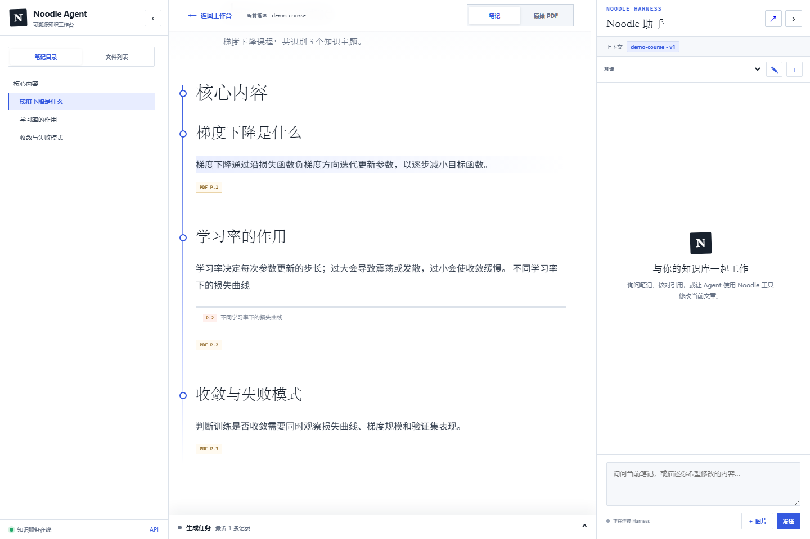
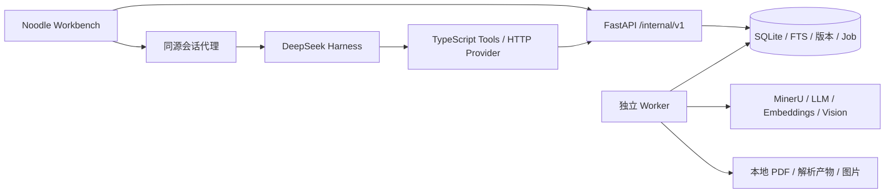

# Noodle Agent

[](https://github.com/JaegerZhao/Noodle_Agent/actions/workflows/ci.yml)
[](./LICENSE)

一个从 PDF 到可溯源笔记、跨文档知识点和知识问答的本地知识 Agent。

Noodle Agent 把资料整理和知识维护连接在一起：上传 PDF 后生成结构化笔记，阅读时可以回到原文页码；多份资料中的相关内容可以归并到共享知识点；当来源被编辑、删除或恢复时，系统重新检查贡献来源，更新受影响的知识版本。

项目基于 **DeepSeek Harness + TypeScript 工具桥接 + Python 知识服务**。会话和工具调用由 Harness 管理，长时间的 PDF 处理与知识更新由独立 Worker 执行。当前面向个人本地使用，仍在持续完善。



*截图使用项目自产的合成课程与 fixture 数据，未包含个人课程资料。*

## 功能

- **PDF 笔记**：解析文本与图片，规划目录，生成 AtomicNote 和 SourceNote，保留页码证据、公式、表格及图片关联。
- **统一工作台**：上传与任务进度、笔记阅读、原 PDF 对照、知识体系和聊天；支持 Markdown、KaTeX、PDF.js。
- **知识问答**：结合原子笔记和 Concept 的混合检索，按当前资料约束检索范围，回答附带来源证据。
- **跨文档归并**：以 Concept / Module 聚合有效来源，由资料变更事件驱动重建，通过质量检查后发布；不确定的候选保留为待复核。
- **版本与回退**：保留不可变笔记、模块和知识体系快照；来源删除采用逻辑删除，恢复后重新计算有效贡献。
- **可控工具操作**：Harness 写工具请求一次性审批，领域写入使用版本校验；自动知识维护使用单独的规则与质量门禁。
- **可恢复任务**：SQLite 持久化 Job、租约和阶段产物，结合解析缓存与有界并发处理模型任务。

## 架构



| 部分 | 职责 |
| --- | --- |
| Harness | 会话、上下文、模型交互、工具执行和审批 |
| TypeScript 桥接 | 工具 Schema、领域能力接口、HTTP 请求和响应限制 |
| Python API | 文件接收、知识查询、笔记与知识版本、任务接口 |
| Worker | PDF 流水线、质量检查、索引和跨文档知识同步 |
| 存储 | SQLite 是领域事实源；FTS 与向量用于检索；文件存储保存原文和产物 |

## 快速开始

需要 Node.js 22.19+ 或 24+、Python 3.12+。统一启动脚本使用 PowerShell；Linux/macOS 可使用 Docker Compose，或分别启动三个进程。

### 安装

```powershell
git clone https://github.com/JaegerZhao/Noodle_Agent.git
cd Noodle_Agent
npm ci
python -m venv .venv
.\.venv\Scripts\Activate.ps1
python -m pip install -e "./services/noodle[dev]"
Copy-Item .env.example .env
```

使用已有 Python 环境时，可省略创建虚拟环境。`NOODLE_PYTHON` 可以指定 Python 可执行文件。启动前确认 `python -c "import noodle_agent; print(noodle_agent.__file__)"` 指向本仓库的 `services/noodle/src`。

### 配置真实模型

`.env.example` 默认采用 fixture 解析器与生成模型，适合无密钥测试；**fixture 只消费合成解析数据，不负责理解任意上传的 PDF**。真实 PDF 使用以下配置，并填写自己的 API 密钥：

```dotenv
NOODLE_PARSER=mineru
NOODLE_LLM=deepseek
DEEPSEEK_API_KEY=<your-key>
DEEPSEEK_BASE_URL=https://api.deepseek.com
DEEPSEEK_FAST_MODEL=<available-fast-model>
DEEPSEEK_PRO_MODEL=<available-pro-model>
MINERU_MODE=precision
MINERU_API_TOKEN=<your-token>
DASHSCOPE_API_KEY=<your-key>
EMBEDDING_MODEL=text-embedding-v4
KNOWLEDGE_AUTO_SYNC=true
```

模型名称需要匹配账号可用模型。也可用 `LLM_*` 配置 OpenAI 兼容生成接口，或用 `EMBEDDING_*` 配置其他兼容向量服务。图片理解可选配 `DOUBAO_API_KEY`、`VISION_BASE_URL` 和 `VISION_MODEL`。Harness 聊天仍需要独立可用的会话模型配置；fixture 测试不代表真实模型聊天。

真实模式会将解析所需文件、相关文本片段或图片发送给配置的服务商。请仅上传你有权处理的资料。密钥只保存在本地 `.env` 中。

### 启动

```powershell
npm run dev
```

- 工作台：<http://127.0.0.1:8000/app/>
- Harness：<http://127.0.0.1:3080>
- API 文档：<http://127.0.0.1:8000/internal/docs>

端口冲突时，同时修改 `.env` 中的 `NOODLE_DSH_WEB_PORT` 与 `NOODLE_HARNESS_WEB_URL`。退出终端后可执行 `npm stop` 清理该项目记录的后台进程。数据默认在 `data/noodle/`，日志在 `.runtime/local/`。

打开工作台、上传 PDF、等待 Job 完成后即可阅读笔记并提问。知识归并属于后续独立任务：笔记生成完成不等于知识同步已经通过质量检查，候选可能进入待复核状态。

### Docker Compose

```sh
cp .env.example .env
# 编辑 .env
docker compose up --build
```

Compose 启动 API、Worker 和 Harness，并把本地数据挂载到 `data/`。默认只绑定本机地址。当前 API 面向可信本地环境，尚不具备完整的多用户认证与权限隔离；部署说明见 [运行与配置](./docs/OPERATIONS.md)。

## 无密钥验证

```powershell
npm run check:release
npm run typecheck
npm test
npm run build
python -m ruff check services/noodle/src services/noodle/tests
python -m pytest services/noodle/tests
python scripts/delivery-check.py
```

`delivery-check.py` 使用隔离目录、合成 PDF 和 fixture 服务，启动真实 API / Worker / Harness，验证上传、笔记生成、页码检索、工具桥接和会话代理。它不会读取开发者的 `.env` 或本地数据库。添加 `--browser` 可以使用已安装的 Chromium 浏览器检查阅读器、PDF.js 和公式渲染（必要时设置 `EDGE_EXECUTABLE`）。

GitHub Actions 在 Windows 和 Linux 上执行离线检查。测试通过说明工程链路可运行，并不代表真实模型回答已经达到确定的准确率。详见 [测试与限制](./docs/TESTING.md)。

## 目录

```text
Noodle_Agent/
├── src/                       # Harness 插件、工具、HTTP Provider、契约
├── services/noodle/
│   ├── src/noodle_agent/
│   │   ├── adapters/          # 解析、LLM、向量、视觉与存储接口
│   │   ├── synthesis/         # Concept、知识体系、归并与自动同步
│   │   ├── prompts/           # 生成、审核和视觉提示词
│   │   ├── web/               # 工作台与第三方前端资源
│   │   └── …                  # API、服务、数据库、Worker、质量检查
│   ├── migrations/            # 数据库迁移相关配置
│   ├── skills/                # 知识服务技能说明
│   └── tests/                 # Python 回归测试
├── scripts/                   # 启动、停止、发布检查与隔离验收
├── tests/                     # TypeScript 工具与 HTTP 契约测试
├── docs/                      # 公开架构、归并机制、运行与测试说明
├── .github/                   # CI、依赖更新与问题模板
├── compose.yaml
└── .env.example               # 配置模板，无真实密钥
```

## 文档

- [架构与数据流](./docs/ARCHITECTURE.md)
- [跨文档知识归并](./docs/KNOWLEDGE-SYNC.md)
- [配置、运行与备份](./docs/OPERATIONS.md)
- [测试策略与当前限制](./docs/TESTING.md)
- [贡献指南](./CONTRIBUTING.md) · [安全报告](./SECURITY.md) · [第三方许可](./THIRD_PARTY_NOTICES.md)

## 当前边界

新安装的仓库没有预置个人知识库。课程 PDF、教材原图、真实生成笔记、截图档案、数据库和模型密钥均不随仓库分发。遗留 LangGraph 接口仅作为兼容代码保留，默认主 Agent 是 DeepSeek Harness。

自动归并仍可能把语义相近但不同的内容归到同一候选；Judge 也可能判断错误。系统用有效来源、证据绑定、版本冲突检查和待复核状态限制发布，但真实内容仍需要人工抽查。知识体系的自动编排以已有分组为基础，复杂重组、知识点拆分、多用户部署和大规模吞吐仍是后续方向。

## 许可证

项目代码采用 [GNU AGPL-3.0](./LICENSE)。第三方组件保留各自许可证，详见 [THIRD_PARTY_NOTICES.md](./THIRD_PARTY_NOTICES.md)。用户上传的资料不因此取得本项目许可证，也不属于仓库发布内容。
