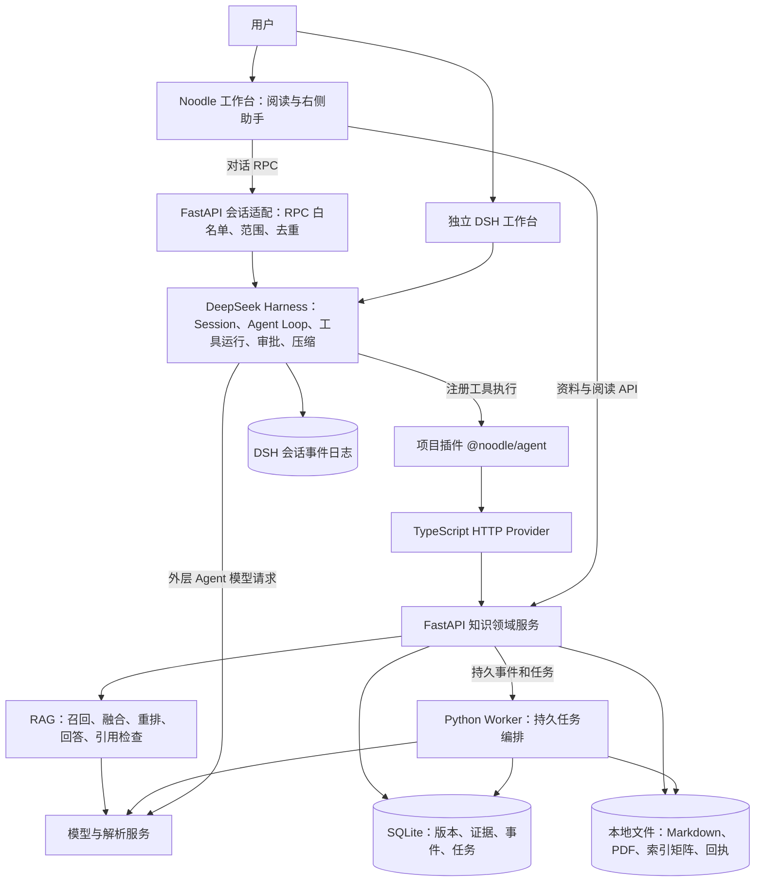
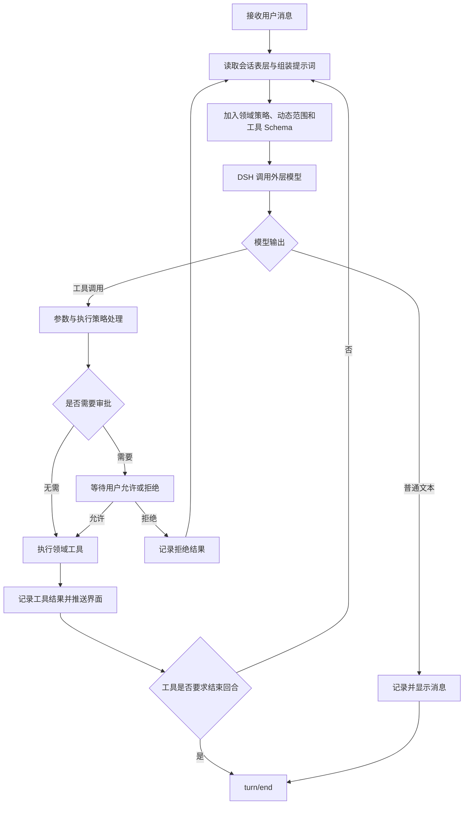
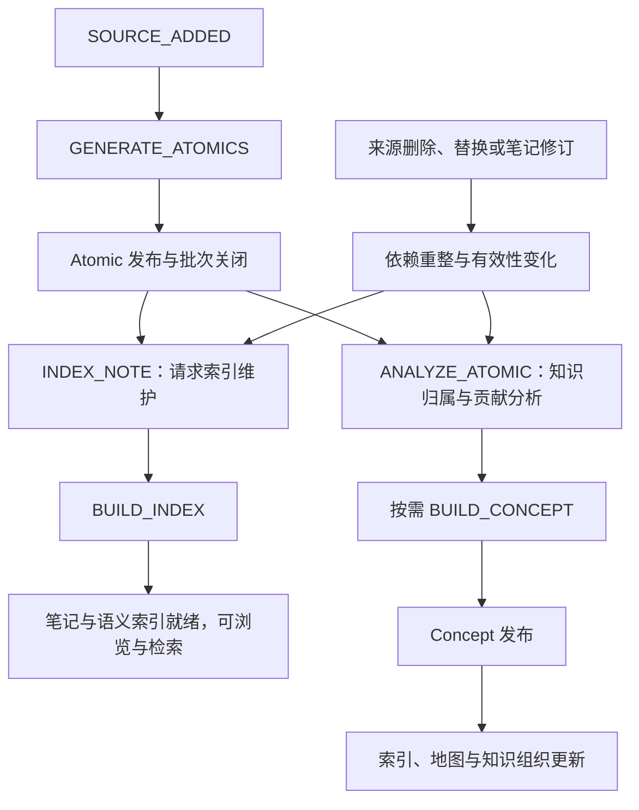
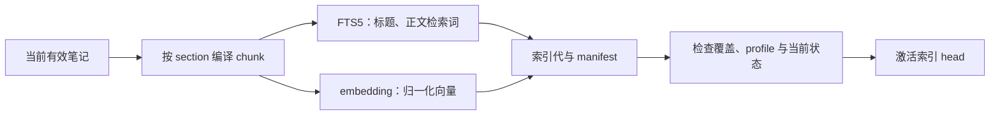
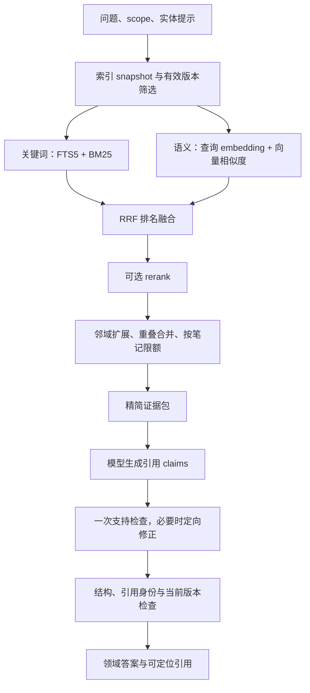
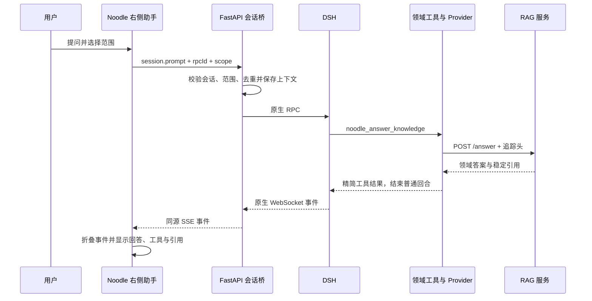

# Noodle Agent：DSH 框架使用、Agent 执行与 RAG 检索详解

核对日期：2026-10-29。依据当前源码、已安装 DeepSeek Harness `0.1.1-rc.2` 及最近正式问答记录。本文介绍实际实现；配置默认值、正式运行值和待验收能力分别说明。

文档已于 2026-10-29 收敛；阶段报告统一查 [开发日志](DEVELOPMENT-LOG.md)，当前验证和未完成项查 [验证说明](TESTING.md)。

适用入口：Noodle 工作台 `http://127.0.0.1:8011/app/`；独立 DSH 工作台 `http://127.0.0.1:3090/`。端口来自当前正式部署，不是框架固定端口。

## 1. 系统定位与阅读主线

Noodle Agent 将 PDF 整理为可阅读、可归并、可追溯的知识，再通过 DeepSeek Harness 提供对话操作与知识问答。

完整链路有两个入口：

1. **资料入口**：上传 PDF，后台执行解析、规划、Atomic 生成、索引、Concept 归并及知识组织。
2. **对话入口**：用户提问或发出操作请求，DSH 选择领域工具，FastAPI 执行检索、读取、修订或任务控制。

理解项目可以沿着以下顺序：框架分工 → 插件装配 → Agent Loop → 工具与审批 → 会话和记忆 → 后台任务 → RAG → 引用与界面 → 对话能力。

三条基本边界：

- DSH 提供对话运行机制；项目实现知识领域能力，没有自行重写通用模型推理循环。
- FastAPI 的会话适配只转发协议、约束范围和整理结果，没有第二套 Python Agent Loop。
- Python Worker 的任务队列负责长任务，不依赖浏览器和某一轮对话持续存活。

## 2. 整体架构



### 2.1 每一层负责什么

| 层 | 负责 | 关键实现 |
| --- | --- | --- |
| Noodle 前端 | 阅读、资料管理、问答范围、历史与回答卡片 | `web/next/agent-panel.js`、`agent-client.js` |
| DSH 运行时 | 会话、上下文组装、Agent Loop、模型与工具交替、审批、压缩 | 已安装 Harness 包 |
| Noodle 插件 | 工具注册、领域策略、动态范围上下文、工作区接入 | `src/index.ts`、`agent-guidance.ts` |
| HTTP Provider | 统一领域调用、超时、取消信号、追踪头和结果投影 | `src/http-provider.ts` |
| FastAPI | 知识身份、来源、版本、编辑、RAG、受限会话桥接 | `next/api.py`、`agent_api.py` |
| Worker | 解析与生成、知识维护、索引、检查点恢复 | `next/worker.py`、`workspace_worker.py` |
| 存储 | 正式知识、证据、版本、任务和可复算产物 | SQLite 与本地文件 |

DSH 在此承担对话控制与工具调度；FastAPI 和 Worker 承担业务执行与持久化。双方通过领域工具协作，不共享一套隐式的模型状态。

## 3. 项目如何接入 DSH

### 3.1 插件装配

项目包名为 `@noodle/agent`。启动器通过 Cordis patch 把该包挂入 DSH，插件入口依次装配：

```text
@noodle/agent → src/index.ts::apply
  ├─ NoodleHttpProvider：向 ctx 提供 noodle 服务
  ├─ ReadTools：问答、搜索、Atomic/Concept 读取
  ├─ NextTools：发现、导航、任务和审批写操作
  ├─ AgentGuidance：领域提示词与动态 scope
  └─ WorkspaceBootstrap：工作区身份与接入
```

这里使用 Cordis 的插件与依赖注入机制。工具依赖 `ctx.tools` 和 `ctx.noodle`，不自行创建另一套业务客户端。

`src/service.ts` 定义 `NoodleService` 能力接口，`NoodleHttpProvider` 实现它。模型可见的工具描述、HTTP 传输和 Python 业务逻辑可以分别维护。

### 3.2 启动与前后端插件

`scripts/start-harness.mjs` 负责：

1. 确定 `DSH_HOME` 和 runtime 目录。
2. 首次准备 `noodle-knowledge` Agent Preset；已有 Preset 不直接覆盖。
3. 生成运行 patch，指定 API 地址、检索模式及工作区。
4. 将 profile 中的 `@noodle/agent` 链接到选定代码版本。
5. 启动 DSH Web，并记录监督进程及子进程信息。

插件用包名注册，是为了让 DSH 同时发现服务端插件与 `package.json` 中的客户端扩展声明。独立 DSH 的客户端通过公开的 `tool.call.toolview` 扩展点显示领域回答。

正式冻结部署会固定代码版本。模型配置通过显式 `NOODLE_CONFIG_DIR` 读取，避免进程 cwd 改变后丢失项目配置。

### 3.3 当前使用的 Harness 能力

| 能力 | 项目如何使用 |
| --- | --- |
| Agent / Agent Loop | 接收用户消息，调用模型，执行工具，继续或结束回合 |
| Session | 保存对话、工具调用、结果和执行事件，支持历史恢复 |
| Tools | 通过 `defineTool` 注册领域工具、参数 Schema、并发声明和执行函数 |
| System Prompt | 静态知识助手策略 + 每次组装时读取的动态范围 |
| Approval | 对四个写操作拦截，要求用户批准后执行 |
| Compaction | 上下文压力出现时剪枝、摘要，并保留近期上下文 |
| Client slots | 将 answer 工具结果显示为 Markdown、公式及引用卡 |
| Workspace | 绑定项目会话、历史与归档操作 |

Preset 显式配置了 persona、基础压缩、手动压缩命令和工具结果剪枝。框架还支持的其他能力，不等于项目已经启用或完成真实验收。

## 4. Agent Loop：从用户消息到结果

### 4.1 一个回合的执行过程



这是当前接入方式的概念图，底层调度、错误恢复与事件顺序由 Harness 实现，项目没有自己维护一个 `while LLM → tools` 的循环。

### 4.2 普通知识问答为什么只调用一次 answer

`noodle_answer_knowledge` 已经包含完整的 RAG 服务调用。普通问题不需要模型先 search、再逐篇 get、最后自行综合。

工具拿到结果后默认执行 `exec.concludeTurn()`：

- `READY`：界面直接展示领域答案及其引用。
- 非 `READY`：展示明确失败或证据不足状态，结束本轮普通问答。
- 只有用户明确要求回答后继续做其他动作时，模型才可设置 `continue_task: true`；非 READY 仍结束。

这样减少外层二次改写、重复检索，以及配置失败后遍历全库的失控回退。一次工具调用仍可能包含多个内部供应商请求，不能称为“一次模型调用”。

### 4.3 多步骤操作如何编排

例如“找到这篇课件的任务，暂停它”：

```text
list_sources → list_tasks → get_task → pause_task → 用户审批 → 报告实际状态
```

这些步骤由外层模型依据工具描述与前一步结果选择，不是为每种自然语言写死一条流程。真正的修改仍由领域 API 校验目标与状态。

例如编辑：

```text
发现目标 → 读取当前目录 → 读取指定小节 → 编辑内容与 expected_revision
→ 用户审批 → API 校验并发布，或返回版本冲突
```

版本冲突需要重读，不能用模型自行猜测的新版本覆盖。

### 4.4 可观察事件

前端使用持久事件折叠出回合、消息和工具轨迹，主要包括：

```text
turn/start
  user/message
  assistant/message
  tool/call
  tool/result
  ...可能还有后续步骤...
turn/end
```

这是主要事件示意，不表示固定只出现一次。`seq` 用于合并历史与实时事件、避免重复显示。计量使用正式 `assistant/message` 的 usage，避免把流式 chunk 的重复用量再累加。

### 4.5 错误和取消

项目区分业务状态与 HTTP 传输失败。HTTP 200 内的 `COVERAGE_GAP` 不是成功答案；HTTP 超时也不意味着后台供应商一定停止。

同一回合出现配置或供应商故障时，工具层记录失败状态，阻止继续枚举笔记作为回退。允许保留 readiness 等诊断读取。

“停止回答”调用 DSH `session.cancel`，工具使用 `exec.signal` 与超时信号。它不等于暂停生成任务，也不保证已经发出的远端请求停止计费。

## 5. 当前 17 个领域工具

以下名称均带 `noodle_` 前缀。13 个为业务读取，4 个为需审批的状态修改；answer 虽是读取业务，也会产生回答产物和模型日志。

| 工具 | 主要用途与参数 | 执行边界 |
| --- | --- | --- |
| `answer_knowledge` | question；可选 scope、模式、实体提示、limit | 检索、回答、检查与引用；普通回合直接结束 |
| `search_knowledge` | query；可选 scope、模式、实体提示、limit | 定位材料，不是 answer 的必经前置步骤 |
| `get_atomic_note` | note_id；可选 section_id | 默认目录，指定 section 才带该节正文 |
| `list_concepts` | query、limit | 查当前知识点身份与摘要 |
| `get_concept` | concept_id；可选 section_id | 当前目录、指定正文及 supporting_notes |
| `get_readiness` | 无 | 实际检索配置、模式与索引是否就绪 |
| `list_knowledge` | kind、query、source_revision_id、offset | 分页发现笔记；可含导航对象 |
| `list_sources` | query、offset | 原文件名称、source_id 与当前来源版本 |
| `list_tasks` | source_id、status | 找已有生成任务 |
| `get_source_status` | source_revision_id | 区分笔记、索引与后台知识维护状态 |
| `get_task` | job_id | 当前任务时间线、用量和暂停状态 |
| `get_relations` | note_id | 有上限的周边导航关系 |
| `list_knowledge_roots` | 无 | 知识体系与领域根节点 |
| `edit_section` | note_id、expected_revision、section_id、markdown；可选 title | 审批后小节修订 |
| `refresh_knowledge_map` | 无 | 审批后刷新当前知识的派生地图 |
| `pause_task` | job_id | 审批后暂停明确选择的已有任务 |
| `resume_task` | job_id | 审批后复用已有任务检查点恢复 |

### 5.1 类型化、身份与传输

工具通过 `defineTool` 定义参数。输入有类型和枚举，输出保留领域 JSON 外壳；不能据此宣称全部返回字段都有精细的 TypeScript 输出 Schema。

身份不能混用：

| 字段 | 含义 |
| --- | --- |
| note_id | 稳定笔记身份 |
| revision_id | 某一笔记版本 |
| section_id | 该笔记小节 |
| source_id | 导入资料身份 |
| source_revision_id | 原资料版本 |
| job_id | 后台任务 |
| sessionId | DSH 会话 |
| rpcId / callId / request_id | 用户 RPC、工具执行、RAG 请求的不同关联键 |

统一 Provider 向 FastAPI 传递 `X-Harness-Session-Id`、`X-Harness-Tool-Call-Id`、`X-Harness-User-Rpc-Id`。这是跨层定位问题与用量归因的基础。

普通元数据工具可并发；answer 声明独占执行；写工具不并发。并发声明不能替代数据库事务与版本校验。

### 5.2 审批机制

`tools/pre-execute` 对 edit、refresh map、pause、resume 返回 `kind: ask`。右侧显示允许一次/拒绝，结果送回 DSH。

审批通过只代表允许尝试这次操作，API 仍负责检查当前版本、内容与任务状态。拒绝时不应发出该业务写请求。

这是应用内修改确认机制，不应描述成已具备完整多用户权限系统。

## 6. 记忆管理：六类状态分别保存

### 6.1 状态分层

| 类别 | 保存内容 | 位置与生命周期 | 能否当作事实证据 |
| --- | --- | --- | --- |
| 会话历史 | 用户消息、模型消息、工具调用与结果 | DSH 持久 Session 事件日志 | 历史答案不能直接作为新问题证据 |
| 当前模型上下文 | 会话表层、近期消息、摘要、工具 Schema、系统策略 | DSH 请求组装与压缩 | 需要重新检索当前有效知识 |
| 应用范围提示 | GLOBAL/SOURCE/NOTES、检索模式、实体提示、当前 RPC | `agent-runtime/context` | 身份提示，不是正文证据 |
| 前端偏好与草稿 | 选中会话、范围、阅读对象、未发送文字 | localStorage 偏好；草稿为页面内存 | 否 |
| 长期知识 | Atomic、Concept、版本、来源与证据关系 | 正式 SQLite + Markdown 等文件 | 满足有效性条件后可检索 |
| 工作流状态 | 事件、任务、租约、检查点、调用回执 | 正式任务表与产物文件 | 用于报告执行状态，不证明知识事实 |

系统没有另外建设一个自动把聊天内容写入向量库的“用户长期记忆”。当前长期知识主要来自资料工作流和明确修订。

### 6.2 会话持久化与刷新恢复

当前正式 DSH 日志示意：

```text
.local-only/formal-workspace-20261025T043825Z/runtime/
  dsh-knowledge/
    sessions/
      <工作区编码>/
        session-<id>/
          session.jsonl.zstd
```

前端刷新后请求 `session.history`，再合并后续实时事件。前端不维护第二份权威聊天历史。

切换会话会清理显示缓冲并使用 generation 标记，避免旧请求晚返回后覆盖新会话。历史按更新时间排列，归档项从普通列表隐藏；目前右侧搜索是会话标题过滤，不应称为完整聊天全文搜索。

### 6.3 动态范围怎样进入模型和服务端

每次从右侧提交问题，FastAPI 保存会话范围与当前 rpcId。`system-prompt/assemble` 钩子读取 `/agent/context`，以动态 context 片段交给 DSH。

工具请求到达 API 时，服务端再次执行范围约束。范围不是单纯依赖模型遵守提示。

原始用户问题仅在当前 RPC 身份匹配时用于 answer，避免外层模型将“只解释这一点”扩写成另一个任务。实体 ID 可帮助理解“它”，但不能扩大 SOURCE/NOTES 范围。

### 6.4 上下文压缩与工具结果剪枝

Preset 使用 Harness 的 `dsh-compaction-basic`、`dsh-command-compact` 和 `dsh-compaction-tool-result-pruner`。

框架按上下文压力决定压缩；剪枝先处理过大的工具结果，重新计量后仍有压力才摘要。压缩保留近期尾部，并保持工具调用/结果配对边界。摘要进入会话上下文，不替代正式知识。

项目配置的工具结果剪枝参数为：超过 8,192 字符时保留头部 4,096、尾部 1,024 字符。这是压力处理中的剪枝配置，不能理解为所有输出都会立即截断；字符数也不等于 Token 数。

项目还在工具边界主动精简输出：目录先行、按节读取；answer 不把全部 hits 与大量 evidence_ids 再送回外层。完整证据仍在原回答产物中。

## 7. 任务编排：DSH 回合与后台 Job 的区别

| 对比 | DSH 对话回合 | Python 后台任务 |
| --- | --- | --- |
| 目的 | 理解请求并调用工具 | 稳定执行解析、生成、维护和索引 |
| 调度 | Agent Loop 与模型工具选择 | 事件路由、JobQueue、Worker |
| 持久依据 | Session 事件 | jobs、events、job_checkpoints 等 |
| 中断方式 | session.cancel | 任务暂停控制、租约与重试 |
| 恢复 | 加载历史、重新读取当前知识 | 按检查点与冻结 profile 恢复 |
| 完成含义 | 本轮工具/回答结束 | 某个 Job 成功；不自动等于整个资料全阶段就绪 |

### 7.1 后台事件图



这是职责与依赖示意。实际 `events.py` 会根据 Atomic/Concept、是否批量归属、是否修订等决定消费者，不是每次发布都机械执行所有节点。

Atomic 索引可与后台 Concept 维护并行。前端笔记可用和知识维护完成是两个状态，不能因为还有 Concept 工作就一直显示笔记未完成。

### 7.2 任务可靠性

- **持久入队**：事件与 Job 在 SQLite 中登记，同一事件和 kind 控制重复创建。
- **领取租约**：Worker claim 获得 token 和有效期，心跳维持所有权。
- **提交保护**：`require_lease` 检查仍由当前 Worker 持有，旧执行者不能在租约被替换后提交。
- **检查点**：生成阶段保存产物及 hash，恢复复用与冻结 profile 匹配的结果。
- **有界重试**：任务具有 attempts 上限；不能声称任意错误均可无限自动恢复。
- **暂停与恢复**：对已有任务控制，恢复不会创建一份新的完整生成任务；在途远端调用可能继续到安全边界。
- **索引请求合并**：`request_index` 合并待处理需求，避免每次笔记变化都立即重复完整构建。

关闭聊天页不会删除这些 Job。反过来，停止一轮聊天也不自动停止用户之前上传的书籍生成。

## 8. RAG 的知识组织与离线索引

### 8.1 检索对象是什么

```text
原 PDF 与解析证据
  → Atomic：按主题组织的可阅读笔记
  → Concept：由多份 Atomic 支持的浓缩知识点
  → 检索 chunk：当前笔记版本中某个 section 的文本范围
```

Atomic 是内容产品，chunk 是检索单元。一个 Atomic 可含多个 section，每个 section 再按检索策略切分。chunk 保存笔记版本、起止 offset、hash 和来源证据，不是另一套可独立修改的正文。

GLOBAL 检索当前有效 Atomic 与 Concept。原 PDF、目录地图 MOC 是来源或导航，不直接当作本条问答链路的事实语料。

### 8.2 什么内容可以进入检索

索引和查询共用 `eligibility.py`：

- 笔记是 ACTIVE，当前版本已 PUBLISHED，满足当前写作策略。
- Atomic 具有来源证据，来源未删除、未被其他版本替换。
- Concept 的输入 Atomic 仍有效，且没有使其当前版本不可用的依赖或冲突状态。
- 返回前再次检查当前版本，避免查询过程中资料变化后仍给旧答案。

因此，文件仍在磁盘或曾经建立向量，不等于它当前可以检索。

### 8.3 索引构建



当前 chunk policy 为 `semantic-cl100k-v2-short600-tail100`。编译结果可以按版本、正文 hash 与策略复用。向量 profile 绑定模型与维度；不匹配时返回明确错误，而不是把不同 embedding 空间混用。

正式部署当前使用 `text-embedding-v4`、1,024 维、`ExactVectors`。向量归一化后用 NumPy 点积排序；代码另有 Chroma 服务后端适配，但不能把当前部署描述成已运行 Chroma。

索引是可重建投影，正式笔记版本与证据关系才是权威数据。

## 9. RAG 在线查询的完整过程

### 9.1 检索范围与请求契约

| 范围 | 允许内容 | 用途 |
| --- | --- | --- |
| GLOBAL | 当前有效 Atomic + Concept | 全库问答、跨资料总结 |
| SOURCE | 一个明确来源下的 Atomic | 只根据这份课件/论文回答 |
| NOTES | 指定笔记集合中的有效内容 | 当前笔记或固定笔记范围 |

`entity_note_ids` 只是指代消解提示。例如“它的 C 增大时怎样”可以带上上一轮相关笔记身份，但最终证据仍需重新检索。

### 9.2 双路召回与融合



关键词处理：Unicode 归一化、英文/数字/公式符号识别、中文双字词组，组成 OR 查询。FTS5 对标题和正文使用 BM25，当前 SQL 的标题权重为 1.5、正文为 1.0。

语义处理：问题向量归一化，只在相同范围白名单内搜索。当前 Searcher 默认最小余弦阈值为 0.2。

HYBRID 两路并行执行，再使用 RRF：

```text
score(chunk) = Σ 1 / (60 + rank_in_lane)
```

当前代码不是把 BM25 原始分数与向量分数按固定权重相加。标题影响 FTS5 的一条召回路线；融合使用排名。

### 9.3 重排与上下文构造

当前代码默认值如下，环境可覆盖，不能当作每次运行实际消耗：

| 参数 | 默认值 | 含义 |
| --- | ---: | --- |
| recall_k | 50 | 每条召回路线的候选上限 |
| rerank_candidates | 10 | 重排候选数 |
| rerank_tokens | 8,000 | 重排输入估算范围 |
| rerank_document_tokens | 3,500 | 单条重排候选大小 |
| context_tokens | 4,000 | 给回答模型的证据正文范围 |
| expansion_tokens | 800 | 单节邻域扩展范围 |
| per_note | 3 | 每个笔记最多入选片段数 |
| top_k | 6 | 默认最终证据条数，请求支持 1–20 |

这些是检索上下文边界，不是把整个资料生成到某个费用就强制终止的总预算。超大候选可能被跳过，因此仍需在固定评测中检查召回是否受影响。

默认使用配置的 DashScope rerank；也有文本 LLM 重排适配。AUTO 下重排故障会保留同一批 RRF 候选并显式记录降级；REQUIRED 下故障返回失败。

证据扩展保留公式、代码和邻近段落，且不越过当前 section/版本。相同小节重叠范围合并，防止多条近似片段挤满输入。

### 9.4 回答、审查与发布

Answerer 要求返回结构化 claims，每项含自然语言正文与 citation_ids；证据不足则返回 insufficient。

正常路径为：生成草稿 → 支持检查一次 → 有可修复意见则依据同一份证据修正 → 引用/结构及版本检查 → 返回。当前 resilience 策略下修复后不重复语义审查；严重支持问题可以拒答。格式或供应商层也可能有有界重试，因此不能声称任意一次请求固定只有两次 HTTP 调用。

必要检查包括引用 ID 存在、正文格式和当前版本仍有效。格式检查与事实正确性不是一回事。模型审查通过也不能代替固定样本的人工/独立评价。

当前 `planning-pro` 模型策略把普通 RAG 回答及审查路由到 Flash；源码中的请求意图仍会被统一 cost policy 决定最终模型。不能仅看到局部 `use_pro_model=True` 就断言真实调用了 Pro，实际以回执为准。

### 9.5 业务状态

| 状态 | 用户应看到的含义 |
| --- | --- |
| READY | 有可返回的当前证据或答案，不代表百分之百科学正确 |
| NO_EVIDENCE | 没有选出足够有效证据 |
| COVERAGE_GAP | 当前知识不足，或回答存在支持问题 |
| CLARIFICATION_REQUIRED | 指代不明，需要明确对象 |
| SCOPE_RESTRICTED | 请求对象不在允许范围 |
| INDEX_PENDING | 所选模式/当前知识尚未具备对应索引 |
| PROFILE_MISMATCH | embedding 配置与所需索引条件不匹配 |
| PROVIDER_ERROR | 模型、重排或相关服务不可用 |
| CONTENT_CHANGED | 查询期间来源或笔记版本发生变化 |

## 10. 引用怎样追溯到 PDF

每条回答引用不是单纯的笔记名称，而是可定位的证据对象：

```text
回答 request_id + citation_id
  → note_id + revision_id + section_id
  → start_offset / end_offset + 文本 hash
  → evidence_ids
  → source_revision_id + 原文件 hash + PDF 页码
```

完整查询、答案与审查产物保存到 `artifacts/queries`、`artifacts/answers`。给外层 Agent 的结果省略全量命中正文与冗长证据 ID，引用解析接口再从原回答产物取得完整定位。

65 版的精简模型证据包增加 `source_pages`，解决“引用卡有页码但模型说没有”的问题。它用于定位，不把 PDF 页码当成额外知识事实。

Concept 可能由多个来源支持，其引用页码是笔记证据关联范围，不能把很宽的范围宣传成对每一句话都已完成最小页级核验。严格要求原资料范围时应使用 SOURCE；这时只检索该来源 Atomic。

## 11. 前端如何与同一 DSH 会话协作



右侧现在没有直接 POST /answer 的聊天执行路径。独立 DSH 也调用同一批工具；它通过 client toolview 显示领域答案。

桥接只允许会话/工作区所需 RPC，不转发任意 URL、凭据或主机文件系统接口。`session.prompt` 使用稳定 rpcId 去重；同一 rpcId 不可对应不同问题。发送状态不明时提示刷新核对，避免重新付费执行。

右侧有新对话、历史、重命名、归档、停止、范围选择和审批显示。工作台链接携带当前 session，独立 DSH 客户端可选择同一会话。

回答使用 Markdown、KaTeX 和引用卡渲染，采用独立对话排版，工具明细默认折叠。界面分别展示 Agent 输入/输出和实际使用的 RAG 文本、embedding、rerank 用量；没有回执不填成 0。该汇总不承诺包含独立标题、压缩等尚未关联回执的全部调用。

### 11.1 实时显示与恢复

第 80 版起，浏览器通过一条 `/internal/next/agent/events/all` SSE 接收后端合并的 mux/host 事件。后端确认两条 DSH WebSocket 就绪后发出 bridge 状态，并在空闲时发送心跳；HTTP 连接打开本身不当作 DSH 已连接。

前端消费 `assistant/chunk` 中的公开文本增量，收到正式 `assistant/message` 后替换临时文本，usage 仍只按正式消息统计。推理增量不展示。RAG 工具内部仍先完成生成与检查，再返回正式引用回答，不伪造逐字输出。

消息连接失效时自动重建；隐藏页面释放长连接，回到页面补齐历史。会话运行时定期同步权威状态，历史与实时事件按 seq 合并，保留更早消息与输入草稿。连接恢复只重新订阅和读取，不重新提交问题或审批决定。

发送已确认接收后释放该问题的请求身份；发送状态不明时保留身份，避免重复付费。切换会话后的迟到响应不能清空另一会话的草稿。

## 12. 用户通过对话可以实现哪些功能

### 12.1 当前已注册的业务能力

| 用户可以说 | 预期工具路径 | 是否审批 |
| --- | --- | --- |
| “解释软间隔 SVM 和 C 的作用，给我来源。” | answer_knowledge | 否 |
| “只根据这篇 Attention 论文解释缩放点积注意力。” | 显式 SOURCE → answer；必要时 list_sources | 否 |
| “它的 C 增大时会怎样？” | 用实体身份提示重新检索，不沿用旧答案事实 | 否 |
| “找出关于核技巧的笔记。” | search_knowledge | 否 |
| “列出已有知识点，打开决策树的某一节。” | list_concepts → get_concept | 否 |
| “这个知识点有哪些相关知识、来自哪些笔记？” | get_relations / get_concept 的 supporting_notes | 否 |
| “知识库有哪些知识体系？” | list_knowledge_roots | 否 |
| “我导入了哪些资料？” | list_sources | 否 |
| “这份课件生成到哪一步，为什么还不能检索？” | list_sources → list_tasks / get_task → get_source_status | 否 |
| “当前检索为什么失败？” | get_readiness，报告实际状态 | 否 |
| “将这篇笔记的这一节改为以下内容。” | 读取当前小节 → edit_section，携带 expected_revision | 是 |
| “暂停这份书的生成任务。” | 定位明确任务 → pause_task | 是 |
| “恢复刚才暂停的任务。” | 核对任务 → resume_task | 是 |
| “根据当前知识刷新地图。” | refresh_knowledge_map | 是 |

这张表是能力契约，不代表每个自然语言示例都已做过正式付费验收。ID 不明确时必须发现或澄清；工具不能猜目标。

### 12.2 界面操作与对话工具的区别

新建/切换/重命名/归档会话、选择问答范围、停止回答由界面直接调用会话协议，不需要模型再使用业务工具来管理自己的会话。

当前工具**尚不能直接**通过自然语言完成：上传本地 PDF、启动任意新生成、删除/恢复资料、批量移动文件夹、指定全库 Concept 重建、操作任意文件/SQL、修改模型凭据、联网搜集外部知识。

工作台存在某个按钮或 API，不代表该功能已经注册给 Agent。上传与批量管理等仍应从相应页面执行。

也没有把多 Agent 自主协作、用户画像记忆或模型微调作为当前项目的已实现能力。

## 13. 三个贯穿示例

### 13.1 普通知识问答

```text
用户：硬间隔与软间隔有什么区别？
→ DSH 选择 answer_knowledge
→ Provider POST /answer
→ 当前知识筛选 → 并行关键词/向量 → RRF → rerank
→ 精简证据 → Flash 回答与检查
→ 最终版本检查 → 引用答案
→ 工具结束回合，前端直接渲染
```

最近正式样例：17.505 秒，1 次领域工具调用；Agent 输入 2,837、输出 134 Token，内层文本调用合计 8,296 Token。它们是不同层的计量，不能只报 2,837 作为整次请求成本。

### 13.2 查询生成进度

```text
用户：这本书处理完了吗？
→ 发现 source_id 与 source_revision_id
→ 找任务并读 timeline
→ 读 source status
→ 分别报告 Atomic、语义索引、Concept 维护状态
```

这类查询读取任务数据，不需要重新解析 PDF 或生成知识，也不能仅凭一个 Job SUCCEEDED 就回答“整个工作流全部完成”。

### 13.3 修改笔记

```text
用户：把当前小节换成我给出的内容
→ 明确 note_id / section_id
→ 读取正文与当前 revision_id
→ 提出 edit_section 参数
→ 用户允许一次
→ API 核对 expected_revision 并执行正常修订链路
→ 发布事件触发依赖、Concept 与索引维护
```

一次聊天结束时，后台维护可能仍在继续。应报告修订已接受以及后续维护状态，不提前承诺向量与所有 Concept 都已更新。本轮隔离库已验证重复请求、过期版本 409，以及修订后 Concept 输入和搜索版本传播；正式库仅做审批拒绝验收，没有写入。

## 14. 存储、观测与故障定位

正式知识目录示意：

```text
data/knowledge-formal-20261025T043825Z/
  noodle.db                     # 知识、来源、证据、版本、事件、任务
  artifacts/
    queries/<request_id>.json    # 检索输入、结果、快照与诊断
    answers/<request_id>.json    # 问题、完整回答及审查
    api-calls/<request_id>/      # 供应商请求回执与真实用量
    agent-prompts/              # prompt 去重回执
  agent-runtime/context/        # 会话的可变范围/当前 RPC 提示
  indexes/                      # 编译与向量索引投影
  Vault/                        # Markdown 阅读/编辑投影
```

上面不是完整磁盘清单。PDF、解析、图片和生成检查点另有相应产物路径；数据库和引用 ref 负责定位，不能凭展示文件名推断身份。

一次问答应按以下关联排查：session → user RPC → tool call → RAG request_id → 查询/回答产物 → 供应商回执。

指标至少分开：

- 用户回合总用时、外层 Agent 用量和工具数。
- 有效知识筛选、lexical、embedding、vector、rerank、context、answer/review 用时。
- 内层文本 prompt/completion/cache、embedding 与 rerank 用量。
- 业务状态、引用数、当前索引代及版本变化。

`timings_ms.total` 在当前 Searcher 中是检索用时，不是整轮用户等待时间；不能直接拿它代表完整问答时长。

## 15. 已验证边界与当前不足

最新功能验收、运行版本及 Transformer 截图见 [最终功能报告](DEVELOPMENT-LOG.md#2026-10-29)。较早故障记录见 [DSH 实施与验收报告](DEVELOPMENT-LOG.md#2026-10-28)。

已验证：正式 HYBRID 和 KEYWORD_ONLY READY；Transformer 问答与追问、论文限定来源、范围缺证据提示；双已有会话切换与草稿隔离；刷新恢复；固定版本引用至 PDF 页；独立 DSH 同会话；审批恢复与拒绝；停止、重命名、归档；正式知识比较快照未变化。

后续边界（按用户要求，本轮以功能收尾，内容准确性后续调整）：

1. 历史 FTS 扫描瓶颈已修复，36 题词法阶段中位数约 32 ms；整轮回答仍包含模型、重排等耗时，不能用 SQL 指标代替总时长。
2. SVM 来源内容与答案仍有条件和推断问题；重复同一问句也观察到外层复用上轮结果，未发起新检索，不能作为新提示的有效复测。
3. 36 项固定集覆盖召回、小节和范围，不构成完整回答准确性统计。
4. 桌面与窄侧栏已验收，全部移动端和全新系统矩阵未覆盖。本机独立生产依赖安装已通过。
5. 长会话输入增长、独立标题/压缩的完整计费归因仍可进一步优化；取消不能保证供应商撤回已开始的调用。

上述内容问题已记录，没有手动修改生成正文，也没有为文档收尾重跑知识生成。

## 16. 对照源码阅读

以下链接相对本文目录，可用于沿一次请求追代码。

| 阅读顺序 | 文件 | 重点 |
| --- | --- | --- |
| 1 | [插件入口](../src/index.ts) | Provider、工具、策略与工作区装配 |
| 2 | [Preset](../config/agent-presets/noodle-knowledge/agent.cordis.yml)、[启动器](../scripts/start-harness.mjs) | persona、压缩、包发现和 DSH 启动 |
| 3 | [领域提示](../src/agent-guidance.ts) | 动态上下文、普通问答一次工具、失败不遍历 |
| 4 | [读取工具](../src/read-tools.ts)、[发现与写工具](../src/next-tools.ts) | 工具参数、审批和 concludeTurn |
| 5 | [能力接口](../src/service.ts)、[HTTP Provider](../src/http-provider.ts)、[工具契约](../src/tool-contract.ts) | 业务解耦、追踪、取消和错误 |
| 6 | [会话桥](../services/noodle/src/noodle_agent/next/agent_api.py) | RPC 白名单、去重、范围、事件与引用 |
| 7 | [右侧面板](../services/noodle/src/noodle_agent/web/next/agent-panel.js)、[事件客户端](../services/noodle/src/noodle_agent/web/next/agent-client.js)、[DSH 回答视图](../src/client-view.js) | 历史、实时事件、工具结果渲染 |
| 8 | [检索契约](../services/noodle/src/noodle_agent/next/retrieval/contracts.py)、[有效性](../services/noodle/src/noodle_agent/next/eligibility.py) | scope 与可用知识集合 |
| 9 | [索引](../services/noodle/src/noodle_agent/next/retrieval/indexing.py)、[chunk](../services/noodle/src/noodle_agent/next/retrieval/chunks.py)、[向量](../services/noodle/src/noodle_agent/next/retrieval/vectors.py) | 索引代、文本范围和后端 |
| 10 | [搜索](../services/noodle/src/noodle_agent/next/retrieval/search.py)、[关键词](../services/noodle/src/noodle_agent/next/retrieval/lexical.py)、[上下文](../services/noodle/src/noodle_agent/next/retrieval/context.py) | 双路、RRF、扩展与输入精简 |
| 11 | [回答](../services/noodle/src/noodle_agent/next/retrieval/answering.py)、[模型策略](../services/noodle/src/noodle_agent/next/cost_policy.py) | claims、检查、版本和实际模型路由 |
| 12 | [事件路由](../services/noodle/src/noodle_agent/next/events.py)、[任务](../services/noodle/src/noodle_agent/next/jobs.py)、[Worker](../services/noodle/src/noodle_agent/next/workspace_worker.py) | 长任务编排、租约、恢复与并行维护 |

面试时可以概括为：**我用 Harness 管理会话、模型与工具执行，用类型化工具连接 Python 领域服务；服务端完成基于当前知识版本的混合检索与引用回答，后台事件和 Worker 负责知识持续更新。**
