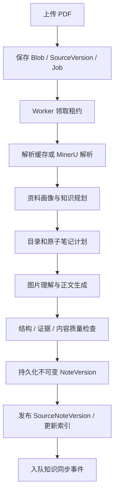

# 架构与数据流

Noodle Agent 服务于“阅读资料 → 形成笔记 → 建立知识体系 → 基于证据问答”的个人学习过程。设计中有两类不同的工作：会话需要及时响应，资料生成需要长时间运行、持久化和恢复。因此，主 Agent 与知识流水线通过工具和 HTTP 边界协作。

## 进程与模块

DeepSeek Harness 负责会话、模型交互、上下文整理与工具调用。`src/contracts.ts` 定义领域契约，`src/http-provider.ts` 实现 HTTP 能力，`src/read-tools.ts` 与 `src/write-tools.ts` 注册工具；`src/agent-guidance.ts` 提供领域使用指引。

Python 精简入口为 `noodle_agent.internal_api:create_app`。`services.py` 实现笔记、查询和版本相关服务；`db.py` 定义 SQLAlchemy 数据结构；`worker.py` 负责租约、调度和阶段执行。`adapters/` 隔离外部服务，`synthesis/` 处理跨文档知识。

工作台位于 `services/noodle/src/noodle_agent/web/`，使用原生 JavaScript、HTML 和 CSS。聊天经同源代理访问 Harness，会话并未由前端另建一套 Agent 状态机。Marked、DOMPurify、KaTeX 和 PDF.js 分别处理 Markdown、安全清理、数学表达式和 PDF 阅读。

## 一次 PDF 生成

上传接口快速返回 Job，Worker 完成耗时工作。阶段状态与产物写入数据库或文件存储，任务失败可查看时间线并重试。相同内容的 PDF 可以复用规范化解析缓存；解析复用不等于直接复用之前的所有生成内容。

生成结果由正文块、证据、图片、原子笔记和资料目录共同构成。阅读器使用导航锚点在笔记位置和 PDF 物理页之间跳转。编辑创建新版本，保留原版本和审计记录。

## 知识数据

| 实体 | 用途 |
| --- | --- |
| Source / SourceVersion | 原始资料身份与上传版本 |
| AtomicNote / NoteVersion | 有独立主题和证据的笔记身份与正文版本 |
| SourceNote / SourceNoteVersion | 一份资料的阅读目录和笔记发布快照 |
| Concept / ConceptModule | 跨资料共享知识点及其内容模块 |
| ConceptVersion / ConceptModuleVersion | 知识点发布快照与模块不可变正文 |
| ConceptContribution | 原子笔记对知识模块的贡献、来源和状态 |
| Synthesis / SynthesisVersion / SynthesisNode | 知识体系、发布版本和树形编排节点 |
| KnowledgeSyncEvent / Proposal / ModuleState | 资料变更任务、候选审核与模块失效状态 |
| Job / 阶段产物 | 长任务的进度、租约、恢复与错误信息 |

单个知识体系的编排结构是树；Concept 的身份独立于树的摆放位置，多个知识体系可以引用同一个 Concept。因此，多个知识体系及其共享引用形成逻辑图。当前使用关系数据库保存这些身份和关系，并非图数据库。

## 问答链路

检索融合全文、关键词和向量信息，按资料版本、可见性与有效知识发布范围筛选。原子笔记保留原 PDF 页码，Concept 提供跨来源解释。排序逻辑位于知识服务代码中；当前没有独立部署的 cross-encoder reranker，也不应把候选打分描述为专用重排模型。

当前页面只传入有界的身份、版本与导航上下文，完整正文由工具按需读取。工具响应也有长度限制；Harness 的会话管理与领域知识版本管理分工明确。

## 一致性与错误处理

领域写入通过预期版本防止陈旧更新。跨文档同步使用事件幂等、贡献指纹、模块状态 revision 和发布前检查，避免慢模型调用覆盖较新的来源状态。外部调用尽量在数据库事务之外执行。

失效来源不继续进入有效问答。质量失败的候选不替换活动发布；失去有效支撑的模块进入失效或待重建状态。任务错误、重试、审计和质量结果可持久化查看。SQLite 的本地事务承担一致性边界，多实例与高并发部署尚需进一步验证。
