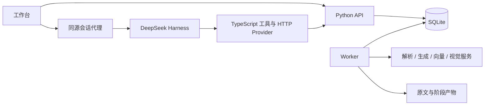
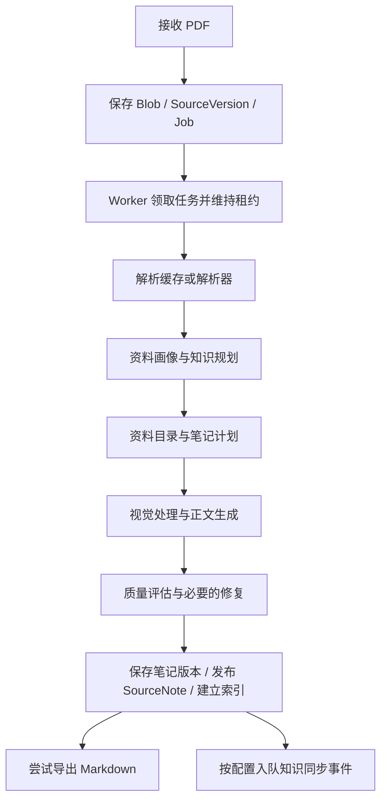

# 架构与数据流

Noodle Agent 将 PDF 整理成有页码证据的笔记，再把相关笔记归并为可复用的 Concept，供知识体系编排和问答使用。会话交互由 DeepSeek Harness 管理，耗时的资料生成与知识维护由 Python Worker 执行。

## 进程与代码边界

| 部分 | 职责 | 代码入口 |
| --- | --- | --- |
| 工作台 | 上传、任务进度、笔记/PDF 阅读、知识体系和聊天 | `services/noodle/src/noodle_agent/web/workbench.*` |
| Harness | 会话、模型交互、上下文、工具执行与审批 | DeepSeek Harness 依赖及 `scripts/start-harness.mjs` |
| TypeScript 桥接 | 工具 Schema、能力契约和 HTTP 请求 | `src/contracts.ts`、`http-provider.ts`、`read-tools.ts`、`write-tools.ts` |
| 精简 API | 接收文件、查询与编辑知识、代理 Harness 会话 | `services/noodle/src/noodle_agent/internal_api.py` |
| Worker | 领取持久化任务，执行生成、模块更新和知识同步 | `services/noodle/src/noodle_agent/worker.py` |
| 领域服务 | 笔记、版本、证据、检索与知识维护 | `services.py`、`synthesis/` |
| 存储 | 关系数据、全文索引、向量和文件产物 | `db.py`、`adapters/blob.py` |

当前前端使用原生 JavaScript、HTML 和 CSS。Marked、DOMPurify、KaTeX、PDF.js 分别用于 Markdown、安全清理、公式和 PDF 渲染。`agent/`、`api.py` 与 `web/app.*`、`web/index.html` 保留历史兼容实现；默认启动使用 `serve-internal` 和 `/app/`，不会初始化旧 LangGraph Agent。

## PDF 生成

上传快速返回 Job。Worker 保存阶段状态与产物，支持恢复和指定阶段重启；并非每次重试都从原 PDF 重新解析。解析缓存复用规范化解析结果，后续知识生成仍需要运行。真实 PDF 由 MinerU 处理，fixture 解析器需要合成 sidecar。

原子笔记的内容检查与 SourceNote 发布包含多阶段校验，失败候选、跳过内容和导出异常会形成错误或覆盖警告。`COMPLETED_WITH_WARNINGS` 表示仍需查看警告，不能当作内容完整且正确的保证。资料 Job 完成后，跨文档同步是另一项持久化工作。

笔记由内容块、Claim、页码证据和图片关联构成。编辑创建新 NoteVersion 与资料发布快照。导航锚点帮助阅读器在笔记和原 PDF 之间定位。

## 数据模型与存储

| 实体 | 用途 |
| --- | --- |
| Source / SourceVersion / BlobObject | 来源身份、上传版本和原文件定位 |
| AtomicNote / NoteVersion / NoteBlock | 原子笔记身份、版本和正文块 |
| Claim / ClaimEvidence / EvidenceSpan | 正文论断与原文证据 |
| SourceNote / SourceNoteVersion | 一份资料的目录与笔记发布快照 |
| Concept / ConceptModule | 共享知识点及其语义模块 |
| ConceptVersion / ConceptModuleVersion / ConceptReleaseModule | 知识发布与固定模块版本 |
| ConceptContribution / KnowledgeContributionSelection | 原子笔记贡献及选中的正文块 |
| Synthesis / SynthesisVersion / SynthesisNode | 知识体系与树形编排快照 |
| KnowledgeSyncEvent / KnowledgeSyncProposal / KnowledgeModuleState | 同步任务、候选与模块失效状态 |
| NoteEmbedding / ConceptEmbedding / FTS5 | 向量与全文检索 |

SQLite 保存正文、身份、关系、向量、任务和版本，本地文件保存 PDF、图片和解析产物。当前没有独立图数据库或向量数据库。

一个知识体系用父子节点表达一棵目录树。Concept 身份独立于目录位置，可以被多棵树引用；多个体系通过共享 Concept 形成逻辑图。每次发布的节点固定 `concept_version_id`，Concept 更新后再生成引用它的新体系快照。

## RAG 问答

`noodle_search_knowledge` 返回候选，`noodle_answer_knowledge` 调用领域问答服务。后者根据问题重新检索，并不直接消费上一次搜索工具的结果列表。

1. 解析问题与可选 `source_version_id`。指定资料版本时只检索该资料的 AtomicNote；全局问题同时检索 AtomicNote 和 Concept。
2. 使用 FTS5/BM25、标题与摘要相似度、向量信息生成候选分数。
3. AtomicNote 当前使用 `0.55 × 非负余弦相似度 + 0.45 × 词法得分`；Concept 使用 `0.58 / 0.42` 权重。两类分数不是统一校准的概率。
4. 分别排序、过滤相关性阈值。两类都有结果时，按名额交错返回 Concept 和 AtomicNote，保留综合解释与原文证据；原子笔记得分另乘 `0.97`。
5. 生成带引用的回答，再检查来源和知识发布是否发生变化。若发现失效，返回 `SOURCE_CHANGED` 提示并清除命中列表。

当前没有独立 cross-encoder 重排模型。向量保存在 SQLite 中并由应用代码计算相似度；未配置真实向量服务时使用确定性 HashEmbedding，主要用于离线验证。

页面上下文传递有界的实体、版本和导航信息，正文由工具读取。Python 代理限制上下文长度，HTTP Provider 限制正文输出长度；会话压缩由 Harness 负责。这些措施减少上下文增长，但不等于完整的知识摘要记忆系统。

## 一致性与当前边界

手动 Harness 写工具使用一次性审批；领域写入通过预期版本检查限制陈旧更新。资料事件驱动的自动维护使用独立的来源、质量和发布规则，详见 [跨文档归并](./KNOWLEDGE-SYNC.md)。

Worker 使用持久化租约和心跳，模块发布检查租约、来源快照、revision 与 Concept 活动版本。模型生成在发布事务外执行。失效活动模块会使相应 Concept 暂停正常读取与检索；历史版本仍用于追踪。

数据库目前同时保留启动补表补列和 Alembic 迁移，尚未统一为唯一版本升级入口。API 也未实现完整多用户认证与隔离。文件规模、迁移和扩展性限制见 [测试与限制](./TESTING.md)。
