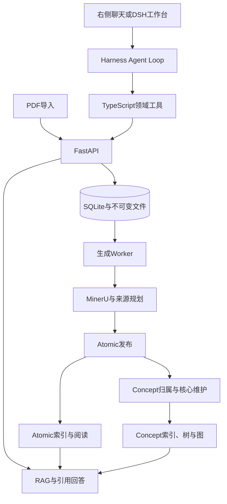

# 当前系统架构

更新：2026-10-29。唯一生产业务入口为 `next-v1`；旧 `/internal/v1`、Synthesis 和旧工作台已退出当前路径。历史演进见[更新日志](DEVELOPMENT-LOG.md)。

## 进程与职责

| 层次 | 职责 | 主要入口 |
| --- | --- | --- |
| 工作台 | 资料、阅读、PDF、知识树和图、任务、右侧聊天 | `services/noodle/src/noodle_agent/web/next/app.js` |
| DSH | 会话、Agent Loop、工具运行、审批、压缩与历史 | `scripts/start-harness.mjs` 与 DSH 依赖 |
| TypeScript 插件 | 领域工具、Scope、HTTP Provider 和结果展示 | `src/index.ts`、`read-tools.ts`、`next-tools.ts` |
| FastAPI | 领域接口、阅读投影、DSH 同源 RPC 和事件转发 | `next/api.py`、`workbench_api.py`、`agent_api.py` |
| 生成 Worker | 解析、规划、Atomic 写作与发布、检查点恢复 | `next/worker.py`、`generation.py`、`assembly_generation.py` |
| 维护消费者 | Concept、索引、依赖和导航更新 | `next/workspace_worker.py`、`maintenance_pool.py`、`runtime.py` |
| 存储 | 来源、修订、证据、事件、租约、索引与不可变资产 | `next/store.py`、`repository.py`、`storage/` |

耗时生成不依赖浏览器持续打开；DSH 决定调用什么工具，Python 负责业务执行，没有第二个 Python Agent Loop。

## PDF 到 Atomic

1. 保存原始文件、SourceRevision 和任务。文件身份由哈希与版本决定，同名文件不直接等同。
2. 读取经核验的兼容 MinerU 缓存，或执行新解析；解析结果保留文本、图片、公式、页码和资产定位。
3. 按资料类型规划。教材按可信目录分章，课件聚合主题，论文保留核心方法和图表。
4. 构造必要证据；按需建立视觉证据，整页上下文与可发布配图分开。
5. 生成草稿，按小节执行一次审查、一次必要修复和结构验收。
6. 发布不可变修订、证据和事件。Atomic 可读，索引与 Concept 消费者分别推进。

新生产任务固定走 `source-sections-v1`。`generation.py` 仍含历史配置恢复能力，不能仅按文件长度删除；部分共享调用底座也由新路径使用。

## Atomic 到 Concept

归属流程：当前有效 Atomic → 候选对象目录 → 身份匹配与内部主题 → 正文、支持或媒体贡献 → 所需构建代次 → 核心编译与发布。

- FOUNDATION 建立稳定核心；SUPPLEMENT 判断净新增、支持证据和深入阅读去向。
- 相同对象复用身份，普通提及或使用关系不强行创建父子层级。
- 未变化的安全小节可复用，纯证据增量不要求全文重写。
- 媒体是独立贡献，选用、沿用和撤回都要匹配仍有效的来源。
- 构建以输入哈希、所需代次、当前修订和租约为前置条件，旧 Worker 不能覆盖新结果。
- 删除或撤回从历史贡献定位受影响 Concept，重算有效输入，必要时撤回失去支持的内容。

## 图、树与 Markdown

数据库当前关系是共同来源。知识体系树选择阅读路径，其余父级显示引用；主题层级、语义链接、正文双链和来源关系用不同投影表达。

G6 延迟加载，负责布局和交互；身份、有效性和关系支持由服务端提供。MOC、卡片和 Vault 不成为第二份知识事实库。

Markdown 与 Obsidian 导出保留相对图片和稳定身份。Vault 编辑通过受保护的版本入口回流，不能直接修改不可变快照绕过发布。

## DSH 与 RAG

右侧聊天和独立 DSH 工作台共享会话。领域插件注册 17 个工具，其中 13 个只读、4 个需要审批；工具执行通过 Provider 调用 `/internal/next`。

RAG 对有效 Atomic、Concept 建立 Chunk。检索先约束来源与版本，再执行 FTS5/BM25、向量召回、RRF、可选重排和上下文合并。回答包含可回到小节与 PDF 页码的引用，来源变化时不得继续发布旧证据答案。

普通聊天消费 `assistant/chunk`。后端将 DSH mux、host 两路 WebSocket 合并为一条浏览器 SSE，提供真实上游就绪和心跳；隐藏页释放连接，恢复后补齐历史。RAG 工具内部仍先生成、检查，再返回正式结果。

完整工具、记忆和调用过程见 [Agent 与 RAG](AGENT-AND-RAG.md)。

## 任务恢复与计量

任务、outbox、幂等键、租约令牌、心跳和检查点共同控制恢复。成功模型响应按当前输入指纹复用；重试不是重新执行整条流水线。

生成、归属、Concept、索引和投影使用独立消费者。并发有界；SQLite 写事务应只提交必要变更，重计算和外部调用应在事务外完成。

维护通道连续异常后保持退避恢复，不再静默退出；独立心跳文件每五秒更新，`GET /internal/next/worker-health` 区分存活、恢复和过期。API 可用与后台健康分别判断。Concept 候选目录正文在读取连接中加载，提交仍核对租约、规划所有权和 Atomic 有效版本。

结构维护回执绑定全图或本次语义邻域指纹；无关节点变化不使局部回执失效，历史失败与当前失败分开统计。局部完成不冒充全库完成。索引请求和导航投影在读取输入前合并已排队任务，执行途中新增事件留给下一批。

资料状态列表与索引里程碑批量复用一次结构覆盖计算。聊天按轮次缓存 DOM，流式输出保留未变化的历史回答节点、工具展开状态与输入草稿。

用量来自供应商回执，区分 Agent、文本生成、视觉、嵌入及重排。排队、执行、暂停和后台维护分别呈现；并行阶段用时不可直接相加。

## 必须保留的约束

- 当前政策、来源和输入版本一致性。
- CAS 发布、租约 fencing、检查点哈希和幂等。
- 来源页码、资产哈希、引用身份、必要正文结构。
- 作者保护、历史修订与可恢复删除。
- 树与图的关系语义区分，层级提案的环检查。

不要按“静态未导入”删除迁移资源、CLI 动态入口或维护脚本；也不要通过清除历史记录掩盖失败。

## 当前维护重点

本轮离线发布门禁已通过；索引回收只提供显式操作和可恢复备份，未删除正式索引。答案准确性、归并质量金标和长会话成本仍需独立评测，见[验证说明](TESTING.md)。
