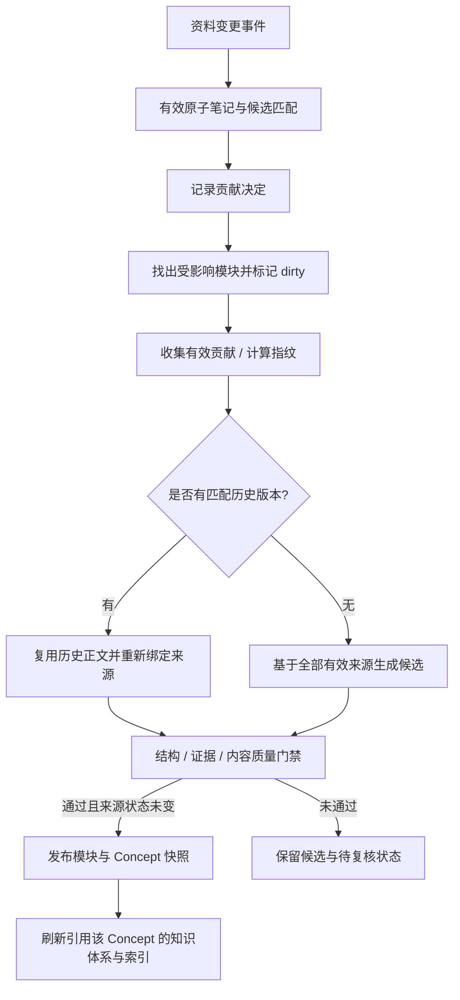

# 跨文档知识归并

自动归并遵循三步：**资料变更触发事件，按有效来源重建，通过质量检查后发布**。知识维护以原子笔记和来源证据为基础，历史知识正文用于版本记录，不能代替当前有效来源。

## 触发与资格

资料笔记发布、原子笔记编辑、来源删除与恢复会产生持久化事件。`KNOWLEDGE_AUTO_SYNC` 控制 Worker 是否自动处理。自动维护与 Harness 的手动审批写工具是不同入口。

每篇新原子笔记都会参与处理，但不是每篇都会成为知识点贡献。来源和笔记必须处于有效状态，笔记版本必须是当前版本，并对应当前来源版本。随后检查主题是否有独立的知识价值、证据是否足够、是否与现有 Concept 的边界一致，以及实际带来的信息是否只是重复。

别名、标题与混合召回用于发现可能相关的 Concept，召回分数本身不构成发布许可。身份模糊、主题混杂、证据不足或不能确定编排位置的候选保留为待复核。满足条件的新主题可以创建新的 Concept，不必全部强行并入已有知识点。

## 更新已有知识点

重建的单位是受影响的 Module，而非整个知识库。更新需要读取该模块的全部有效贡献，避免把新片段简单拼接到旧正文末尾。相同有效来源集合与策略可以命中历史版本；历史正文只有在重新验证并绑定当前有效来源后才可使用。

生成过程中如果来源再被修改，发布前的 revision / 版本检查会拦截陈旧候选。通过后创建不可变模块版本与 Concept 发布快照，并更新关联知识体系快照和检索索引。未通过的事件可能结束为 `COMPLETED_WITH_REVIEW`，这表示自动处理已结束，但仍有内容需要人工复核。

## 删除与恢复案例

假设资料 A 介绍反向传播基本公式，资料 B 补充矩阵推导和数值稳定性。两者各有有效原子笔记，共同贡献给“反向传播”Concept 的不同模块。

1. 上传 B 并发布笔记后，事件找到已有 Concept，判断补充内容及模块位置，记录 B 的贡献。
2. Worker 对受影响模块重新收集 A、B 的有效来源，生成候选，检查引用和内容，发布新模块版本。
3. 删除 B 后，系统逻辑删除来源，使 B 的笔记和贡献退出有效读取范围，并标记相关模块失效。
4. Worker 只按 A 的有效内容重建；如果已有与该来源集合一致的历史版本，可以验证后复用。否则重新生成。
5. 若删除后已没有足够来源，模块不能继续以旧正文作为有效解释；它进入无有效支撑或待处理状态。
6. 恢复 B 后重新计算来源资格和贡献，并触发新事件。再次上传同一 PDF 则需经过新的来源版本与贡献匹配，不能仅凭文件名认定为恢复。

历史发布保留可追踪性，“回退”是当前知识恢复到有效来源支持的内容，不能无条件把过去某版重新设为有效。

## 新 Concept 与知识体系

新主题通过身份、证据与内容检查后可以创建 Concept 与模块。知识体系编排复用同一 Concept ID，通过分组节点和引用节点决定它在每棵树中的位置。不同体系对同一知识点的解释可以共享，编排位置可以不同。

自动编排优先使用已有体系和分组，避免每次上传都重写整棵树。无法确定放置位置时进入待复核；不会为了把所有原子笔记放进目录而强制建点。复杂拆分、合并、先修关系和体系重组仍需要进一步完善。

## 代码入口

- `services/noodle/src/noodle_agent/synthesis/knowledge_sync.py`：事件处理、有效来源、模块重建、版本发布与失效处理。
- `services/noodle/src/noodle_agent/synthesis/semantic_builder.py`：内容生成、证据绑定和质量审核。
- `services/noodle/src/noodle_agent/synthesis/curation.py`：身份、别名、Concept 复用和编排操作。
- `services/noodle/src/noodle_agent/db.py`：贡献、事件、候选、版本和模块状态。
- `services/noodle/tests/test_knowledge_sync.py`：来源删除/恢复、版本冲突与同步回归。

当前门禁兼有确定性校验与模型判断。它可以限制明显错误，却不提供语义正确性的数学保证。真实资料仍应抽查，并记录待复核候选的原因。
