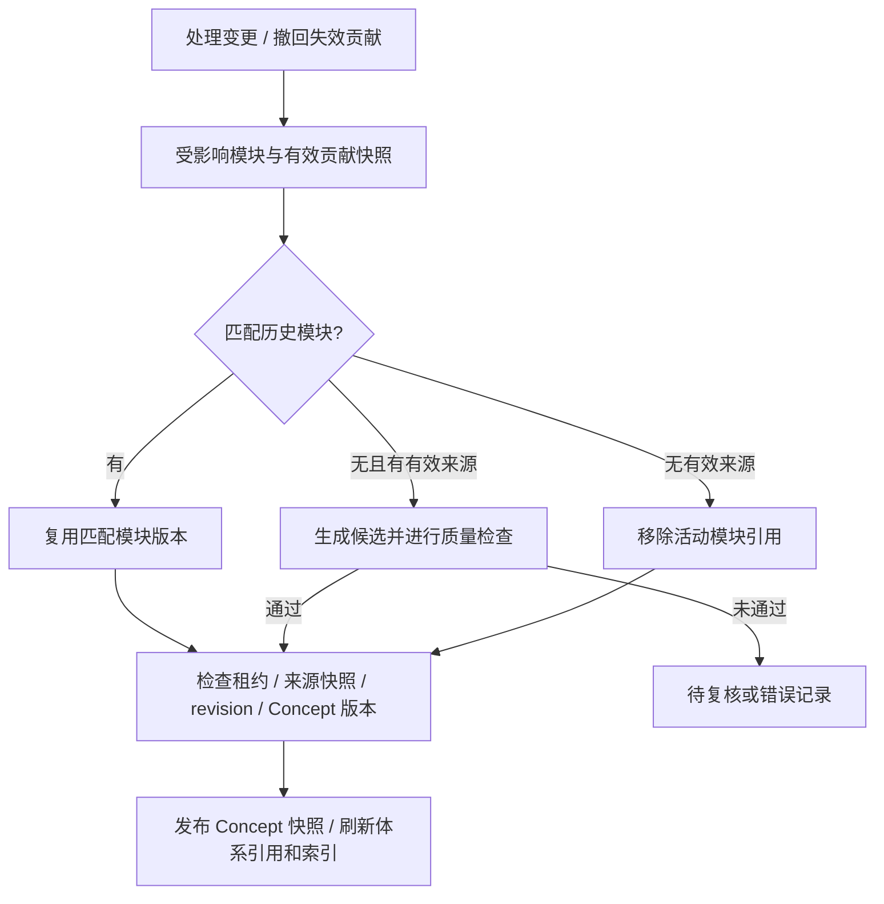

# 跨文档知识归并

归并以当前有效的原子笔记和证据为输入，流程为：**资料变更触发事件，收集有效来源，重建受影响模块，检查后发布知识快照**。新增正文需要通过结构、证据与独立 Module Judge；匹配历史模块的复用分支采用来源一致性检查，不会重新调用 Judge。

## 事件与自动同步开关

| 事件 | 触发条件 |
| --- | --- |
| `SOURCE_PUBLISHED` | 资料笔记发布，且 `KNOWLEDGE_AUTO_SYNC=true` |
| `NOTE_UPDATED` | 原子笔记编辑，且 `KNOWLEDGE_AUTO_SYNC=true` |
| `SOURCE_DELETED` | 来源逻辑删除 |
| `SOURCE_RESTORED` | 恢复逻辑删除的来源 |
| `NOTE_DELETED` | 删除单个原子笔记 |

`KNOWLEDGE_AUTO_SYNC` 控制正常发布、编辑时是否创建增量事件。关闭后，这些变更对既有 Concept 的贡献协调可能滞后。当前删除、恢复和单笔记删除仍创建事件，Worker 也会继续处理已入队事件；它不是暂停全部知识维护的总开关。删除和恢复事件还可能分析该资料中其他有效、尚无贡献的笔记。

事件处理与手动 Harness 写工具的审批路径不同。事件有幂等键、租约、处理状态和候选记录，Worker 在资料生成与同步任务之间调度，同一事件内的笔记和模块当前主要顺序处理。

## 哪些笔记参与更新

处理事件时，系统收集该来源当前版本下可见的 AtomicNote 活动版本。已有有效贡献的笔记、已处理的候选可能跳过重复分析。因此，新资料的有效原子笔记会进入处理范围，但不会保证每个知识块都形成独立更新。

模型比较新笔记与候选 Concept，输出最多三个主题决定：

| 决定 | 处理 |
| --- | --- |
| `NO_CHANGE` | 没有值得更新的内容，跳过 |
| `INVALID` | 无实质知识或不具备足够支撑，跳过 |
| `EVIDENCE_ONLY` | 增加来源贡献，仍进入受影响模块的协调流程 |
| `ADD_DETAIL` | 补充已有模块 |
| `NEW_MODULE` | 为已有 Concept 增加新侧面 |
| `NEW_CONCEPT` | 创建独立知识身份与模块草稿 |
| `CONFLICT` | 保留为待复核候选 |

候选来自标题混合检索、注册表、同来源已有贡献和名称匹配，送入模型的 Concept 最多八个。正文块和候选模块文本会截断；新身份还检查规范化同名与已注册别名。当前并没有遍历全库全文进行完备的语义等价证明，不同名称的同义知识点仍可能漏检。

更新选中的块必须存在，并有 ClaimEvidence 支撑；已有 Concept 必须来自候选范围，已有模块须匹配语义 key，发布前还检查预期版本。模型决定只是候选，不能直接替换知识正文。分类调用或 JSON 校验异常也可能记录为待复核，不能把所有待复核原因都解释为科学内容冲突。

## 按有效来源重建模块

有效来源要求：Source 和 AtomicNote 可见，NoteVersion 是活动版本，并属于来源当前版本。贡献还须处于接受或批准状态，选择记录保存使用的块 ID。

生成分支汇集该模块的全部有效贡献；自动贡献按选择记录限制块范围，部分历史贡献没有选择记录时使用原准备逻辑。重建单位是 Module，其他模块通过版本引用保留。

历史匹配当前比较 **NoteVersion ID 集合和选择块 ID**；当前选择为空时存在兼容规则。它不单独检查提示词/策略版本，也不重新运行 Module Judge。历史复用仍检查来源快照与发布状态是否在处理期间变化。重新上传同一 PDF 会产生新笔记版本，不能仅凭内容相同保证命中旧模块。

来源发生变化、租约丢失或 Concept 活动版本被推进时，陈旧候选会被拒绝发布。新正文通过门禁后创建不可变 ModuleVersion 和 ConceptVersion；历史复用则将匹配的 ModuleVersion 固定进新的 Concept 快照。

## 删除、编辑与恢复

假设资料 A 支撑“反向传播”的基本公式，B 给同一模块补充矩阵推导：

1. B 发布后，分类提出补充，选择有证据的正文块。模块按 A、B 的有效贡献生成候选，通过检查后发布。
2. 编辑 B 的笔记产生新版本，旧贡献退出有效来源集合；新版本需重新分析，并不自动继承旧版本全部贡献。
3. 删除 B 后，其笔记退出有效检索，相关模块标记失效。Worker 撤回贡献并按剩余 A 重建；若 NoteVersion 和选择块匹配历史模块，可复用历史正文。
4. 如果已没有来源，活动快照移除该模块；Concept 没有任何活动模块时成为 `WITHDRAWN`。
5. 恢复 B 会恢复符合条件的笔记可见性，并尝试恢复最近一次删除所撤回、仍有效的贡献，再触发协调。再次上传属于新的来源处理，文件名不能代替恢复操作。

新增候选被 Judge 拒绝时，只有旧发布的来源仍有效才能继续保留正常读取。旧发布已引用删除或过时笔记时，模块仍保持失效，相关 Concept 暂停普通读取和问答。不能为了保留旧正文而继续引用无效来源。

## 新 Concept 与知识体系

新主题可以创建 `DRAFT` 身份、明确范围和模块，正文通过检查后成为活动 Concept。没有编排位置时仍可能发布到全局 Concept 库，不会因此自动进入待复核。

每个体系保存一棵父子目录树，节点引用 Concept ID 和固定版本。多个体系共享 Concept 身份，形成逻辑图。自动更新采用以下规则：

- 已引用该 Concept 的体系发布新快照，替换版本引用，保留既有树形结构。
- 新 Concept 只能放入模型选中的现有 `GROUP`，不会自动创建体系或分组。
- `CURATED` 手工编排体系可以刷新已有引用，但不会自动插入原来没有的 Concept。
- 缺少有效分组位置时保留全局 Concept，不强行放入树。复杂重组、先修关系和知识点拆分尚未实现完整自动化。
- Concept 撤回时，已有引用节点转为带撤回身份标记的占位分组；恢复有效发布后可以重新绑定。

## 状态与检查入口

`COMPLETED` 表示事件处理结束；`COMPLETED_WITH_REVIEW` 表示存在待复核候选或模块；`COMPLETED_WITH_ERRORS` 表示模块处理存在错误；`FAILED` 表示事件处理失败。候选的 `APPLIED` 仅表示已安装贡献，最终发布还要看模块结果。

- `GET /internal/v1/knowledge-sync?source_id=...`：最近的同步事件。
- `GET /internal/v1/knowledge-sync/{event_id}/proposals`：候选决定与原因。
- `POST /internal/v1/knowledge-sync/{event_id}/retry`：重试失败或待复核事件，可选指定 `module_ids`。

重试待复核事件会按原因恢复相应分析或模块审核，并非对所有候选重新分类。当前没有完整的逐候选人工审核工作流。

实现入口为 `synthesis/knowledge_sync.py`、`semantic_builder.py`、`curation.py` 和 `db.py`；回归测试见 `services/noodle/tests/test_knowledge_sync.py`。确定性检查与模型审核共同限制发布，真实语义质量仍需抽查。
