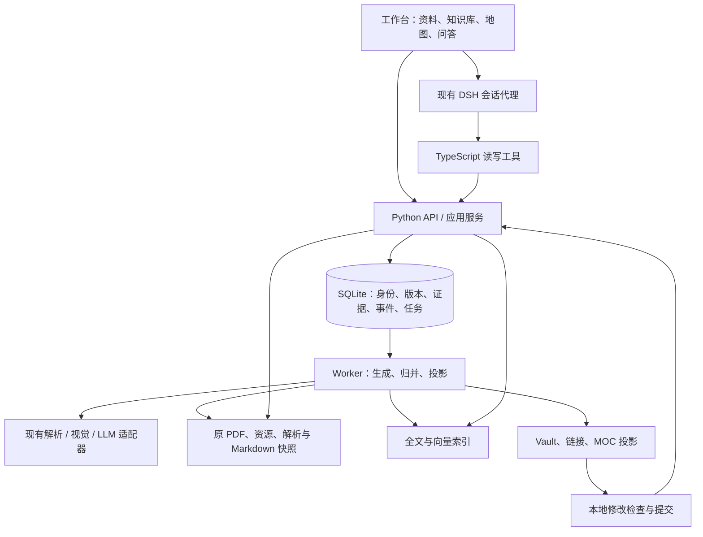

# Noodle-Agent 新系统重构与验收方案

日期：2026-10-21  
设计标识：`next-v1`；代码核对基线：`58099ce`，项目版本 `0.2.0`。  
状态：分阶段实施中。P0 工程基线、P1 底座及 P2 生成主链已有实现，已完成首份课件的真实试跑，完整内容验收仍在进行；本文保留目标设计，实际结果见 [实施与阶段验收记录](./IMPLEMENTATION-STATUS.md)。未完成链路不表示已通过真实模型验收。

本次从原 PDF 重建知识库，不兼容旧笔记数据。保留现有上传、解析适配、任务恢复、PDF 阅读、DSH 会话、工具审批和跨平台启动等能力，重做内容模型、笔记生成、Concept 维护、检索、知识地图和相应前端。正式切换后，活动系统只包含新系统生成或按新规则接受的内容。

## 目标与重构边界

目标链路是：PDF → 有证据的原子笔记 → 持续维护的 Concept → MOC 与双向链接 → 阅读、检索和问答。资料变化后，由事件定位受影响内容，按有效来源重建，通过检查后发布。

需要达到四个结果：笔记内容与文风一致；Concept 更新有明确资格和范围；回答只使用有效原子笔记与 Concept；同一套 Markdown 能在工作台、Obsidian 和个人网站阅读。

| 处理方式 | 范围 |
| --- | --- |
| 保留并适配 | Python API、独立 Worker、MinerU/视觉/LLM 适配器、DSH 与 TypeScript 工具桥、工具审批、租约与重试、版本并发检查、PDF.js 阅读、安全 Markdown 与数学渲染、npm 启停、Alembic |
| 重构 | 内容与来源模型、生成规划、写作协议、质量门禁、Concept 归并、检索索引、MOC、Vault、知识库与阅读前端 |
| 不做兼容 | 旧 AtomicNote/Concept 正文、旧模块发布结构、旧 Synthesis 快照、旧向量与全文索引、旧笔记导出格式和内容 ID |
| 原件复用 | 原 PDF 及文件校验值；解析缓存只有在原件、解析器版本和配置匹配时才可复用，至少一个验收案例执行完整冷解析 |
| 后续扩展 | 音视频输入、多人协作、认证与隔离、大规模分布式部署；本次不提前建设 |

不编写旧笔记转换器，不长期双写旧新模型，不为旧 API 数据形状保留业务兼容层。旧系统仅在切换窗口内作为隔离的恢复副本，不参与新系统生成、检索或问答。原有人工改动不自动迁入；若以后需要引入，必须作为新的作者来源重新检查。

## 当前问题与修复要求

下表区分代码可确认的问题、条件性缺陷和设计不足。它们不等于本轮已经执行了故障复现；不把此前强刷后消失的“命中 0 篇”界面现象当作仍存在的后端故障。

| ID / 类型 | 当前事实与影响 | 新系统处理 | 验证 |
| --- | --- | --- | --- |
| D01 规划缺陷 | 笔记数受候选折半上限约束；分组无效时相邻配对，可能混合不同问题 | 以主题边界和覆盖规划数量；超预算分批，不机械合并 | T02 |
| D02 能力缺口 | `merge_knowledge_map()` 逐项汇总窗口候选，没有跨窗口语义归并 | 合并等价候选与证据，保留不同条件和独立问题 | T02 |
| D03 规则冲突 | Writer 禁止内部标题，并要求行内变量使用反引号；长文层次与数学呈现受影响 | 统一结构、写作与数学规则；三个阅读端使用同一正文 | T03 |
| D04 发布缺陷 | 首次 Concept 构建可接纳拼接 fallback；模块自动更新则拒绝并执行 Judge | 初始化、更新、历史复用执行同一门禁；拼接仅为失败诊断或待复核草稿 | T07 |
| D05 条件性计算缺陷 | `_cosine()` 实际计算点积；真实 embedding 适配器没有统一归一化，结果依赖提供方前提 | 入库与查询使用相同 profile、维度和归一化；拒绝零向量、非有限值和维度错误 | T16 |
| D06 检索不足 | 整篇正文向量、JSON 逐条解析、两类结果按名额交错，缺少统一融合与可选精排 | 语义 Chunk、批量索引、RRF、按相关性排序及上下文补全 | T15、T16 |
| D07 归并不足 | 候选偏重名称；仅取部分 Concept，单篇最多三个决定，正文被固定字符截断 | 身份/章节/增量分步判断，预算分批与可继续读取，逐片段记录处理状态 | T05、T06 |
| D08 稳定性与成本问题 | 新来源支持与知识增量未完全分开；历史复用政策检查不完整 | 分开正文、来源、策略指纹；纯证据增补不调用正文 Writer | T06、T08 |
| D09 重复工作 | 搜索与回答工具可能分别检索，缺少共享检索快照 | 复用有范围、版本和策略约束的快照；回答前仍检查有效性 | T18 |
| D10 模型复杂 | 块正文、模块正文、资料发布和体系快照有多层相近包装 | 统一 Note/Revision、Markdown、章节与来源清单；新库不创建旧模型 | T01 |
| D11 浏览不足 | Concept 注册表用于编辑体系，前端查询固定 `limit=80`；阅读依附体系入口 | 独立分页 Concept 库、稳定路由、独立阅读器与多地图导航 | T19 |
| D12 编辑与移植不足 | Markdown 主要是版本化导出结果，没有稳定工作副本与编辑回流 | 稳定路径 Vault、基础版本比较、相对链接和两类导出包 | T21、T22 |
| D13 证据表达不足 | 有 Claim/来源关联不等于逐事实验证；粗粒度关联难以解释局部撤回 | 章节与关键事实证据、选定贡献片段、反向依赖和分层检查 | T04、T09 |

代码定位见文末。索引覆盖、生成遗漏和公式错误的实际数量必须在试点重新测量，不沿用历史统计作为当前验收成绩。

## 总体架构与职责



API 校验请求与返回状态，长流程由 Worker 执行。应用层控制发布事务、预期版本与来源有效性；模型只返回候选，不直接改数据库或发布指针。搜索索引返回候选 ID，应用从领域库再次检查并读取正文。

按能力拆分 `content`、`ingestion`、`concepts`、`retrieval`、`maps`、`vault` 和 `evaluation`，共用任务和发布设施。先隔离 Repository、BlobStore、Parser、Generator、Embedder、VectorStore、Ranker 等外部边界，不为每个内部类建立接口。

保留现有工作台渲染组件和 ES Module 技术栈，按页面、阅读器、API 客户端与状态管理重组；前端契约与 TypeScript 工具共用类型定义或生成的类型声明。新引入 React 等框架不作为本次重构前提。

## 数据模型与存储

### 四类对象与统一内容

| 对象 | 定义与边界 |
| --- | --- |
| Source | 不可变来源及版本。首版支持 PDF；作者新增事实使用明确的 AUTHOR 来源，不伪装成 PDF |
| ATOMIC | 基于特定来源，完整回答一个主要学习问题；不等于一个句子、页码或检索片段 |
| CONCEPT | 跨来源主题身份；正文由有范围的语义章节构成，适合持续维护 |
| MOC | 有范围、说明和阅读顺序的导航页；引用知识正文，不复制知识正文 |

ATOMIC、CONCEPT、MOC 共用 Note 与 NoteRevision。完整资料笔记通过资料 MOC 与选定原子笔记版本组装，不再维护另一份可独立编辑的正文。检索 Chunk 是派生数据，父类型只能为 ATOMIC 或 CONCEPT。

| 模型 | 主要字段与约束 |
| --- | --- |
| Source / SourceRevision | ID、kind、文件哈希/作者快照、活动版本、逻辑删除状态、解析产物与解析配置；同 PDF 副本不算独立证据 |
| Note | ID、kind、名称、领域、别名、活动 Revision、稳定路径、可见性、合并跳转；名称和别名按领域消歧，不要求全库标题唯一 |
| NoteRevision | ID、父版本、Markdown 引用与哈希、摘要、scope、章节清单、冻结输入、作者、策略与检查结果 |
| Section | Revision 内的章节元数据：稳定 section_id、标题、主要问题、范围、正文定位/哈希、证据引用、人工保护；不另设章节版本发布体系 |
| EvidenceAnchor / SectionEvidence | 来源版本、解析版本、页码/范围/bbox、资源/原文哈希；关联章节，关键公式或数值可增加更细的支持记录 |
| ConceptInput | 目标 Concept/section、来源 ATOMIC Revision、选定片段、证据、贡献角色、动作与有效性；支持反向定位 |
| Link / MapEntry | 正文出链、确认语义关系、地图条目及顺序的派生投影；保存出处和 Revision，不维护第二份可编辑正文 |
| Event / Job / BuildArtifact | 输入快照、幂等键、租约、状态、重试、计划、候选与检查报告；事件不能在未处理完片段时假报完成 |
| Chunk / IndexEntry / EmbeddingProfile | 父版本、章节、正文范围、哈希、来源范围、模型/维度/归一化、索引代次与处理状态 |

新存储写入 `next-v1` 契约标记；启动在执行升级前识别库类型，指向旧业务库时明确拒绝，不能误升级或自动清空。不兼容指内容数据不迁移，不代表使用 ORM `create_all()` 替代 Alembic。

正文唯一持久表达是 UTF-8、LF 的 Markdown。候选 JSON 只是传输和构建产物，AST/Chunk 文本是可重建缓存。section_id 不用标题、页码或正文哈希充当；改名、拆分和合并通过显式映射维护身份。

### 权威关系与落盘

SQLite 决定当前活动版本与来源有效性；不可变 Markdown 快照保存正文；Vault 是可编辑工作副本；向量、全文索引、图与反链都是派生投影。证据、贡献和人工修改不是可丢弃缓存。

```text
data/noodle-next/             # 示意目录，不提交 Git
├── noodle.db                 # 新模型、任务与来源关系
├── blobs/                    # PDF、图片、内容寻址资源
├── artifacts/                # 解析、覆盖表、计划、候选和检查
├── revisions/                # 不可变 Markdown 与构建清单
├── indexes/                  # 精确索引、代次与可选向量后端配置
└── vault/                    # Sources / Notes / Concepts / Maps / assets
```

发布顺序：先写不可变正文并校验 → SQL 事务保存 Revision、输入与 outbox，条件推进活动指针 → 幂等更新 Vault、链接与索引。事务失败留下的孤立文件延后回收；投影失败可重放，数据库不得引用尚未写出的文件。

内容发布状态与可检索资格分开：候选可处于 DRAFT/REVIEW/READY，接受后为 PUBLISHED；撤回保留历史。已发布内容若来源失效、资源损坏或范围不合格，立即不可检索，不能等后台重建结束。Job 成功也不等于索引和 Concept 全部就绪，各子链路单独报告状态。

### 目标契约与 Schema

规则文档描述页面、写作、维护和查询政策；JSON Schema 描述机器形状；领域检查描述真实来源、语义与事务资格。三者都版本化，并写入构建策略指纹。

| 契约 | 必须表达 |
| --- | --- |
| AtomicPlan / AtomicCandidate | 主要问题、范围、来源单元、建议章节、Markdown、证据和资源；规划不作为事实来源 |
| ConceptUpdatePlan | 目标与基础 Revision、输入片段、动作、实质增量、必须保留项、新章节或新主题提案 |
| ConceptCandidate | FULL 或 SECTION_PATCH；只提交允许修改的章节及其 Markdown 和引用，列明保留章节 |
| PublishedManifest | 服务端生成的正文引用/哈希、章节清单、冻结输入、策略、检查与父版本；不重复保存可编辑正文 |
| MOC / MapEntry | 地图范围、维护政策、条目身份/父条目/顺序/说明、目标 Note ID、可选固定 Revision |
| RetrievalEntry / SearchSnapshot | 仅两类父身份、版本、Chunk、profile/代次、问题、范围和命中；不包含未受控原文 |

Concept 的贡献输入仍只允许 ATOMIC。人工新增事实先形成 AUTHOR 来源及经过检查的 ATOMIC，再贡献给 Concept；人工章节可以受保护，但不能绕过来源资格。措辞调整不需要虚构新事实来源。

已有 `WIKI-SCHEMA.md` 与 `wiki-concept.schema.json` 是前期草案；实施阶段按本方案修订并增加 Atomic、MOC 等契约，不把现有 Schema 结构通过当作本方案已实现，也不直接继承旧数据格式。

## 统一笔记架构与文风

统一的是内容契约、术语、引用、数学和编辑政策，不要求每篇文章拥有相同栏目。原子笔记忠实解释某个来源中的问题；Concept 综合多个来源；两者共享阅读规则。

| 内容类型 | 推荐展开顺序 | 重点 |
| --- | --- | --- |
| 定义 | 对象与含义 → 条件 → 必要区别 | 简单定义可以只有两段，不补空栏目 |
| 机制 | 问题 → 原因/步骤 → 结果与边界 | 不把相邻事实擅自连成因果 |
| 推导 | 用途与条件 → 符号 → 公式与必要步骤 → 解释 | 不漏条件、不跳关键步骤 |
| 比较 | 问题 → 一致比较维度 → 差异 | 无来源的单元格不靠常识补齐 |
| 案例 | 初值 → 计算过程 → 结果与解释 | 保留数值语义、单位与舍入口径 |

写作要求：中文为主，首次出现保留必要英文；开篇直接进入主题；短段落、有信息的小标题；并列用列表、稳定比较用表格；删除背景套话、写作说明、重复摘要与末尾复述。隐藏检索摘要不强制放在正文。

数学统一为行内 `$...$`、独立 `$$...$$`；数学变量不放代码反引号。反引号仅用于代码、API 与标识符。原图放在相关解释旁，多面板/碎片按图组保留，图注说明观察重点。数字、公式和图片关系不得凭常识补写。

下例只展示版式，不对应真实课件证据：

```markdown
# 隐藏层误差项如何计算

隐藏层没有直接给出目标误差，需要把后续节点的导数贡献汇总后继续反向传播。

## 公式与适用条件

先说明本节使用的网络结构、损失、激活和符号，再列出来源支持的公式。

## 下一层权重为什么出现

按来源保留链式法则的必要中间步骤，并给出证据引用。

## 一个简短例子

只有来源提供足够数据时才保留数值演算；复杂案例链接到独立笔记。
```

上述小标题按实际内容增减。脚注、资源 URL 和阅读链接由编译器根据合法 ID 生成，模型不得编造路径。统一 Markdown AST 和渲染政策，分别验证工作台、Obsidian、网站；标准 Markdown 本身不保证数学和脚注都能渲染。

## PDF 解析到原子笔记


上传按原件哈希识别重复，Worker 记录阶段产物。解析保留页码、文字、公式、图组和识别异常；不要把 OCR 结果自动视为准确事实。缓存键包含文件、解析器与配置版本。

主题规划需为每篇指定主要问题、includes/excludes、证据、必要前置解释和建议章节。一份 PDF 中的重要知识单元必须有主要讲解位置，或记录未纳入原因；重复、装饰、来源损坏和未完成分别统计。没有覆盖完不能简单标为生成成功。

去除固定笔记数上限和相邻配对兜底。内容太长则按独立子问题拆分；完整长案例可独立成篇。长证据使用可继续读取的分段目录，不按字符截掉公式或推导尾部。

Writer 接收完整必要证据、统一写作政策与视觉结果，只能使用支持范围。图中方向、层级、比较关系需要视觉或原文支持。识别异常先回看原页；教材本身可疑的结论保留条件并标记，不由模型静默修正。

发布检查分三层：确定性检查引用/资源/结构；语义检查事实/公式/条件/覆盖；编辑检查重复/层次/指代。失败只修复相关章节并复核依赖，超过预算进入 REVIEW。真实公式与数值仍需人工抽查，模型 Judge 不等于独立专家验证。

## Concept 的构建与持续更新

### 持久 Wiki 与语义章节

借鉴 [LLM Wiki](https://gist.github.com/karpathy/442a6bf555914893e9891c11519de94f) 在摄入阶段维护持久 Markdown 知识页的思路。本项目增加原子笔记层、确定的来源关系、版本事务和人工编辑保护。摄入负责整理，查询负责使用，健康检查负责发现遗漏、重复、断链与失效，编译发布由应用执行。

Concept 用对象、领域和 scope 约束总范围，每个章节回答一个相对稳定的子问题。章节不是段落、公式或展示组件；章节可以含文字、表格、图片，也可以拆成多个检索 Chunk。

```text
Concept：反向传播
├── 计算什么，与参数优化有什么关系
├── 输出层与隐藏层的误差项
├── 下一层权重来自哪一步链式法则
├── 与其他微分模式的比较
└── 独立数值案例的阅读入口
```

不是每个主题都要有上述栏目。单来源也可建立具有独立组织价值的 Concept，但不为每篇原子笔记复制同义主题。没有合适 MOC 位置不影响独立发布。

### 三个判断与八种动作

所有合格原子笔记的重要片段都进入分析范围；被分析不等于必须改写。先结合领域、别名、scope 和正文匹配 Concept 身份，再选择章节，最后判断知识增量。候选不足时扩大查找或待复核；相似度只筛候选，不证明同义或支持。

| 动作 | 资格 | 处理 |
| --- | --- | --- |
| NO_CHANGE | 重复事件、同一支持或无新知识 | 记录处理结果，不写正文 |
| ADD_EVIDENCE | 新有效来源支持已有知识 | 更新输入清单；正文与向量复用，不调用 Writer |
| UPDATE_SECTION | 同一子问题出现新解释、公式、条件、限制或短例 | 综合当前有效输入，局部改写 |
| CREATE_SECTION | 同主题内独立新问题，现有章节不能自然容纳 | 检查范围、重复、证据与阅读位置后建章节 |
| LINK_ONLY | 相关主题或独立长案例 | 增加阅读入口或有依据的关系，不吞并正文 |
| CREATE_CONCEPT | 没有等价身份，或内容超出当前主题范围 | 建独立主题、去重并连接关系 |
| CONFLICT | 相同条件下存在不能可靠解释的矛盾 | 标明立场和证据，待复核或显式描述冲突 |
| INSUFFICIENT | 内容或证据不足 | 不发布增量，保留原因 |

检查对象、激活、损失、单位、量词和符号约定后再判断冲突。不同措辞可能完全重复；相似公式可能新增关键条件。不得按资料时间新旧决定科学结论胜负。

更新计划至少包括下列内容；这是字段示意，不是现有可调用接口：

```json
{
  "contract_version": "next-v1",
  "target_concept_id": "concept_backprop",
  "base_revision_id": "revision_3",
  "operations": [{
    "action": "UPDATE_SECTION",
    "section_id": "hidden_delta",
    "input_ref_ids": ["accepted_input_c"],
    "new_knowledge": ["解释下一层权重来自局部导数"],
    "must_preserve": ["已有公式", "变量定义", "适用条件"]
  }]
}
```

### 局部综合与发布

同批相关贡献先聚合再构建。Writer 根据计划、有效原子笔记片段和旧正文参考重新组织目标章节，不直接拼接原子笔记。旧正文不是已删除事实的独立证据；来源很多时按知识覆盖分配上下文，完整输入清单仍保留，未读取部分不得虚报已综合。

未变章节由应用复制，不交给模型自由重写。更新需要保全旧知识，并检查概述、符号表、链接等依赖。正文指纹、输入清单指纹、策略指纹分别保存；纯新增证据可生成元数据新 Revision，但正文哈希不变。

初建、增量和历史复用使用相同门禁。Schema、来源资格、必须保留项、冲突/公式和可读性均通过，再核对租约、输入快照和基础版本并发布。拼接 fallback 不进入正式知识；失败候选不改变有效旧版本，旧版本来源失效时则不能继续使用。

历史复用要求内容、来源、选择片段、策略和检查资格相容，不只比较 ID 集合。Concept 合并保留旧身份跳转；拆分保留章节与来源映射。

### 修改、删除与恢复

ConceptInput 提供“来源版本/笔记片段 → 受影响章节”的反向依赖。编辑生成新的原子笔记 Revision，旧贡献不再有效；删除来源立即限制相关知识可见性，后台只重建受影响范围。

| 变化 | 正确行为 |
| --- | --- |
| 增加重复定义 B | 增加支持，正文不改 |
| 增加推导 C | 更新推导章节或创建新章节，公式章节不顺带重写 |
| 删除来源 A，B 仍支持公式 | 移除 A 引用，检查后保留 B 能支持的内容 |
| 删除唯一支持某结论的来源 | 撤回该结论；不确定安全剩余范围时暂时排除整个旧 Concept |
| 构建期间笔记或 Concept 又更新 | 拒绝陈旧候选，重新协调 |
| 恢复资料或重新上传同 PDF | 区分恢复身份与新输入；按哈希防止虚增独立来源，不承诺旧笔记 ID 不变 |

回退不是无条件切回旧正文：旧版本只有在当前来源与政策仍合格时才能重新使用。保护的人工章节也不能绕过来源失效；新增事实须有作者 ATOMIC 或其他有效输入。

Concept 之间的链接可以循环，但支持链最终必须落到来源原子笔记。聊天回答默认不自动摄入；用户保存时仍需来源检查，防止“回答 → Concept → 回答”自我强化。

## 只检索原子笔记与 Concept 的 RAG

### 语料、分块与查询

FTS、向量、缓存、图扩展、父级补全、工具与回答统一执行 `kind in {ATOMIC, CONCEPT}`。原 PDF、DocumentBlock、原文 Markdown、MOC 和系统规则不作为 RAG 事实语料。核验可按已知证据 ID 定位原文，但不能追加笔记中没有的事实。

层级为知识页 → 语义章节 → Chunk。Chunk 保留父版本、标题路径、正文范围、邻接、公式/符号/资源依赖与证据。分块按 token 预算和语义边界执行；公式与条件成组，表格保留表头，图组不随意拆开。标题、领域和资料名称可作为确定性上下文，不拼入原文扩充答案。

```text
问题 + 当前实体 + 显式资料范围
→ 规则路由，必要时解析指代
→ 原问题关键词检索 + 查询向量
→ 两类有效知识候选
→ RRF 融合，保留精确术语、编号与公式信号
→ 按需扩展已确认关系，重新检查范围
→ 可选重排、衍生重复与证据去重
→ 父章节/邻接补全，按问题覆盖控制 token
→ 带引用回答、引用校验、最终来源与版本检查
```

同一问题跨两类内容复用查询向量；扩展词或子问题使用不同向量时计入预算，不虚称只有一次调用。多个查询变体不能通过重复列表不合理放大 RRF 权重。精排只排序候选，不召回池外事实；无明确收益则不默认启用。

普通问答默认混合搜索，不遍历图；比较和关系题可有界扩展确认关系，再在目标知识正文内搜索。图只选候选，不把路径当证据。中文检索评测分词/字符 n-gram、双语别名和符号，不只依赖默认 tokenizer。

全局检索同时使用两类内容；限定单 PDF 时首版只检索该资料有效 ATOMIC，避免多来源 Concept 越界。未来允许 Concept 子章节进入限定范围时，必须证明完整支持集合都符合范围，不能只有一个 source_id 命中就放行。

来源未整理、笔记遗漏、索引待更新、来源变化和模型故障分别返回可理解状态。PDF 有而笔记未覆盖时提示覆盖不足，提供生成/修复入口；不回退为原文搜索，不用模型记忆补答案。

### 向量后端与一致性

保留 SQLite 管业务，正文使用 Markdown。先修复索引覆盖、profile 和 JSON 标量遍历，再评估后端；更换数据库不能修复生成遗漏或 Concept 范围错误。

| 后端 | 本次定位 | 采用条件 |
| --- | --- | --- |
| 归一化 float32 矩阵精确搜索 | 必备基线与轻量回退；不逐请求解析全部 JSON | 正确处理版本、范围、缓存与内存 |
| Chroma 本地服务 | 首个工程化候选，API/Worker 共用 | 增删、过滤、恢复、故障和同条件评测通过；无收益可保留精确后端 |
| FAISS | 可选本地索引实验，不是完整领域数据库 | 自行实现 ID/元数据、删除、持久化和并发；单写入拥有者与代次快照 |
| Milvus | 后续容量、并发或部署需求增长再验证 | 实测需求能解释额外部署与运维成本；首版不引入集群 |

这些定位是项目选型判断，不是实测排名。组件能力参见 [Chroma 服务模式](https://docs.trychroma.com/docs/run-chroma/client-server)、[FAISS](https://github.com/facebookresearch/faiss)、[Milvus 部署比较](https://milvus.io/docs/comparison.md)。

VectorStore 统一 upsert/delete/search/health/rebuild 语义。profile 固定提供方、模型、维度、归一化与文本策略；维度和范数入库校验，不混用真实向量与测试 HashEmbedding。正式语义模式缺配置时明确失败，显式纯关键词模式可运行；不静默改用测试向量。

SQL 事务提交 outbox，后台更新索引；每项带 Revision、内容哈希和代次。先写新代次再切换。候选返回后重新检查来源与活动版本，来源变更事务推进有效性代次，旧快照不能仅凭索引未变继续命中；删除来源立即被 SQL 拦截，物理向量异步清理；剔除后有界补召回，不足则说明状态。

## MOC 知识库与双向链接

MOC 是有说明和顺序的阅读导航，Concept 始终独立存在。资料阅读地图跟随 PDF 笔记；主题地图组织跨来源知识；个人地图保存用户学习目标。单张地图的编排可为树，多张地图通过共享知识页形成图。

地图条目保存稳定 entry_id、父条目、顺序、说明与目标 Note ID；分组是结构条目，不是空 Concept。跨地图链接作为链接条目，不展开成无限递归树；检测结构循环。普通双链允许有环，先修关系单独检测循环。

新 Concept 先发布到全局库，再寻找地图位置。自动地图按范围增补；人工地图只接收建议，不自动重排。没有位置则显示“尚未加入地图”；不为挂树而扩大 Concept 范围。

日常地图跟随目标当前有效版本，不因每次正文更新复制整棵目录。归档阅读包可固定 Revision，界面明确两种模式。改名保持身份；撤回目标显示状态或占位；合并跳转同步更新；移出地图不删除 Concept。

关系分开处理：正文 `LINKS_TO` 生成反链；贡献 `CONTRIBUTES_TO` 追踪支持；`CONTAINS` 表示阅读编排；先修/比较/冲突等语义边需来源或人工确认。相似度与共现只形成建议，不自动进入事实图或 RAG。每条关系可查看出处。

## 适配新系统的完整前端

### 页面与浏览入口

| 页面 | 必须具备的能力 |
| --- | --- |
| 资料库 | 上传、搜索、重复识别、来源版本、删除/恢复、任务入口与状态 |
| 生成详情 | 分阶段进度、覆盖与警告、失败原因、重试；分别显示笔记、Concept、索引是否就绪 |
| 资料阅读 | 资料 MOC、原子笔记、原 PDF/页码定位、图片、数学、修订与导出 |
| 全部知识点 | 独立分页 Concept 列表/卡片；名称/别名搜索、领域/地图/贡献来源/未入地图/状态筛选、最近更新 |
| Concept 阅读 | 独立 URL、正文与章节、来源笔记、反链/关系、地图归属、版本差异和维护入口 |
| 知识地图 | 地图列表、树形阅读、创建/编辑/排序/复用、自动编排建议、固定版本说明 |
| 问答 | 全局或资料范围、流式回答、真实命中类型与引用、快照复用、覆盖不足与来源变化提示 |
| 维护中心 | 待复核、来源失效、索引积压、重复主题、断链、编辑冲突、建议与重试 |

全部知识点按唯一 Concept ID 计数；默认只读有效已发布内容，草稿、撤回和合并对象在维护筛选中查看。支持服务端分页与总数，未入地图内容不能消失。搜索、筛选、页码与滚动可恢复到 URL/导航状态，不预加载所有正文。

Concept 阅读布局：

```text
┌─────────────────────────────────────────────────────────┐
│ 全部知识点 / 当前地图 / 反向传播              搜索        │
├───────────────┬──────────────────────┬──────────────────┤
│ 当前地图或列表│ 正文、公式、图片     │ 本文章节         │
│ · 多层感知机  │                      │ 已确认相关知识   │
│ · 反向传播    │                      │                  │
│ · 梯度下降    │ 来源/历史按需展开    │ 局部图按需打开   │
└───────────────┴──────────────────────┴──────────────────┘
```

同一 Concept 从不同地图打开时正文身份不变，左侧导航随上下文变化。独立路由不要求 synthesis_id；支持直达章节、浏览器前进/后退、复制链接和刷新。右侧信息可折叠，小屏收起侧栏；不要把维护表单默认铺满正文。

默认用列表完整浏览，用局部图探索关系；全局图支持领域筛选、聚合和按需展开，不将所有 Chunk 或段落画成节点。来源、地图归属、正文反链、确认关系和相似建议分区展示，不混成统一推荐。

### 编辑、状态与交互

前端与 Agent 的写入共用同一应用服务，提交基础 Revision。编辑正文、修改目录、移出地图、撤回笔记、删除 PDF 和永久清除分别呈现操作范围。并发冲突保留本地修改，展示差异与重新提交入口。

请求返回结构化错误与关联任务 ID；失败不清空未保存输入。明确区分空库、没有匹配、加载失败、待生成、索引中、部分完成与待复核。命中数从实际快照按类型计算，不硬编码“原子笔记”；运行时版本标识与静态资源版本避免旧页面误导。

统一 Markdown、安全过滤、数学、图片和引用组件；键盘可达、焦点恢复、加载/错误提示与窄屏布局纳入验收。保留现有 PDF 阅读与聊天能力，对新 DTO 和路由重新做集成验证。

## Agent、可靠性与性能

DSH 继续管理会话与工具执行。读工具提供资料、笔记、Concept、MOC、来源和检索快照；写工具提供提交修订、资料维护、归并/地图建议接受和本地同步。保留现有审批边界；自动事件维护走来源与质量政策，模型不能通过工具跳过发布。

会话只携带有界实体、范围、版本和摘要，正文按需读取；压缩记忆不代替实时知识。搜索与回答复用的快照键包含问题、范围、有效性代次、profile/检索策略及索引/图代次；最终检查不可省略。旧会话摘要和旧检索引用不导入新运行库。新 DTO 和工具请求带契约版本，旧请求明确拒绝并提示更新，不静默解释成新格式。

事件与 Job 使用幂等键、租约、心跳、检查点和有界重试。模型调用在事务外执行，提交前再检查租约、基础版本和来源快照。网络/限流可退避重试；契约错误不盲重试；陈旧候选重新调度；语义冲突进入复核；损坏文件明确失败。

同批来源变化合并构建，重复事件和纯证据变更不调用正文 Writer。缓存解析、视觉、embedding 与候选检查时带内容/策略指纹；批量生成向量、限制并发，不跨范围复用上下文。重排和查询扩展按消融结果决定是否启用。

日志关联 source/note/concept/revision/job/event，记录阶段耗时、调用/token、失败、重试、缓存、索引覆盖与队列积压，默认不记录密钥和完整正文。每个重要片段都有已处理、排除、失败或待处理状态；不能用一个绿色完成图标替代内容验收。

## Markdown、Obsidian 与导出

Vault 中 Notes、Concepts、Maps 使用稳定路径，文件名可含简短标题与短 ID，不含 Revision 后缀。frontmatter 只放 id/kind/revision/aliases/tags 等小型属性，完整来源清单留在业务元数据与恢复包。

优先标准 Markdown 相对链接，兼容导入 Wikilink；反链由出链逆向计算。内部 ID/section_id 与显示路径分离，改名和章节移动显式重定位；Obsidian 专有块锚点可选，网站发布时转换。链接行为参考 [Obsidian 官方说明](https://obsidian.md/help/links)，仍需实测中文、空格、重名、公式和脚注。

本地编辑先使用显式同步：校验 ID 与 base Revision，比较基础版、当前版与本地版；确认后发布并触发依赖更新。通过后再启用监听。Markdown 删除只是工作副本变更，不自动删除 PDF；重复 ID 拒绝自动写入。

导出分两种：阅读发布包含 Markdown、导航和相对资源；完整恢复包包含一致性数据库、正文、原件、解析、证据、贡献和任务清单，向量可重建。公开包过滤正文、原 PDF、关系、反链、搜索、脚注与资源中的私密内容；每次发布从已过滤目录构建。

## 分阶段实施与交付

各阶段独立提交与验收；未通过不得扩大真实资料批次。前端随对应链路逐步接入，不把所有可视验证留到最后。实际进度与结果见实施记录，不将工程底座通过等同于整套业务验收通过。

| 阶段 | 交付与依赖 | 进入下一阶段的门禁 |
| --- | --- | --- |
| P0 基线与隔离 | 原 PDF 清单、旧系统可恢复副本、试点金标、成本/质量/检索基线；固定本方案契约与写作样本 | 原件可读，备份可恢复，评测题/范围/指标已冻结 |
| P1 内容与发布底座 | 新库、新 Note/Revision/证据/任务模型、Markdown 编译与发布、显式运行配置；依赖 P0 | T01、T04、T12、T23 通过，不读写旧业务库 |
| P2 PDF 与统一笔记 | 候选去重、范围/覆盖规划、共享写作政策、图文生成与检查；接入上传/进度/资料阅读；依赖 P1 | T02～T04、T24 通过；真实试点覆盖、公式与阅读门禁通过 |
| P3 Concept Wiki | 三层判断、八种动作、局部综合、输入反依赖、统一门禁、删除与并发；独立 Concept 阅读；依赖 P2 | T05～T14 通过，重复/补证据不改正文，来源失效不外泄 |
| P4 RAG 与索引 | Chunk、关键词/向量、融合、可选精排、范围、快照与后端对照；接入问答；依赖 P2、P3 | T15～T18 通过，边界/索引/支持度评测达标 |
| P5 MOC、Vault 与完整前端 | 全量分页库、地图编排/建议、关系、独立路由、编辑回流与导出；依赖 P3、P4 | T19～T22、T24、T25 通过；Obsidian 与浏览器实际验证 |
| P6 全部原 PDF 重建 | 按原件清单在新库分批处理、报告、人工抽查、差量处理和切换演练；依赖 P0～P5 | T26、T27 通过；无旧生成数据混入，无未解释失败 |
| P7 清理与发布 | 只留新运行模型/前端/工具，删除无用旧代码与模型，更新文档/CI/配置；依赖 P6 | T28 与完整发布检查通过，恢复窗口与清理结果明确 |

P0 在旧环境只读评测。P1～P5 的实验数据放独立目录，失败可以删除对应实验代次并重新构建，不做旧笔记兼容回退。P6 切换失败可短期恢复完整旧运行配置；切换后新输入和人工编辑单独保存，不能随回退丢失。P7 完成前结束旧副本的恢复窗口。

每阶段输出代码版本、数据批次、配置/政策指纹、执行命令、结果、失败样本、人工检查和恢复演练记录。未来新增的评测/重建命令随实现交付，不在本方案中冒充现有 CLI。

## 测试案例与验收方法

### 原 PDF 试点

主试点采用 `IE4483-EE6483+4 Neural+Networks-已解密.pdf`，覆盖定义、公式、图、推导与数值案例；第二份采用 `EE6427 Lecture Part 5 AY2526S2.pdf`，验证跨领域、数学和图文阅读。两份原件在 2026-10-21 本地只读检查时存在；本轮没有上传、解析或调用模型。

建立本地资料清单保存实际路径、哈希、页数和可用性，公开文档不写私人绝对路径。增加一份真正包含互补神经网络解释的原资料作为多文档正例；视频课件不能被强行当作反向传播互补来源。受控合成资料用于精确制造重复、冲突、删除和边界测试，与真实模型验收分开记录。

试点依次执行：首次完整生成 → 阅读与固定问答 → 相同 PDF 重传 → 加入互补来源 → 重复/增量/新主题观察 → 修改原子笔记 → 删除来源 → 恢复/重传 → 本地编辑 → 导出与新目录恢复。删除前后比较具体知识与支持，不要求随机生成正文逐字相同。

### 必须通过的场景

| ID | 场景 | 验收断言 |
| --- | --- | --- |
| T01 | 新库与模型 | 空库启动、唯一 Alembic 入口、只创建新内容模型；误指旧库在升级前拒绝，不读取旧生成正文 |
| T02 | 重复候选与数量预算 | 跨窗口等价候选合并，不同问题不被配对；超预算明确分批，无静默遗漏 |
| T03 | 写作、公式与图组 | 内部标题、数学、表格、数值与图组正确；三个阅读端检查，不出现数学变量被统一当代码 |
| T04 | 证据与 Schema | 缺字段、非法 ID、越界片段、失效来源、缺资源、坏哈希均阻止发布；结构通过不能代替领域检查 |
| T05 | 同名、同义与新主题 | 同义复用身份，同名不同义分开；独立新主题可发布且不要求先入地图 |
| T06 | 片段归属与更新动作 | 单笔记多主题全被分析；重复不改，补证据 Writer 为零，增量和新章节有范围与证据 |
| T07 | 初始化失败/fallback | 初始化和更新均拒绝未经门禁的拼接；保留有效旧发布或明确未发布 |
| T08 | 局部更新与历史复用 | 无关章节哈希不变，概述/符号依赖一致；政策不兼容的历史不能直接复用 |
| T09 | 删除非唯一来源 | 不再引用删除来源，其他有效支持可保留；删除立即影响查询资格 |
| T10 | 删除唯一来源 | 独有内容撤回，残留向量/缓存/图不能让它继续进入答案 |
| T11 | 笔记修改、资料恢复/重传 | 新 Revision 触发依赖协调，旧支持失效；同 PDF 不虚增独立证据 |
| T12 | 并发与事件重放 | 陈旧候选拒绝，租约失效任务不发布，重复事件不复制身份或产生无意义版本 |
| T13 | 来源冲突与条件 | 条件不同先区分；真正冲突可见，不按时间或多数票强行统一 |
| T14 | 人工来源与循环支持 | AUTHOR 内容标明来源；Concept/聊天不能互相充当独立证据；保护不豁免来源检查 |
| T15 | RAG 语料边界 | 注入 SOURCE、原文、MOC、规则文本后各入口仍拒绝；原文独有知识明确不可回答 |
| T16 | 向量与后端 | 同 profile/维度/归一化；拒绝异常向量；过滤、删除、重建与故障不返回失效或越界知识 |
| T17 | 召回、融合与重排 | 精确术语/公式不被无关扩展压掉；父章节补全有界；衍生重复不虚增支持；消融有记录 |
| T18 | 范围、快照与最终检查 | 单 PDF 不混入其他来源，快照可复用；发布/删除后旧快照失效，回答中途变化可见 |
| T19 | 全部 Concept 浏览 | 超过 80 条仍可完整分页、筛选、计数；无地图 Concept 可直达，返回保留查询与位置 |
| T20 | MOC 与关系 | 跨地图复用无复制；人工地图不被重排；移出不删除；确认关系与建议分开；图有界 |
| T21 | 本地修改与冲突 | 三方比较保留双方，改名不换身份，重复 ID 拒绝，Markdown 删除不级联删除 PDF |
| T22 | 发布与恢复 | 阅读包无断链/缺图/私密泄漏；新目录完整恢复后来源、正文与固定问答一致 |
| T23 | 崩溃、限流与部分提交 | 写文件/SQL/outbox/投影前后故障可恢复；不引用缺文件，不无限重试，不丢未保存修改 |
| T24 | 前端与 Agent 全链路 | 上传、等待、阅读、维护、聊天、工具审批与版本冲突可操作；键盘、小屏、刷新与错误提示有效 |
| T25 | 性能与可观测性 | 可定位调用/成本/延迟/积压/覆盖；无正文密钥泄漏，后端选择有相同条件对照 |
| T26 | 全量原件清单 | 每份原 PDF 有成功/待复核/失败/无法取得等状态；未解决项阻止宣称全量重建完成 |
| T27 | 运行切换 | 新旧数据、Worker、端口、索引和 Vault 隔离；切换失败能恢复且保存新增编辑 |
| T28 | 最终清理 | 新运行库、搜索、导出、前端和会话均不包含旧生成内容；过渡代码/配置/旧派生副本清理有记录 |

### 质量与性能门禁

以下是试点目标，P0 固定金标、分母、样本数和检查方法；目前没有实测成绩。重要指标必须报告失败样本，不能通过删除困难题达标。

| 维度 | 判定 |
| --- | --- |
| 生成覆盖 | 人工标注的重要来源知识正确保留比例目标 ≥95%；全部来源单元有状态，未完成不算已覆盖 |
| 事实与公式 | 选定关键公式、条件、方向、数值零重大错误；来源关联、资源与内部链接存在性 100% |
| 阅读 | 主题边界、顺序、清晰度、重复和图文各 1～5 分，试点中位数 ≥4；保留盲评样例 |
| 归并 | 分别标注身份、章节、增量、新章节和新主题资格；T05～T14 关键断言全部通过，报告误合并和漏归并 |
| 检索 | 已正确生成且发布内容的条件证据 Recall@10 目标 ≥90%；同时报告全来源金标覆盖与端到端覆盖，不用条件分数掩盖生成遗漏 |
| 回答 | 抽查事实有效引用支持率目标 ≥95%；失效/不存在引用、范围越界为硬失败；不可回答题正确说明不足目标 ≥90% |
| 更新稳定性 | 纯重复/补证据正文 Writer 为零；无关章节哈希不变；唯一支持撤回与陈旧提交零违规 |
| 性能 | 固定至少 100 次查询，分别报告冷/热检索与端到端 P50/P95、内存、调用和费用；不提前承诺毫秒或倍数提升 |
| 后端选择 | 相同 Chunk/向量/范围/候选预算下比较精确、Chroma，FAISS 可选；近邻召回、问答金标、增删恢复与部署成本分别报告 |
| 前端与导出 | 主路径、错误/空态、断链、资源、范围和公开过滤检查通过；未实际打开 Obsidian不得记为已验 |

真实 PDF、金标、模型报告与截图放本地隔离目录，不进入公开仓库。合成数据测工程故障或容量，不能替代真实内容质量；Writer/Judge 同模型调用也不能替代人工抽查。

当前已有命令可按阶段选择，最终发布需完整运行；它们不等于新验收场景已经实现：

```sh
npm run check:release
npm run typecheck
npm test
npm run build
npm run lint:python
npm run test:python
npm run test:launcher
npm run test:delivery
```

可选浏览器交付检查沿用 `python scripts/delivery-check.py --browser`。新增场景随实现补入相应测试，再进行真实前端和模型验证；只通过 fixture 不判定内容验收完成。

## 从原 PDF 重建与最终清理

新运行环境显式配置独立的 `NOODLE_DATA_DIR`、`NOODLE_EXPORT_DIR`，并检查 `NOODLE_DATABASE_URL` 未指向旧库；同时隔离 VectorStore、Harness 工作区/会话、Worker、端口和 Vault。真实配置值留在本地，不提交密钥。不得只改导出目录而继续写旧 DB。

重建流程：

1. 列出全部原 PDF、哈希、可读状态与缺失原因，建立处理清单。只从原件清单选择输入，不读取旧笔记补内容。
2. 备份旧库及配套文件用于短期恢复，停止旧自动维护；新库由新 Alembic 基线初始化，不在旧库上强行转换正文。
3. 先完成两份真实试点及互补来源，达到 P0～P5 门禁，再按小批次处理其余原件。
4. 每批检查覆盖、公式、来源、Concept、链接、索引、成本与失败；有失败先修复，不扩大批次。
5. 全量完成后对账：所有活动 ATOMIC/CONCEPT 必须来自新构建或明确接受的作者来源，策略为新版本，来源清单与文件哈希有效。
6. 短暂停写或记录差量，复跑固定问答、删除/恢复、导出与恢复演练，切换唯一活动运行配置。
7. 恢复窗口结束后清理旧生成库、旧笔记/Concept/体系快照、旧向量/FTS/导出/Vault/旧会话投影及包含旧生成内容的临时副本；原 PDF 和新系统历史版本保留。

“最终只保留新内容”同时约束运行库、搜索、导出、前端与默认会话，不能仅在 UI 隐藏旧内容。验收报告记录实际清理范围；本方案本身不执行删除。清理前验证目标绝对路径属于明确的旧业务目录，不能递归删除项目源码或课件原件。

P7 不保留永远可用的旧内容读取适配器。若原件缺失、仍有待复核内容或恢复演练失败，就不能宣称全部重建与收尾完成。最终报告需区分工程通过、真实内容通过、已知限制和未完成项。

## 代码落点与文档交付

| 当前位置 | 重构职责 |
| --- | --- |
| [解析适配](../services/noodle/src/noodle_agent/adapters/mineru.py) | 保留，规范解析版本、锚点与缓存资格 |
| [抽取](../services/noodle/src/noodle_agent/adapters/knowledge/extraction.py)、[规划](../services/noodle/src/noodle_agent/adapters/knowledge/planning.py) | 主题去重、范围与覆盖；移除数量压缩和配对兜底 |
| [Writer](../services/noodle/src/noodle_agent/prompts/note_writer.v5.md)、[共享策略](../services/noodle/src/noodle_agent/prompts/writing_policy.v2.md) | 合为一致的写作政策与新契约，移除数学/标题冲突 |
| [内容发布](../services/noodle/src/noodle_agent/application/persistence.py)、[存储模型](../services/noodle/src/noodle_agent/storage/models) | 新库模型、Markdown 快照、证据、统一发布与 outbox |
| [生成协调](../services/noodle/src/noodle_agent/application/planning.py) | 保留恢复设施，接入新阶段与报告 |
| [知识同步](../services/noodle/src/noodle_agent/synthesis/knowledge_sync.py) | 分出身份路由、增量分析、依赖协调，去除硬数量正确性边界 |
| [初建发布](../services/noodle/src/noodle_agent/synthesis/semantic/publication.py)、[更新编译](../services/noodle/src/noodle_agent/synthesis/semantic/compilation.py) | 收敛为统一候选检查与发布，移除 fallback 直发和旧模块结构 |
| [检索](../services/noodle/src/noodle_agent/application/retrieval.py) | 语义 Chunk、融合、profile、快照与可替换索引 |
| [导出](../services/noodle/src/noodle_agent/application/exporting.py) | Vault 投影、本地修改导入与两类包 |
| [知识前端](../services/noodle/src/noodle_agent/web/workbench/knowledge.js)、[页面状态](../services/noodle/src/noodle_agent/web/workbench/state.js) | 全局库、独立路由、MOC、阅读器与新状态 |
| [HTTP 入口](../services/noodle/src/noodle_agent/http)、[读工具](../src/read-tools.ts)、[写工具](../src/write-tools.ts) | 新 DTO、共享应用服务、审批与预期版本、错误与快照 |
| [迁移](../services/noodle/src/noodle_agent/storage/migrations) | 新库基线及后续升级；不新增第二套数据库初始化机制 |

实现后同步更新 README、架构、知识维护、运行、测试、配置示例和工具说明。旧数据库迁移与旧业务模块在新基线可独立启动、旧库拒绝接入且恢复窗口结束后再清理；保留 Alembic 升级能力，不能把“不兼容旧笔记”误解为“以后不需要数据库升级”。

交付物包括新系统代码与契约、生成/检索/归并评测集、可恢复新库、Markdown 阅读包、前端截图、阶段记录与最终验收报告。设计与实际交付分开记录；当前实现范围、测试结果和剩余工作见实施记录。默认运行切换与旧业务清理由后续阶段验收控制。
