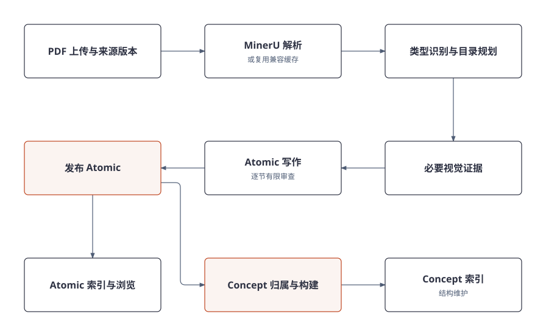
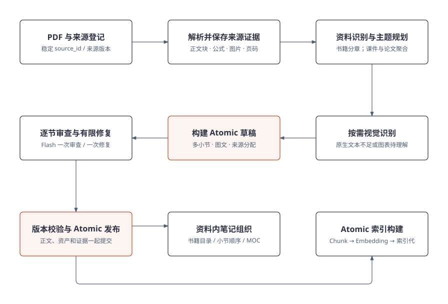
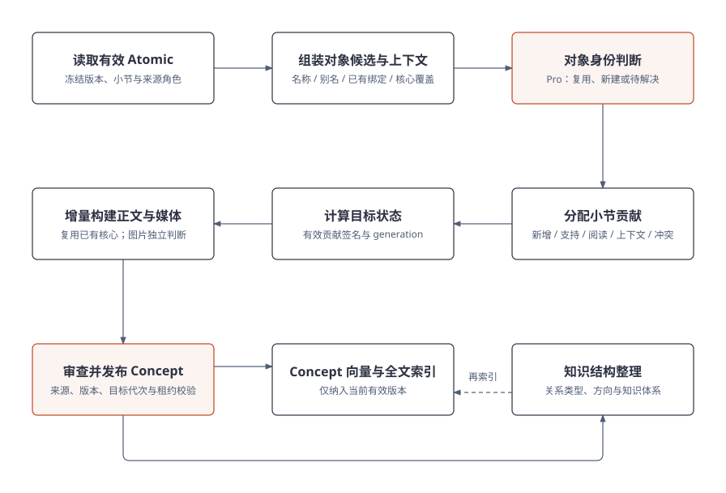
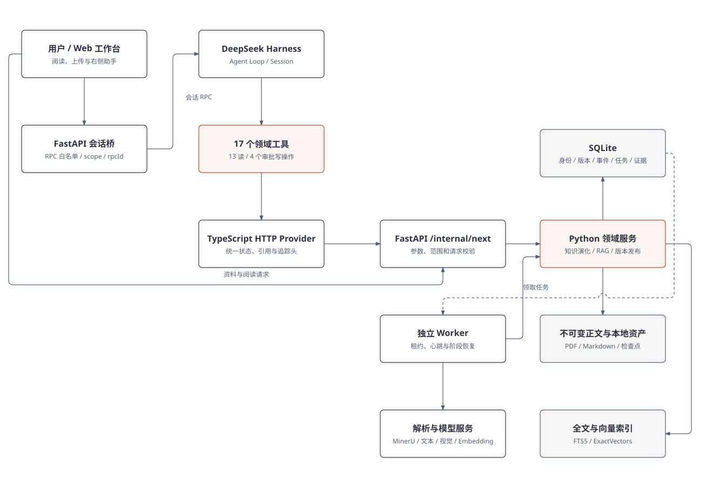
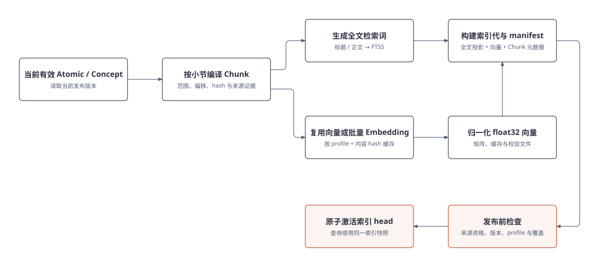
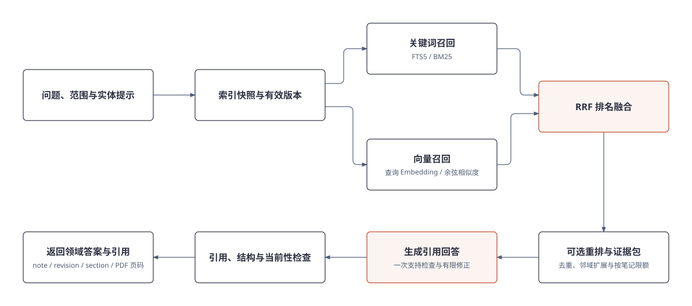
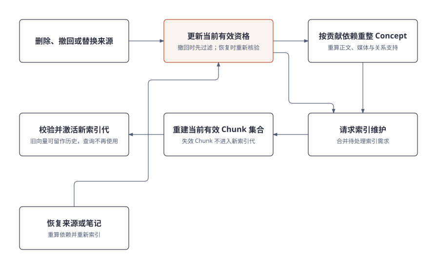

# Noodle Agent：项目介绍与实现说明

核对日期：2026-10-29。本文按当前源码说明业务流程、数据结构与 Agent 接入方式；运行结果引用已有验收记录，本次编写没有重新调用模型或执行知识生成。图中只保留流程节点与连线，解释放在正文中。

## 1. 开场

**基于 Deepseek Harness 开发的可溯源本地个人知识管理 Agent，重点解决多文档知识管理、知识持续演化和可靠问答问题。**

Noodle Agent 先将 PDF 教材、课件和论文整理成有来源、可独立阅读的 Atomic 笔记，再把不同资料对同一知识对象的描述归并成 Concept。用户可以阅读笔记、对照原文、浏览知识体系，也可以通过 Agent 查找知识、进行引用问答、修订小节和查询任务。

我主要实现了文档到知识的 Workflow、知识身份与贡献模型、版本和证据维护、检索与引用，以及任务恢复。在这些业务能力之上，使用 DeepSeek Harness 管理会话、模型与工具调用，通过领域工具连接 Python 服务。

这里的“本地”主要指知识、版本、资产和任务状态保存在本地。MinerU、文本模型、视觉模型和 Embedding 使用配置的外部服务，不是所有推理都在本机运行。

## 2. 项目背景

### 2.1 要解决的实际问题

学习同一个主题时，教材、课件和论文通常分别承担不同角色：教材建立基础框架，课件补充推导和例子，论文介绍方法、结构和实验。随着资料增加，会出现四个问题：

- **文档分散。** 相关内容存放在不同文件中，需要反复搜索和切换。
- **内容冗杂。** 封面、版权、导航、重复背景与实质内容混在一起，按页阅读和整理成本高。
- **不便浏览。** 原始 PDF 目录、跨页公式和图表不一定适合直接作为知识笔记阅读。
- **知识点重复。** 同一对象出现在多份资料里，既有重复说明，也有新推导和不同条件，难以判断该新建、补充还是保留冲突。

因此，项目目标是**支持长期知识整理和更新**。临时 PDF 问答可以采用更简单的解析、切片和检索流程；当资料持续积累、需要反复阅读并维护跨资料对象时，额外的知识层才体现价值。

### 2.2 最终形成的使用方式

用户先在工作台导入资料，系统后台生成可读笔记。Atomic 发布后即可阅读，索引就绪后可用于检索；Concept 归并和知识组织继续在后台推进。用户无需等待整套知识维护全部结束，才看到第一批结果。

后续加入新资料时，系统判断它支持哪些已有对象、是否存在正文增量、哪些图片值得保留。来源被修改或撤回时，再沿贡献依赖更新受影响内容。问答始终基于符合当前有效性条件的笔记，而不是无条件使用曾经生成或索引过的文本。

## 3. 知识演化

### 3.1 完整流程与三种内容粒度



主流程是：上传并登记来源版本，经解析、资料规划和必要视觉理解，生成与发布 Atomic。发布后的 Atomic 一方面进入索引和阅读工作台，另一方面参与 Concept 的对象归属、内容构建及结构维护。

这条流程包含三种不同粒度，不能把它们都理解为“切片”：

| 单元 | 定义 | 主要保存的内容 | 主要用途 |
| --- | --- | --- | --- |
| Atomic | 一份资料内围绕完整主题组织的综合笔记 | 稳定笔记 ID、当前修订、标题与摘要、多个 Section、公式和图片、小节来源证据 | 独立阅读、来源内修订、为 Concept 提供输入 |
| Concept | 跨资料长期维护的稳定知识对象 | 对象身份、别名和边界、内部主题、浓缩正文、Atomic 输入、贡献与关系 | 跨资料归并、增量演化、知识体系浏览 |
| Chunk | 已发布 Atomic 或 Concept 正文中的一个检索范围 | 笔记与修订 ID、小节 ID、起止偏移、文本 hash、证据和资产定位 | 精确召回、约束问答上下文、引用定位 |

Atomic 优化阅读完整性，Concept 优化跨资料对象维护，Chunk 优化检索粒度与上下文长度。Atomic 和 Concept 都可以生成多个 Chunk，原 PDF 与目录地图不是本条问答链路直接使用的事实语料。

以 SVM 为例：一份课件可以形成硬间隔、软间隔、核方法等综合 Atomic；教材里也有相关 Atomic。这些来源可以共同支持“支持向量机”这个 Concept，Concept 内再组织不同主题。检索时，系统从这两类笔记的当前版本中选择相关片段。

### 3.2 笔记生成：PDF → Atomic → 笔记组织与向量构建



图中资料内笔记组织和 Atomic 索引都依赖已发布笔记。它们是两项派生工作：**目录组织不是向量构建的前置条件**，也不要求两者在实际调度中始终同时执行。

#### Atomic 的定义与数据结构

Atomic 是可独立阅读的综合主题笔记，不固定对应一页 PDF，也不要求每个原文小标题都单独成篇。它通常由标题、摘要和多个 Section 构成，可以跨多页保留定义、条件、推导、公式、图片和实例。

实现上，稳定身份和内容版本分开保存：

| 数据 | 作用 |
| --- | --- |
| `note_id` | 标识同一篇笔记，修订后保持稳定 |
| `revision_id` | 标识一次不可变正文及其证据快照 |
| `section_id` 与正文偏移 | 定位可阅读、可编辑、可检索的小节 |
| 来源证据 | 将小节与来源版本、页码、原件 hash 关联 |
| 资产引用 | 保存图片等文件的引用、来源与校验信息 |
| 发布与审查记录 | 记录生成策略、必要检查、修复和警告 |

数据库维护身份、版本与关系；正文、PDF、图片和阶段产物存为本地文件。文件存在不代表当前版本有效，检索和发布仍要检查数据库中的状态。

#### 资料识别与规划构建

1. **登记来源。** 上传 PDF 后保存原件与来源版本，创建持久事件和生成任务。资料身份与具体版本分开，便于后续替换、撤回和恢复。
2. **解析与缓存校验。** MinerU 输出正文块、标题、公式、图片及页码等结构。兼容缓存可以复用，但要核对原件和解析配置，不能仅凭同名文件命中。
3. **识别资料类型。** 结合页面数量、横竖版比例、目录锚点、摘要与参考文献等信号，识别书籍、课件、论文或一般文章；也支持明确指定类型。容器仍是 PDF，资料类型决定组织视角。
4. **规划完整主题。** 书籍沿可信目录分章节批次，章内再组织综合主题；课件聚合同一知识对象的连续内容，避免一页一篇；论文围绕方法、架构、实验与边界归纳，避免沿每个原文标题机械拆分。
5. **组织局部证据。** 为写作单元分配相关来源块、必要页图和相邻上下文，记录排除项。版权和导航可排除，实质引言、关键实验或附录不能因为位置靠前或靠后就被丢弃。
6. **生成结构化草稿。** 模型输出标题、摘要、小节正文及来源分配，程序校验结构、内容归属和资源引用，再进入审查与发布。

新真实任务使用 `source-sections-v1` 生成路径、`entity-v2` Concept 布局和冻结的任务 profile。历史任务恢复时沿用原 profile，不能因为启动配置变化就混用新策略。

#### 模型选用

当前默认 `planning-pro` 路由按操作分配模型，而不是整条流水线只选一个模型：

| 操作 | 默认分工 | 原因 |
| --- | --- | --- |
| 文档主规划、排除项规划审查、标题组织 | Pro | 前期边界错误会放大后续生成和审查成本 |
| Atomic 常规写作 | Flash | 已有明确来源、主题和结构约束，属于高频操作 |
| Section 审查与定向修复 | Flash | 只检查当前小节和实际来源，减少重复上下文 |
| 必要的局部格式恢复 | 最多一次 Pro 恢复 | 解决局部格式或结构问题，不把整篇反复升级 |
| 图表和页图理解 | 配置的视觉模型，按需使用 | 补足解析文本无法表达的视觉证据 |
| 向量构建 | 配置的 Embedding 模型 | 将检索文本转换成匹配 profile 的向量 |

Pro/Flash 是项目路由角色，实际模型以运行配置和调用回执为准。Python 工作流路由与 DSH 外层对话模型配置相互独立。

#### 审查策略

当前 Section 审查采用“一次 Flash 审查，有意见则一次 Flash 修复”的有限流程。输入包含当前小节、相关来源与必要上下文；相邻段落和其他小节标题用于理解，不应被当成当前小节缺失正文而误报。

修复后不再循环做第二次语义复审，随后完成必要的结构、引用和资产检查。局部格式失败可以进入一次有界 Pro 恢复。审查服务异常会记录不可用与警告，不把没有得到审查结果伪装为审查通过。

这是一项质量、成本和可用性的取舍。它减少误报造成的无限修复，但可能保留事实错误，需要抽查、后续修订和独立质量评测。空白、损坏结构或坏资源引用不能被当作正常成功结果。

#### 视觉识别与内容组织视角

视觉模型主要处理图表、结构图、扫描内容以及解析文本不完整的页面。原生文本已经足够且没有缺失图像证据时，可以跳过重复视觉识别；缓存复用还需匹配来源、页图 hash、模型、提示策略和上下文。

系统区分两类图像：整页截图可以用于理解页面，但不一定适合作为正文配图；真正发布的图片需要是可用图表或必要区域，并登记来源、资产路径和 hash。模型说“使用这张图”以后，编译和发布阶段还要落实实际引用，不能只保留一个选图回执。

资料类型也决定内容视角：教材突出知识框架和条件，课件突出连贯主题与推导，论文突出问题、方法、实验和限制。视觉理解和主题规划共同服务笔记组织，不能靠 OCR 文字长度决定重要性。

#### 前端显示

工作台提供资料列表、书籍目录或文章目录、Atomic 正文、公式和图片，以及原 PDF 阅读与页码定位。原资料目录是导航结构，不等于为每一个目录项创建一篇 Atomic。

前端分别显示笔记发布、语义索引和后台知识维护状态。笔记已生成不代表已索引，已索引也不代表 Concept 和全库结构维护全部完成。来源内目录与阅读地图可由已发布笔记生成，不作为事实证据参与回答。

### 3.3 知识点构建：Concept 归并、向量构建与结构整理



Concept 发布后触发索引和结构维护；结构整理如果形成新修订，也会再次请求索引更新。图中的“再索引”表示这种依赖，不是要求先完成一次向量化才能判断所有关系。

#### 归并流程

Concept 的核心是把四个问题分开：

| 概念 | 回答的问题 | SVM 示例 |
| --- | --- | --- |
| 对象身份 | 这是哪个稳定知识对象？ | 支持向量机 |
| 内部主题 | 这个对象内部讲哪些内容？ | 硬间隔、软间隔、核技巧 |
| 内容贡献 | 新来源需要改变什么？ | 增加推导，或只增加支持 |
| 证据 | 为什么可以作出这项判断？ | 某 Atomic 的小节、版本与 PDF 页码 |

具体流程是：读取当前有效 Atomic 并冻结版本；带入来源角色、同章主题和已确认绑定；从 Concept 目录中构造有界候选；由 Pro 判断复用、新建或待解决；再把各小节和片段分配给目标对象。

候选上下文包含名称、别名、身份边界、内部主题和实际核心覆盖。目录较大时按已有绑定、名称和词项相关性压缩。当前主批量归属路径不是简单复用问答的向量检索；存在身份向量检索实现，也不能据此说每批都调用 Embedding。

判断时要区分“同一对象”“内部变体”“使用关系”和“不同对象”。逻辑回归使用伯努利分布，不意味着伯努利分布属于逻辑回归这个对象；SVM 的软硬间隔则通常可以作为内部主题组织。目标是减少同对象重复，同时保留不同方法的边界。

#### 内容更新方案

| 贡献类型 | 对内容的影响 |
| --- | --- |
| `CORE_DELTA` | 有净新增知识，更新相应主题 |
| `SUPPORT_ONLY` | 增加支持来源，尽量复用已有正文 |
| `FURTHER_READING` | 增加深入阅读关联，不扩写全部细节 |
| `CONTEXT_ONLY` | 提供判断上下文，不直接进入核心正文 |
| `CONFLICT` | 保存条件差异或争议，不作为已确认事实直接覆盖 |

系统根据当前有效贡献计算输入签名和目标 generation。签名不变时避免重复维护；需要更新时，尽量保留已经充分支持的核心内容，只构建受影响主题。图片有独立贡献逻辑：新资料可能没有文字增量，却提供了更清晰的架构图。

教材作为基础来源、论文和课件作为补充来源，是默认组织策略，不是判断科学真假的规则。新来源也不会仅因为时间更新就覆盖旧来源。来源冲突应保存具体条件和证据，受控处理；作者修订还需要保留作者属性与保护规则。

来源修订、删除或撤回后，系统沿贡献依赖重新计算有效支持。撤回一份课件，不应直接删掉仍有教材支持的整个 SVM Concept。发布时再次核对来源、版本、目标代次与租约，防止基于旧输入完成的结果覆盖当前状态。

#### 结构整理方案

结构整理处理对象之间如何组织和浏览，包括主题父子、方法使用、相关对象、比较关系和方法变体。它不应为了让图更连通，就把普通提及或使用关系强行变成目录父子关系。

现有实现包含有界组织提案与关系维护：读取当前对象、已有关系和 Atomic 支持，判断哪些关系保留、移除或替换，校验端点、方向、证据归属和覆盖，再以版本化方式提交。对于已有边，结构维护可以逐边返回 `KEEP`、`REMOVE` 或 `REPLACE`，不借此重写知识正文或凭空创建新知识。

需要区别三层信息：

- Concept ID 是稳定对象身份。
- 树中的父路径和知识体系归属是阅读投影，可以有多个入口。
- 语义关系与来源支持各自有不同含义，不能因为显示在同一个图中就混为一谈。

一个对象可以出现在多个体系中，不需要复制多份正文。结构修订与用户维护的结构也要区分，不能无条件覆盖用户选择。当前图主要服务导航与维护，主问答仍是混合检索，不将其称为已实现 GraphRAG。

## 4. Agent 框架

### 4.1 完整项目架构



系统分为用户工作台、DSH 对话运行时和 Python 业务执行三部分：

| 层 | 职责 |
| --- | --- |
| Web 工作台 | 资料管理、阅读、问答范围、历史会话、审批与引用展示 |
| FastAPI 会话桥 | 将右侧助手请求接入 DSH 原生会话协议，执行 RPC 白名单、范围约束与请求去重 |
| DeepSeek Harness | 组装上下文，调用外层模型，运行工具，管理会话、审批与压缩 |
| 领域工具与 Provider | 定义模型可用能力，统一 HTTP、状态、引用、超时、取消与追踪信息 |
| FastAPI 与领域服务 | 校验业务请求，执行知识演化、RAG、版本比较和发布 |
| Worker | 领取持久任务，处理生成、归并、索引和检查点恢复 |
| SQLite 与本地文件 | 保存权威身份、版本、证据与任务，以及正文、原件和资产 |
| 全文与向量索引 | 保存可重建的检索投影，不另行充当正文权威源 |

图中 Worker 连接了解析与模型服务；在线 RAG 也会调用查询 Embedding、重排及回答模型，DSH 则有独立的外层模型请求。这些调用分别由对应层管理，不是一套共享的隐式模型状态。

**当前右侧助手已经接入 DSH 会话桥。** 资料与阅读操作仍直接访问知识 API；对话请求走 DSH，再由领域工具调用回答或其他业务服务。会话桥只适配协议与约束范围，没有第二套 Python Agent Loop。独立 DSH 工作台使用相同的领域工具。

### 4.2 DeepSeek Harness 的使用与选用原因

项目通过 `@noodle/agent` 插件接入 Harness。Cordis 插件装配 HTTP Provider、工具模块、领域系统提示和工作区；知识助手 Preset 配置角色、压缩与工具结果剪枝。工具依赖 `ctx.tools` 和 `ctx.noodle`，不直接操作数据库。

选用 Harness 主要出于以下考虑：

1. 已有会话、模型与工具交替运行的机制，可以把精力放在知识业务上。
2. 插件与服务注入便于拆开工具契约、HTTP 传输和 Python 领域逻辑。
3. 审批、取消、历史、压缩与客户端工具展示有可复用入口，不需要从头维护整套对话运行时。
4. 关键业务状态仍放在自己的服务中，框架接入可以变化，来源、版本和发布规则保持独立。

这不是对其他框架性能的全面比较，也不表示项目重写了通用 Agent 推理循环。

### 4.3 当前工具清单

当前源码注册 **17 个业务工具：13 个读取类工具，4 个需要审批的状态修改工具**。answer 属于读取知识的业务，但会生成回答产物和模型调用日志。

| 工具 | 作用 | 关键输入 |
| --- | --- | --- |
| `noodle_answer_knowledge` | 完整 RAG 问答并返回领域答案与引用 | 问题、范围、检索模式、实体提示 |
| `noodle_search_knowledge` | 定位相关当前笔记 | 查询、范围、检索模式 |
| `noodle_get_atomic_note` | 读取 Atomic 目录或指定小节 | `note_id`，可选 `section_id` |
| `noodle_list_concepts` | 查找当前 Concept 身份与摘要 | 查询词、数量 |
| `noodle_get_concept` | 读取 Concept 目录、小节及支持笔记 | `concept_id`，可选 `section_id` |
| `noodle_get_readiness` | 查询实际配置、模式与索引就绪状态 | 无 |
| `noodle_list_knowledge` | 分页发现笔记与导航对象 | 类型、查询、来源版本、偏移 |
| `noodle_list_sources` | 发现资料 ID、名称和当前来源版本 | 查询、偏移 |
| `noodle_list_tasks` | 查找已有生成任务 | 来源 ID、状态 |
| `noodle_get_source_status` | 查看笔记、索引与后台维护状态 | `source_revision_id` |
| `noodle_get_task` | 查看持久任务时间线、用量与暂停状态 | `job_id` |
| `noodle_get_relations` | 查看有上限的周边关系 | `note_id` |
| `noodle_list_knowledge_roots` | 查看知识体系入口 | 无 |
| `noodle_edit_section` | 审批后发布作者小节修订 | 笔记、基准版本、小节和新正文 |
| `noodle_refresh_knowledge_map` | 审批后刷新派生地图 | 无 |
| `noodle_pause_task` | 审批后暂停明确选择的已有任务 | `job_id` |
| `noodle_resume_task` | 审批后从已有任务检查点恢复 | `job_id` |

所有工具现在通过统一 Provider 访问领域 API，传递会话、工具调用和用户 RPC 的关联信息。参数由 Schema 约束，输出保留领域 JSON 与关键状态、引用字段；这不等于所有返回字段都有完整细分的静态类型。

### 4.4 DSH 可以完成什么

用户可以用自然语言提问并要求来源、限定某份资料、查找笔记、读取某节、浏览知识关系、查询生成进度、诊断检索就绪状态，以及发起受审批的编辑、地图刷新或任务暂停恢复。

例如：“暂停这份课件的生成任务”，可以先发现来源，再找任务、核对状态，最后调用暂停工具并等待审批。模型不能把来源版本 ID 当成笔记 ID，也不能猜测一个任务 ID。

目前对话工具没有开放上传本地 PDF、启动任意新生成、删除恢复资料、全库重建、任意文件或 SQL 操作。相应工作台按钮或后端接口存在，不代表自然语言工具已经开放。

### 4.5 记忆管理与工具设计

会话、知识和任务状态分别保存：

| 状态 | 保存方式 | 使用原则 |
| --- | --- | --- |
| 对话历史 | DSH 持久 Session 事件 | 刷新后恢复历史；旧答案不是新问题的事实依据 |
| 当前模型上下文 | 近期消息、摘要、领域策略和工具定义 | 在上下文压力下剪枝与压缩 |
| 范围与实体提示 | 当前 scope、实体 ID 和 RPC 上下文 | 协助指代消解；服务端仍约束范围 |
| 长期知识 | Atomic、Concept、版本和证据 | 通过工具检索当前有效内容 |
| 工作流状态 | 事件、Job、租约、检查点和回执 | 支持状态报告、暂停与恢复 |

Preset 的工具结果剪枝阈值为 8192 字符，保留头部 4096、尾部 1024；它是上下文压力处理中的配置，不是每次输出都立即截断，也不是 Token 上限。读取工具还采用目录先行、按小节读取，降低重复正文进入后续对话的成本。

工具粒度按用户任务设计。answer 已经包含检索，普通问答默认只调用一次，返回后通过 `exec.concludeTurn()` 结束回合，减少外层模型再次改写事实。只有用户明确要求回答后继续做其他动作时，才允许在 READY 后继续；非 READY 状态仍应停止本轮问答。

四个修改工具在 `tools/pre-execute` 阶段触发审批。审批确认用户意图，服务端继续检查版本和对象状态；例如目标小节已变更时返回冲突，不能因为用户同意修改，就覆盖读取之后的新内容。

## 5. 检索与溯源

### 5.1 向量如何构建



向量从当前有效笔记构建，不直接把所有原 PDF 文本无限追加进一个向量集合。

1. **筛选有效版本。** 笔记必须处于有效发布状态；Atomic 的来源和 Concept 的输入支持都要符合当前资格。
2. **按小节编译 Chunk。** Chunk 是不可变 Markdown 的正文范围，记录修订、小节、起止偏移、hash、来源页码和资产。当前策略以约 400 Token 为切分目标，短小节在约 600 Token 内可整体保留，小尾块在条件允许时合并；不是固定设置 100 Token 的重复重叠。
3. **生成检索文本。** Embedding 输入包含笔记标题、小节标题与正文；全文路线生成适合 FTS5 的检索词。
4. **复用兼容向量。** 缓存键绑定 Embedding profile 与内容 hash，未命中部分批量请求模型。当前实现每批处理最多 20 条缺失向量。
5. **归一化与落盘。** 校验返回数量和维度，将向量归一化，保存 float32 矩阵、逐内容缓存、manifest 和校验文件。
6. **激活索引代。** 在事务中核对本次输入仍有效、索引头未被并发替换、租约等条件，再将新索引代切换为当前 head。

最近正式部署记录使用 `text-embedding-v4`、1024 维和本地 `ExactVectors`；归一化后以 NumPy 点积排序。代码也有 Chroma 适配，但不能据此说正式环境已部署独立 Chroma 数据库。配置和维度不同的向量空间不能混用。

### 5.2 RAG 混合检索



请求先确定范围，再读取匹配配置的索引快照，并过滤当前无效版本。

- `GLOBAL`：当前有效 Atomic 与 Concept。
- `SOURCE`：明确来源下的 Atomic，避免跨来源 Concept 带入其他资料。
- `NOTES`：指定笔记集合内的有效内容。

HYBRID 同时使用两条召回路线。关键词路线通过 FTS5/BM25 匹配标题和正文，包含中文双字词组、英文、数字与部分公式符号处理；向量路线计算问题向量，在相同范围白名单中执行相似度检索。

融合使用 RRF 的排名，而不是直接相加 BM25 与余弦分数：

```text
score(chunk) = Σ 1 / (60 + rank_in_lane)
```

之后按配置重排，再做相邻范围扩展、重叠合并和单笔记片段限额，形成有界证据包。默认代码中每路召回上限为 50，重排候选为 10，回答正文上下文约 4000 Token；这些是可配置边界，不是每次实际消耗。

重排支持关闭、自动和必需模式。AUTO 故障可以保留同一批 RRF 候选并记录降级；REQUIRED 故障应返回失败。检索配置不可用不能被解释为“知识库没有内容”，更不应让 Agent 自动翻遍全库作为替代回答路径。

### 5.3 回答与原文查找

Answerer 根据证据生成带 `citation_ids` 的结构化 claims，执行一次支持检查，有可修复问题时定向修正，再校验引用身份、必要格式和当前版本。严重支持不足可以返回 `COVERAGE_GAP`；查询期间内容变化则返回 `CONTENT_CHANGED`。

引用链包含：

```text
request_id + citation_id
    → note_id + revision_id + section_id
    → start_offset / end_offset + 文本 hash
    → evidence_ids
    → source_revision_id + 原文件 hash + PDF 页码
```

用户可以从引用打开笔记对应位置，再按保存的来源关系定位原 PDF。页码来自证据记录，不让模型凭空编页码；Concept 的引用可以关联多个来源。完整查询、回答和审查产物保存在本地，外层模型只拿到完成当前任务所需的精简结果。

当前不少证据还是小节级绑定，因此可定位不等于每个生成句子都已经逐句核实。需要严格限定原资料时，应明确使用 SOURCE，并单独检查引用是否真正支持结论。

### 5.4 DSH 怎样调用回答

右侧助手提交问题时携带范围和稳定 RPC 身份，会话桥校验并保存上下文，再进入 DSH。Agent 选择 `noodle_answer_knowledge`；统一 Provider 调用 `/internal/next/answer`，保留 `status`、`request_id`、答案正文和引用身份。

普通问答的路径为：

```text
右侧助手 / 独立 DSH
    → DSH Agent 选择 answer 工具
    → TypeScript Provider
    → FastAPI RAG 服务
    → 检索、回答、检查与当前性校验
    → 领域答案与引用卡，结束普通回合
```

服务端再次约束实际范围，不只依赖模型遵守提示。`entity_note_ids` 用于解释“它”等指代，不允许扩大 SOURCE 或 NOTES 的证据范围。配置或供应商故障在工具层保留明确状态，阻止继续枚举笔记作为无约束回退。

最近验收已有正式 HYBRID READY、SVM 问答、追问、论文来源限定和无证据拒答记录；但 READY 只表示可以返回结果，不保证答案完全正确。页码上下文修复后的真实 UI 复验和完整引用点击矩阵等仍需收尾。

## 6. 任务可靠

### 6.1 笔记删除与对应向量处理



删除或撤回首先改变来源与笔记的当前有效资格，再根据贡献依赖重整 Concept，合并请求并维护索引。新的索引代只包含当前有效 Chunk，激活后查询不再使用失效片段。

因此，“删除对应向量”需要区分逻辑失效和物理清理：

- **逻辑失效立即约束查询。** 即使旧矩阵或缓存文件仍存在，查询资格和返回前检查也不能允许它作为当前证据。
- **索引维护移出当前集合。** 不要求每删一篇笔记就立刻逐条物理删除缓存，而是构建和激活不含失效 Chunk 的当前索引代。
- **保留必要历史。** 历史正文、索引或向量缓存可以支持审计、回滚和恢复；物理清理是独立存储策略。
- **恢复重新核验。** 恢复来源或笔记后重新计算有效支持与索引，兼容缓存可复用，不盲目恢复过期关系。

### 6.2 Worker 与持久任务

上传、发布、来源变化等业务行为写入事件，事件按类型派发成 Job。生成 Worker 处理 PDF 到 Atomic；维护 Worker 处理归属、Concept 构建、索引和结构整理。任务不依赖浏览器或某一轮聊天持续存活。

同一事件与任务种类控制重复派发，索引维护还会合并待处理需求。暂停和恢复针对已有任务执行，不通过重新创建一份完整生成任务来“恢复”。

### 6.3 租约与幂等

Worker 领取任务时获得带 token 的限时租约，通过心跳维持所有权。租约过期后可以由新 Worker 接手；旧 Worker 即使迟到返回，也不能用旧租约继续提交。

幂等分为三个层次：任务层避免同一事件反复创建同类 Job；执行层复用相同输入下的有效阶段产物；发布层通过租约、版本、输入签名和目标 generation 拒绝过期结果。

这些机制不等于远端调用严格 exactly-once。如果供应商已经生成，但回执在本地落盘前丢失，重试仍可能重复调用与计费。系统控制的是有限重试、可追踪恢复和合法发布。

### 6.4 阶段恢复

阶段产物与输入、策略和 hash 绑定并保存检查点。解析完成、草稿已落盘后 Worker 崩溃，新 Worker 接手时先校验冻结 profile 与产物兼容性，再从缺失阶段继续。

```text
Worker A：领取租约 → 解析检查点 → 草稿检查点 → 崩溃
Worker B：新租约 → 校验输入与产物 → 继续未完成阶段 → 当前状态校验 → 发布
Worker A：恢复后迟到提交 → 旧租约拒绝
```

暂停在安全边界生效，在途远端请求可能继续；取消 DSH 本轮回答也不等于暂停后台生成。前端需要分别报告聊天、生成、索引和知识维护状态。

## 7. 成本优化

### 7.1 并行减少等待

独立任务、小节级审查和检索双路召回使用有界并发；Atomic 发布后的检索准备与后台 Concept 维护可以独立推进。并发受供应商限额、共享索引保护和提交一致性约束，不是无限增加线程。

并行主要降低等待和端到端延迟，不天然降低 Token。并发调用服务耗时之和也不等于用户实际等待时间，不能把各阶段耗时直接相加当作整条流水线耗时。

### 7.2 按错误影响范围选择模型

规划和对象身份错误会影响大量后续步骤，因此默认保留 Pro；高频写作、审查、修复和普通 RAG 回答主要用 Flash；必要格式问题局部升级。视觉和 Embedding 使用专门能力，按需调用。

实际路由以统一 cost policy 和调用回执为准，不根据某个局部 `use_pro_model=True` 就断言使用了 Pro，也不把 DSH 外层模型用量当作整套 Python 工作流账单。

### 7.3 约束输入输出，减少重复工作

| 优化动作 | 减少的重复 |
| --- | --- |
| 综合主题规划 | 过度拆分 Atomic 带来的重复上下文与审查 |
| 局部证据包 | 每次发送整份 PDF 或整章正文 |
| 有界候选目录与批量归属 | 每篇 Atomic 单独重复读取全库候选 |
| 支持贡献与正文增量分开 | 内容已覆盖时仍重写 Concept |
| 解析、视觉、Chunk 和向量缓存 | 输入与策略兼容时重复计算 |
| 检查点和目标任务合并 | 失败从头重跑、同一对象频繁重复维护 |
| 结构化输出与有限修复 | 冗长审查解释、无边界的多轮模型循环 |
| 工具目录先行、按节读取 | 全篇正文反复进入外层对话上下文 |
| answer 返回后结束普通回合 | 重复检索、外层二次改写与证据丢失 |

约束用于明确当前任务所需信息，不应通过吞掉必要来源或隐藏失败来降低数字。超大候选被筛掉时，仍需要评测是否损害召回或新增覆盖。

### 7.4 已有结果的统计口径

历史四份固定 PDF 的文本 LLM 调用从 185 次降到 125 次，Token 从 996,515 降到 592,536，减少约 40.5%。这说明相应历史流程减少了重复模型工作，不等于当前任意 PDF 都有相同收益，也不等于全链路费用降低 40.5%。

该历史对比没有完成独立盲式质量 A/B，缓存、重试和等待条件也未完全控制。后续优化需要固定输入、模型、缓存和并发条件，同时观察内容质量、Token、延迟和失败恢复情况。

## 8. 问题与扩展

### 8.1 知识质量仍有优化空间

结构合法、审查通过、引用存在和回答 READY 是不同层次的条件，都不能单独证明科学内容完全正确。近期样例仍存在条件遗漏、过度推断、图文覆盖和公式表述需要核查的情况；小节级证据也不总能为每一句回答提供最小粒度证明。

后续先建立覆盖教材、课件和论文的独立标注集，分别检查主题与公式覆盖、关键图片保留、引用支持、证据不足拒答、范围泄漏和来源失效。检索比较关键词、向量、RRF 与重排，避免用回归测试数量代替问答准确率。

### 8.2 合并规则仍需持续调整

当前规则已经区分对象身份、内部主题与贡献，但仍可能发生同一对象重复创建、不同方法错误合并、净新增遗漏，以及使用关系被误判成父子关系。名称差异较大时，词项候选筛选也可能漏掉相关对象；导入顺序对结果的影响尚未充分量化。

改进方向包括标注“同对象 / 不同对象 / 使用关系 / 变体”，测重复率和错合并率；对核心覆盖和新增遗漏做消融；补充来源冲突与顺序变化测试；必要时再引入身份向量召回，验证收益后调整规则，而不是只追求更少的 Concept 数量。

### 8.3 后续扩展到视频与音频

音视频笔记识别是后续探索，当前没有完成接入或验收。

- **音频输入：** 语音识别、分段和时间戳，必要时区分说话人，并核查专业术语。
- **视频输入：** 结合音轨、字幕、关键帧和画面文字，将讲解与对应图表或幻灯片对齐。
- **来源证据：** 从 PDF 页码扩展到时间区间与关键帧，笔记和回答可以回到原始片段。
- **知识维护：** 复用 Atomic、Concept、版本和贡献流程，保留不同模态的来源身份、修订与撤回依赖。
- **评估与恢复：** 用小样本比较识别质量、定位准确性、成本和长任务恢复，再决定扩大接入范围。

新增输入不应掩盖现有知识质量与合并规则的问题。优先把当前内容、证据和评测做好，再让更多资料类型进入同一套可维护流程。

## 实现与验收依据

| 内容 | 主要实现或记录 |
| --- | --- |
| 资料识别与生成 | [material_profiles.py](../services/noodle/src/noodle_agent/next/material_profiles.py)、[assembly_generation.py](../services/noodle/src/noodle_agent/next/assembly_generation.py)、[section_review.py](../services/noodle/src/noodle_agent/next/section_review.py) |
| 归属、增量与结构 | [entity_routing.py](../services/noodle/src/noodle_agent/next/concepts/entity_routing.py)、[coordinator.py](../services/noodle/src/noodle_agent/next/concepts/coordinator.py)、[builder.py](../services/noodle/src/noodle_agent/next/concepts/builder.py)、[structure_maintenance.py](../services/noodle/src/noodle_agent/next/concepts/structure_maintenance.py)、[organization.py](../services/noodle/src/noodle_agent/next/organization.py) |
| DSH 与工具 | [index.ts](../src/index.ts)、[read-tools.ts](../src/read-tools.ts)、[next-tools.ts](../src/next-tools.ts)、[http-provider.ts](../src/http-provider.ts)、[tool-contract.ts](../src/tool-contract.ts)、[Preset](../config/agent-presets/noodle-knowledge/agent.cordis.yml) |
| 切片、索引与问答 | [chunks.py](../services/noodle/src/noodle_agent/next/retrieval/chunks.py)、[indexing.py](../services/noodle/src/noodle_agent/next/retrieval/indexing.py)、[search.py](../services/noodle/src/noodle_agent/next/retrieval/search.py)、[answering.py](../services/noodle/src/noodle_agent/next/retrieval/answering.py) |
| 任务与模型策略 | [events.py](../services/noodle/src/noodle_agent/next/events.py)、[jobs.py](../services/noodle/src/noodle_agent/next/jobs.py)、[checkpoints.py](../services/noodle/src/noodle_agent/next/checkpoints.py)、[cost_policy.py](../services/noodle/src/noodle_agent/next/cost_policy.py) |
| 当前 Agent 说明与验收 | [2026-10-29 DSH 与 RAG 详解](AGENT-AND-RAG.md)、[DSH 实施与验收报告](DEVELOPMENT-LOG.md#2026-10-28) |
| 知识生命周期与历史成本 | [Concept 正式验收](DEVELOPMENT-LOG.md#2026-10-28)、[项目介绍原始材料](DEVELOPMENT-LOG.md#2026-10-28) |

本文流程图同时保留同名 HTML、SVG 与可编辑 Mermaid 源文件，位于 [图示目录说明](project-introduction-assets-2026-10-29/README.md)。复杂架构图保留关键组件，省略模型请求返回、完整日志和每一条底层存储读写连线；相关职责在正文分别说明。
