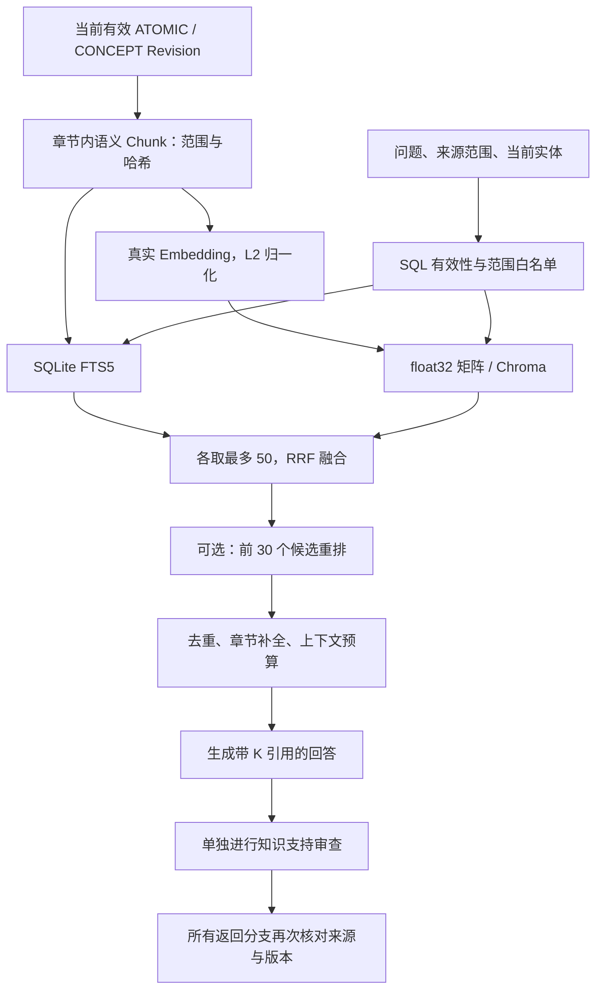

# RAG 实现、重排选型与实际验证

更新：2026-10-21。对应 `next-v1` 后端。默认日常工作台尚未切换到新系统，本页的配置用于显式 `next-*` 入口与 `/internal/next` API。

## 结论

- 当前可用的默认组合是：SQLite 事实存储与 FTS + float32 精确向量 + RRF。Chroma 是可选向量检索后端。
- 当前 rerank 是调用 DeepSeek 的 listwise LLM 重排，不是已经部署了 BGE、Qwen 专用 reranker 或 Cross-Encoder。
- 本轮 34 个问题测试中，重排改善了首位相关性，同时增加秒级延迟。适合精读、推导、条件区分和演示；日常快速检索可以先关闭。
- 本地 Chroma 不需要云 API Key。当前 Embedding 与 LLM 重排/回答所需的 DashScope、DeepSeek 配置已存在，本轮均已真实调用。
- 工程回归通过，真实问答行为通过；科学内容的逐条准确性仍需要独立复核。

## 从正文到回答的数据流



### 语料和分块

只索引当前有效的原子笔记和 Concept。原 PDF、解析原文、MOC 与聊天历史不参与事实召回。PDF 页码只用于追溯，不能补入笔记正文缺失的知识。

Chunk 默认约 400 个 `cl100k_base` token，保存父 Revision、章节、字符范围、正文哈希和来源定位。代码、表格、展示公式与邻近解释尽量保持整体。单个语义块超过预算则停止，不静默截断。token 计量是预算工具，不是 DeepSeek 的原生 tokenizer。

### 召回与融合

关键词采用 FTS5 BM25，中文投影为字/二元词。向量使用模型生成的归一化 float32；一次查询产生一个问题向量。两路并行，各取最多 50 个候选，使用排名融合：

`RRF(chunk) = Σ 1 / (60 + rank_in_lane)`

这里融合的是各路名次，避免把 BM25 和 cosine 当成同一种量直接相加。RRF 是排名融合，不等同于重新理解问题和片段的语义重排。

来源与版本过滤发生在候选检索前，返回前再次核对。限定单个来源时只允许该来源的 ATOMIC，不混入跨来源 Concept。

### 当前如何重排

代码位于 `next/retrieval/answering.py` 的 `ModelReranker`，调用位于 `next/retrieval/search.py`。

1. 从 RRF 排序中取前 30 个候选。
2. 读取候选的知识正文与必要定位，发送问题和全部候选给当前 DeepSeek 快速模型。
3. 模型返回全部 `chunk_id` 的新顺序。
4. 校验数量、重复、未知和遗漏 ID；不完整则带明确反馈修正，最多三次结构/语义检查尝试。
5. 合法顺序替换前 30 个候选的次序，其余候选保留原顺序。
6. 最后才做章节补全、同范围去重、每篇最多 3 段与约 6,000 token 上下文预算；预算计入片段及来源元数据。

这是 **listwise**：让模型共同比较一组候选。通常一次请求完成；有界修正可能增加请求数。它只调整已有候选，不能找回未召回内容，也不能提升未送入前 30 的候选位置。

响应中的 `score` 仍是 RRF 分数，不是重排模型的置信度；重排后的列表可能不按这个数值递减。重排也不证明笔记本身正确，来源检查和回答支持审查仍独立执行。

### Chroma 的位置

本项目先生成向量，再把向量和 Chunk ID 写入 Chroma，未启用 Chroma 默认 EmbeddingFunction。原正文继续存放在不可变 Markdown，SQLite 继续判定当前版本及来源资格。

每个索引代次对应一个 Chroma collection。构建完成后才激活 SQL 指针；同一代的向量数量不完整会拒绝检索。检索按允许 ID 分批过滤并合并结果，避免先取全库前几条再过滤造成范围内漏召回。

Chroma 提供可独立运行的向量检索服务。它不会自动修正分块、Embedding 或来源资格，也不保证比小矩阵的本地点积更快。官方支持 [HTTP client/server](https://docs.trychroma.com/docs/run-chroma/client-server) 和 [只保存向量与外部记录 ID](https://docs.trychroma.com/docs/collections/add-data)。

## 本轮测试设计

使用隔离目录复用 22 篇已生成原子笔记，以及此前已生成的 2 个 Concept，共 **24 篇知识页、128 个 Chunk**。没有重新解析 PDF、重写原子笔记或启动 Concept 生成维护。

这些知识来自一份神经网络课件，独立来源家族是 1。本轮验证的是课程内检索和排序，不能据此证明跨课程、跨文档或企业规模效果。

### 样本与指标

- 34 个检索问题：覆盖感知机、XOR、激活、梯度、卷积、池化、RNN、自编码器、GAN、Transformer 等；包含 6 个中英转述和 1 个 Concept-only 查询。
- 相关性标签区分“指定主笔记”和“可接受的 Concept / 补充笔记”。明确记录少量多目标判断，避免把合法 Concept 命中误判为错误。
- 指标按去重后的知识页 ID 计算，不把同一笔记的多个 Chunk 当成多篇命中。
- Hit@1：第一篇是否可接受；Primary Hit@1：第一篇是否为指定主笔记；Hit@3：前三篇是否至少有一篇可接受；另计算 Recall、MRR 和 nDCG。
- 标签是本项目人工编写的稀疏判断，未进行独立盲评，且大量问题直接围绕章节内容。结果不能包装成通用榜单成绩。

对照组包括关键词、混合 exact、混合 Chroma，以及两种后端分别开启真实 DeepSeek 重排。

为控制变量，各组共享同一批真实 DashScope 问题向量，并提前预热。**下表耗时不包含在线 Embedding 网络请求与回答生成**，当前产品的查询流程没有启用这种评测专用的问题向量缓存。重排耗时则包含实际模型网络调用。

### 修正后结果

| 组合 | 可接受 Hit@1 | 指定主笔记 Hit@1 | Hit@3 | MRR@5 | nDCG@5 | 中位耗时 |
| --- | ---: | ---: | ---: | ---: | ---: | ---: |
| 关键词 | 88.2% | 85.3% | 94.1% | 0.912 | 0.910 | 89 ms |
| 混合 exact | 91.2% | 88.2% | 100% | 0.951 | 0.958 | 156 ms |
| 混合 Chroma | 91.2% | 88.2% | 100% | 0.951 | 0.958 | 176 ms |
| 混合 exact + LLM 重排 | 100% | 94.1% | 100% | 1.000 | 0.989 | 3.32 s |
| 混合 Chroma + LLM 重排 | 100% | 94.1% | 100% | 1.000 | 0.989 | 2.88 s |

两次重排的时间差受模型网络和生成波动影响，不能解释为 Chroma 加速了模型推理。第一篇全可接受也不代表答案全正确；指定主笔记仍只有 32/34 排在第一，另两例首先返回了相关 Concept 或补充知识页。

同一问题向量下，Chroma 对 exact 的邻居 Recall@50 在本语料为 **1.0**。另外有 1,500 条随机 float32 向量的分批过滤回归，用来验证超过 1,000 个允许 ID 时的合并、范围约束及近邻一致性；它使用合成向量，不是大规模真实语义质量证明。

### 代表案例

- “把一张图的所有像素接到每个隐藏单元，为什么容易学过头？”：关键词优先返回特征可视化，混合检索将全连接图像参数与过拟合笔记提到首位。
- “隐藏层的误差信号如何通过下一层权重反向传递？”：混合检索首位偏向数值算例；重排将算法推导笔记提到首位。
- “How is a hidden state updated over time with shared parameters?”：混合检索前三篇含 RNN，但首位是卷积；重排将 RNN 提到首位。
- 步长/零填充问题：重排有时先返回“正则化与卷积层维度计算”，而不是指定的特征图笔记。前者确有维度公式，因此“可接受”和“指定主笔记”分开统计。

### 回答与拒答

四个可答问题均返回带引用的 READY；教师手机号、FlashAttention-3 硬件优化、Dijkstra 堆优化和注意力高斯核完整推导四个无覆盖问题均返回 COVERAGE_GAP。

检索阶段可能返回主题相关却不足以回答的材料。因此 READY 检索状态、相似度较高或重排第一名都不能替代回答支持检查。

抽查还发现原 RNN 笔记将“时间展开单元”称作“层”，回答继承了这一容易混淆的措辞。该项记录为生成内容待复核，没有重写现有笔记，也没有将四个 READY 结果宣称为科学准确性金标通过。rerank 无法纠正来源正文错误。

## 测试发现与修复

| 问题 | 修复与验证 |
| --- | --- |
| 拒答或审查失败期间来源失效，旧命中正文仍可能返回 | 对所有回答出口统一做来源和版本检查，失效时清空回答、命中与引用；两条独立回归复现并修复 |
| LLM 只返回相关项或重复候选，导致重排失败 | 完整 ID 排列校验进入同一个三次有界修正循环；加入明确的遗漏/重复反馈 |
| 原评测仅检查命中指定 Atomic，合法 Concept 被误判 | 保留主笔记指标，另增加可接受知识页和分级 nDCG，不通过删掉困难样本提升分数 |

修复前第一轮，exact 重排有 2/34 个请求、Chroma 重排有 3/34 个请求因排列不完整而失败；修复后这两组均 34/34 READY。原始失败报告保留在私有目录，未覆盖。

本轮新增 19 个工程测试；Python 全量 243 通过，0 失败/错误/跳过，TypeScript 15 通过，类型检查、构建和 Ruff 均通过。Windows 上执行，Linux/macOS 的本地实机验证仍未完成。

新增工程回归还覆盖 RRF 排名融合、重排在 top_k 之前生效、重排不能救回漏召回、原文不进入关键词语料、错误维度/零向量/NaN/Inf 拒绝、上下文预算和去重、CLI 策略传递及评测指标本身。

## 何时开启

### Embedding 与混合检索

希望支持同义表达、英文问题或跨词汇检索时开启 HYBRID。只做关键词排障或未配向量服务时，显式使用 KEYWORD_ONLY，不伪造语义向量。

### Chroma

当前 128 个 Chunk 的本地点积很快，继续使用 exact 更简单。资料规模、并发或独立服务需求增长后，先测向量检索阶段是否成为瓶颈，再与 Chroma 对照。开启前要求质量不下降、来源过滤和故障恢复通过，同时评估部署及索引维护成本，不按固定文档数盲目切换。

### Rerank

- 日常快速查找：HYBRID + OFF，减少网络和模型成本。
- 条件相近、推导细节、跨术语问题或较正式的回答：可开启重排。
- 日常允许继续使用 RRF：AUTO，失败会返回明确降级标记。
- 验收或希望确保实际运行重排：REQUIRED，失败明确返回错误。

当前尚未实现基于“问题难度”的自动触发。AUTO 表示“已配置就尝试、失败可降级”，不是系统已经判断问题是否复杂。

## 配置与 API

| 能力 | 需要什么 | 是否需要新增密钥 |
| --- | --- | --- |
| FTS 关键词检索 | 本地 SQLite | 不需要 |
| exact / Chroma 的语义检索 | Embedding 模型和兼容接口 | 当前已有 DashScope 配置 |
| 当前 LLM 重排 | DeepSeek / 兼容聊天模型 | 复用当前 LLM Key |
| 生成回答和支持审查 | 同上；是分开的模型调用 | 复用当前 LLM Key |
| 本地 Chroma | 安装包、本地服务地址与数据目录 | 不需要云 Key |
| 以后接入专用云 rerank | 对应模型权限、地域端点及适配器 | 百炼可能复用现有 Key；其他厂商通常需其 Key |
| 新 PDF 入库 | MinerU；图片识别视配置使用视觉服务 | 这属于 P2，已有笔记的检索不调用它们 |

密钥留在本机 `.env`，无需在聊天中提供。当前对话和向量模型分别配置，不把聊天模型名填入 Embedding 设置。

以下为配置示意，不会自动修改当前 `.env`：

```dotenv
NOODLE_LLM=deepseek
DEEPSEEK_API_KEY=<your-key>
DEEPSEEK_BASE_URL=https://api.deepseek.com
DEEPSEEK_FAST_MODEL=deepseek-flash

DASHSCOPE_API_KEY=<your-key>
EMBEDDING_BASE_URL=https://dashscope.aliyuncs.com/compatible-mode/v1
EMBEDDING_MODEL=text-embedding-v4
EMBEDDING_DIMENSIONS=1024

NOODLE_NEXT_VECTOR_BACKEND=exact
NOODLE_NEXT_RETRIEVAL_MODE=HYBRID
NOODLE_NEXT_RERANK=off
```

本轮请求名沿用当前 `deepseek-v4-flash`。官方现建议 `deepseek-flash`，旧名称仍可接受并由服务方映射，因此配置名不是固定模型权重版本的证明。参见 [DeepSeek 接口说明](https://api-docs.deepseek.com/)。百炼 Key、端点与可用模型须匹配地域，参见 [API Key 文档](https://help.aliyun.com/zh/model-studio/get-api-key) 与 [Embedding 文档](https://help.aliyun.com/zh/model-studio/embedding)。

### 启用与逐请求控制

重排器在查询进程或 API 初始化时创建。将 `.env` 的 `NOODLE_NEXT_RERANK` 设为 `on` 后，需要重启对应查询/API/Harness 进程；只改维护器环境不会让已经运行的查询 API 自动更新。

| 全局配置 | 请求 OFF | 请求 AUTO | 请求 REQUIRED |
| --- | --- | --- | --- |
| off | 直接使用 RRF | 直接使用 RRF | PROVIDER_ERROR |
| on，模型可用 | 跳过重排 | 尝试重排，失败报告降级 | 重排失败则报错 |

CLI 已支持单次选择：

```powershell
python -m noodle_agent.cli next-search --data-dir ./data/noodle-next --query "隐藏层梯度如何反向传播？" --rerank OFF
python -m noodle_agent.cli next-search --data-dir ./data/noodle-next --query "隐藏层梯度如何反向传播？" --rerank REQUIRED
python -m noodle_agent.cli next-ask --data-dir ./data/noodle-next --query "隐藏层梯度如何反向传播？" --rerank AUTO
```

API 对应 JSON 中的 `rerank`。默认请求值是 AUTO。

### 开启本地 Chroma

```powershell
python -m pip install -e "./services/noodle[vector]"
chroma run --path ./data/noodle-next-chroma --host 127.0.0.1 --port 8001
```

另一个终端配置 `NOODLE_NEXT_VECTOR_BACKEND=chroma`、`NOODLE_CHROMA_HOST=127.0.0.1`、`NOODLE_CHROMA_PORT=8001`，先执行 `next-index`，再启动使用同一配置的 `next-api --port 8002`。切换后端需要建立对应代次；只有安装包或开启重排，不需要重做笔记。

切换 Embedding 模型或维度则需要重建向量索引，不能混用旧 profile。现有普通工作台仍使用旧接口；完整新 UI 属于 P5。

## 可借鉴的重排路线

### 专用相关性模型

Cross-Encoder 将问题和候选一起送入模型，计算相关性；召回仍使用可预计算的向量。适合作为第二阶段，避免对全库逐条运行较昂贵的联合编码。参考 [Sentence Transformers Retrieve & Re-Rank](https://www.sbert.net/examples/sentence_transformer/applications/retrieve_rerank/README.html)。

本地可评测 [BAAI/bge-reranker-v2-m3](https://huggingface.co/BAAI/bge-reranker-v2-m3)；云端可评测 [百炼文本排序](https://help.aliyun.com/zh/model-studio/text-rerank-api) 或 [Cohere Rerank](https://docs.cohere.com/docs/reranking-with-cohere)。不同专用模型可以采用不同 backbone；“专用模型”与“本地/API 部署”是两个维度。

该路线通常直接返回候选索引和分数，减少让通用聊天模型生成完整 ID 排列的负担。实际吞吐、中文公式能力和成本仍须在本项目样本上验证。分数不一定是概率，不同模型的阈值不能直接通用。

### LLM 排序

- Pointwise：逐候选评分，便于并行，但要控制评分尺度和请求数。
- Pairwise：比较两个候选谁更相关；需要多次比较，注意顺序不一致与成本。
- Listwise：同时排序一组候选；当前实现属于此类，需控制上下文、位置偏差和输出排列。

现有方案便于复用 DeepSeek，适合先验证复杂中文问题的排序价值。若要控制日常延迟，可以保留它作为高质量路径，同时增加专用适配器。

### Late interaction

[ColBERT](https://github.com/stanford-futuredata/ColBERT) 保留 token 级表示并做后期交互，可用于检索或二次排序，代价是更多向量、存储和系统复杂度。它需要额外索引设计，不是给当前 Chroma 开一个选项就能得到。

### 本项目建议

保留现有范围、版本和证据检查，沿 `rank(query, passages)` 增加可替换的 `llm / dashscope / local-cross-encoder` 适配器；对同一批 Chunk 和标注比较 Hit、MRR/nDCG、拒答、p50/p95 与费用。

优先尝试现有百炼账户可用的专用排序服务，或本地 BGE 作为对照；不要仅凭更换模型名称宣称已经接入。当前代码只有 LLM 重排适配器，没有专用 rerank endpoint，也没有自动读取 `RERANK_API_KEY`。接入新服务需要新增适配代码，并验证返回索引、未知/重复候选、超时和降级策略。

## 复测与产物

通用脚本：`scripts/evaluate-next-rag.py`。输入现有 next 数据与显式相关性标签，不生成笔记、不运行维护器；建议在隔离语料副本上运行。付费模型调用仍会发生。

```powershell
python scripts/evaluate-next-rag.py --data-dir ./data/rag-evaluation --cases ./private-cases.json --output ./.local-only/rag-results --chroma --chroma-port 8001 --rerank --rerank-both --qa
```

标签文件包含 `retrieval` 和可选 `answers`。每个检索项具有 `id`、`query`、`relevance`（Note ID 到非负等级的映射）和可选 `filters`；最高等级代表主目标。回答项具有 `id`、`query`、`answerable` 和可选 `filters`。

脚本输出逐问题结果、引用、分阶段耗时和汇总；复用已生效索引与真实问题向量，不以测试向量替代语义服务。报告含正文和问题，保存在忽略目录。

本机结果位于 `.local-only/rag-evaluation-2026-10-21/`：`results/` 保留首次问题，`results-v2/` 保存修复后对照；另有来源清单、代码指纹和测试 XML。工程测试使用显式 fixture，真实数据测试单独记录。该目录不上传。
