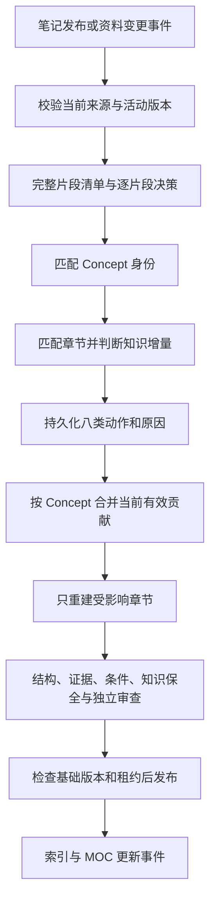

# P3：Concept 的构建、局部更新与来源同步

日期：2026-10-21。状态：**设计完成，尚未实现**。基于现有 `next-v1` 数据库、P2 原子笔记和统一发布器；本文不描述旧系统已经具备这些能力。

配套：[总体方案](../NEXT-SYSTEM-DESIGN.md)、[实际实施记录](../IMPLEMENTATION-STATUS.md)、[P4 检索设计](./P4-KNOWLEDGE-RAG.md)、[计划 Schema](../schemas/planned-concept-update.schema.json)。Schema 为设计合同，不是当前 API。

## 目标和边界

Concept 是围绕一个稳定主题、由语义章节组成的知识页。每章回答一个明确子问题，正文由模型综合当前有效的原子笔记片段生成。原子笔记提供证据，Concept 负责跨资料组织，MOC 负责导航。

保留 P2 的解析、原子笔记、Markdown、证据、版本和检查点；不再次读取 PDF 来补写 Concept，不将旧 Concept 或聊天回答当作事实来源。单来源可以创建有独立组织价值的 Concept，但不为每篇原子笔记复制一个同义页面。

本阶段实现后台维护和最小只读接口，不建设完整地图编辑器、Obsidian 回流或新版工作台；这些属于 P5。P3 内部的身份匹配先用目录和轻量关键词筛选，避免反过来依赖尚未实现的 P4。

## 当前代码能做什么，还缺什么

| 位置 | 已实现 | P3 增量 |
| --- | --- | --- |
| `next/content.py` | 当前版本、来源有效性、Concept 的 ATOMIC 输入检查 | 批量有效性接口、失效原因、维护状态 |
| `next/publication.py` | 候选哈希、章节证据、输入、人工保护、CAS 与租约 | 精确选段、未变章节校验、贡献计划与发布绑定 |
| `next/contracts.py` | Candidate / Section / Input / Review | 片段与更新计划合同；既有正文合同继续使用 |
| `next/jobs.py` / `checkpoints.py` | 事件扇出、租约、有界重试、阶段恢复 | 集中事件路由、归并协调、同一 Concept 的构建代次 |
| `concept_inputs` | 已发布 Concept Revision 的输入快照 | 待处理贡献和不改正文动作的持久记录 |

现有 Input 只能指定原子笔记章节，不能说明章节里哪一段被采用；现有 `concept_inputs` 只记录已发布结果，无法证明所有新片段均被分析。两个缺口都要补齐，不能仅增加一条模型提示词。

## 处理流程



事件是重新核对状态的信号，不是要求按到达顺序重放旧事实。积压的旧版本事件若已被新版本取代，记录过期原因，并协调当前有效输入。

## 片段范围与处理覆盖

片段来自原子笔记的稳定章节。普通短章作为一个片段；长章按段落或完整公式组拆分，公式、变量定义、条件与紧邻解释不能断开。首次建议以 600 个模型 token 为目标预算，超过预算先保全完整语义组，再分批分析；无法完整处理就停止并报告。

每个片段冻结 `atomic_revision_id、section_id、正文起止偏移、UTF-8 内容哈希、evidence_ids`。偏移统一使用 Python Unicode 码点索引；前端若用 UTF-16，需要转换。摘要只用于找候选，不能替代实际输入。

分析清单必须覆盖全部重要正文和教学图注。每个片段恰有一个主要归属决策；若同一片段确实支持多个主题，先明确多个不重叠选择范围或显式记录重复使用理由，不能机械复制整章到所有主题。

任务只有在全部片段已得到明确结果后才能完成。模型失败、漏项或待人工判断时保留 REVIEW，已完成片段不重算。INSUFFICIENT 是有理由的分析结果，不等于片段已经贡献了知识。所有接受的贡献必须已发布，或已可靠交接给独立构建任务；不得丢在进程内队列。

## 判断 Concept 和章节

按顺序判断三个问题：

1. 是否是同一研究对象、同一领域和相容的 scope？名称或向量相似只能给出候选。
2. 是否回答已有章节的同一个子问题？只改写措辞不构成新章节。
3. 是否增加了事实、必要条件、解释、推导、限制、短例或独立证据？

身份候选由领域、规范名、别名、核心问题和 scope 共同筛选。记录检索范围、目录代次和候选清单；候选没找全时扩大范围或待复核，不能把“搜索为空”当成创建资格。

新 Concept 必须能用一句话说明其独立问题；与现有身份不等价，证据足够，正文组织有价值。创建前做第二次身份去重检查，并在发布事务中占用规范化身份键。身份键不是“全库标题唯一”；跨领域的同名术语可以存在。模型给出的不同键仍可能语义重复，因此歧义进入待复核，不宣称数据库唯一约束能解决全部同义问题。

P2 当前领域多为 `general`。P3 可在片段分析中提出领域建议，但不能擅自将整篇笔记改名或迁移领域；Concept 的领域和 scope 经身份审查确认。

## 八类动作

| 动作 | 条件 | 正文和版本处理 |
| --- | --- | --- |
| NO_CHANGE | 重复事件、已处理片段、输入关系也未变化 | 记录原因，不发布新 Revision |
| ADD_EVIDENCE | 新有效支持没有新增知识 | 不调用 Writer；生成输入清单更新的 Revision，正文复用 |
| UPDATE_SECTION | 同一子问题有实质增量 | 综合该章节的当前有效输入，发布新整页 Revision |
| CREATE_SECTION | 同主题内出现独立新问题 | 先检查与旧章节不重复，再插入合理位置 |
| LINK_ONLY | 相关主题或独立长案例 | 发布有依据的链接，不吞并长篇正文 |
| CREATE_CONCEPT | 新的独立主题且无等价身份 | 初建章节和输入，再提交导航建议 |
| CONFLICT | 同条件下有无法可靠解释的矛盾 | 保留双方证据，进入复核；不按资料新旧裁决 |
| INSUFFICIENT | 范围、内容或来源不足 | 留下原因，不发布猜测性内容 |

新原子笔记 Revision 即使正文相同，也会使旧 Revision 的贡献失效。需要把输入引用替换为新 Revision，并经验证发布元数据版本；不能用 NO_CHANGE 留住对旧版本的依赖。相同 PDF 的副本按文件哈希归为同一证据族，不能增加独立支持数。

## 最小数据增量

继续使用 `notes、note_revisions、sections、section_evidence、concept_inputs、links、events、jobs、build_artifacts`。不新增另一套可编辑章节正文或“章节版本发布器”。

| 增量 | 建议字段及职责 |
| --- | --- |
| `contribution_decisions` | 原子 Revision、片段引用/哈希、决策政策、目标 Concept/section、动作、理由、接受状态、计划 artifact、应用 Revision；唯一键覆盖输入与政策，支持逐片段恢复 |
| `concept_work_state` | Concept ID、desired_generation、completed_generation、desired_input_hash、状态；描述待维护目标，不保存正文 |
| `concept_identity_claims` | 领域、身份键、Concept ID、审查 artifact；唯一约束协调并发创建，别名仍可歧义 |
| `concept_inputs` 增量 | 保存精确片段引用；已发布快照仍是事实来源依赖的权威记录 |

`contribution_decisions` 中接受的目标绑定形成期望输入集合；`concept_inputs` 是某次正式发布实际采用的集合。前者不是第二份正文，也不能仅因已接受就提前让检索使用未发布内容。旧原子 Revision 的决策保留用于审计，计算期望集合时通过当前有效性过滤。

Input 计划增加 `fragments` 字段，包含来源章节、起止偏移和选段哈希。现有 `section_ids` 可由片段归纳；Publisher 必须核对范围、哈希、章节证据及引用关系。完整章节选择也要编译为明确范围。新增迁移通过现有 Alembic 增量完成，不改写 `next_0001` 或历史 JSON Schema。

目标身份、基础版本、generation 和输入哈希由应用冻结，模型只提出操作和理由；模型不能通过填写这些字段获得发布权限。

更新计划示例：

```json
{
  "contract_version": "planned-p3-v1",
  "concept_id": "concept_backprop",
  "base_revision_id": "concept_r3",
  "generation": 4,
  "publication": "PUBLISH",
  "remove_section_ids": [],
  "input_snapshot_sha256": "本次有效输入清单的SHA256",
  "operations": [{
    "action": "UPDATE_SECTION",
    "target_section_id": "hidden_delta",
    "fragment_ids": ["fragment_chain_rule"],
    "reason": "补充下一层权重来自局部导数的解释",
    "must_preserve": ["已有误差项公式", "激活函数和损失的适用条件"]
  }]
}
```

这是字段示意；可直接校验的完整示例见设计目录的 examples。Schema 校验只能确认结构，不能证明片段支持结论。

八类动作描述输入分析。来源移除后的构建效果另由应用编译为 `remove_section_ids` 或 `publication=WITHDRAW`，不让模型虚构一个新来源来表达删除。自动无支持撤回只改变内容资格和维护状态；人工隐藏的 Note 不能被自动恢复。

## 章节构建和质量检查

按 Concept 合并同批贡献，冻结有效输入清单。Writer 只接收目标章节计划、真实选段、必要条件与旧正文参考；旧正文不提供已删除来源的替代证据。

未变章节由应用复制，校验章节正文哈希和稳定 section_id。变更章节检查必须保留的有效知识、公式条件、符号、单位、数值、图片角色与冲突。图片沿用 P2 的原图和页码证据，不重新猜测孤立裁切图。跨章节依赖如符号定义、概述或链接需要显式列为受影响章节，不能顺手改全文。

来源过多时按子问题分批综合，记录每批已读片段及哈希，再综合带支持引用的中间结论；每个接受片段都要有去向。未进入上下文的内容不能标记“已经综合”。无法在预算内保全支持时进入 REVIEW。

可以在构建 artifact 内保存关键结论及其支持片段、条件和必须保留项，辅助检查独有事实是否丢失，不新增可编辑的“事实数据库”。模型 Judge 是检查手段，不是正确性证明；重要公式和数值案例继续保留人工抽查。

新增证据只改变输入时，重用 Markdown 字节；新 Revision 仍需当前输入检查和审核报告。发布时复核 Concept 基础 Revision、原子 Revision、来源、政策、期望输入哈希、构建代次及租约。任意条件过期，候选只能保存为历史构建结果，不能覆盖活动指针。

## 事件、合并与并发

必须先修复一个基础边界：目前各 Worker 可以带自身 routes 调用 dispatch。增加 P3/P4 后，若多个消费者分别抢同一 NOTE_PUBLISHED 事件，第一个会将其置为 DISPATCHED，其他消费者可能永远收不到。

P3 改为**单一完整路由表**，在同一事务内为所有消费者创建任务；Worker 只领取自己的任务。路由按数据库中的真实 kind 判断，不能只信事件 payload。

| 事件 | 计划任务 |
| --- | --- |
| SOURCE_ADDED | GENERATE_ATOMICS |
| SOURCE_REPLACED | GENERATE_ATOMICS + RECONCILE_DEPENDENCIES；P4 再加入索引可见性同步 |
| ATOMIC 的 NOTE_PUBLISHED | ANALYZE_ATOMIC；P4 再加入 INDEX_NOTE |
| CONCEPT 的 NOTE_PUBLISHED | P4 的 INDEX_NOTE，以及 P5 的地图建议；不再次输入 Concept 分析 |
| SOURCE_DELETED / SOURCE_RESTORED / NOTE_INVALIDATED / NOTE_WITHDRAWN / NOTE_RESTORED | RECONCILE_DEPENDENCIES；P4 再加入索引可见性同步 |

一个 ANALYZE_ATOMIC 任务负责完整片段清单，片段阶段使用检查点恢复，不突破现有 `(event_id, kind)` 唯一约束。跨 Concept 的构建由单独的 CONCEPT_REBUILD_REQUESTED 事件可靠交接。

同一 Concept 通过 desired_generation 合并短时间的多条变更。旧代次构建可完成计算，但提交时必须比较 generation 和输入哈希；过期任务记录 SUPERSEDED 后结束，新的期望状态已有持久任务接手。不能依赖进程内锁保证跨进程一致性。

事件 COMPLETED 只表示它的任务已完成，不等于所有后续 Concept 都已发布。界面进度要沿 causation/trace 关联后续构建任务；存在 REVIEW 或未处理片段时不能显示“知识库更新完成”。接入新消费者时执行当前有效原子笔记的幂等 bootstrap，不能期待已经完成的历史事件自动重放。

## 修改、删除和回退

依赖链固定为 `SourceRevision → ATOMIC Revision → Concept Revision`。Concept 之间只能建立阅读或语义链接，不能互为事实输入；MOC 也不提供独立支持。

资料删除或替换事务立即推进有效性代次。当前 `valid_revision` 会沿来源和原子版本限制整个旧 Concept 的读取，P3 首版保留这个保守行为。后台依据反向输入只重建受影响章节；发布前不将“尚未证实安全的剩余正文”继续交给 RAG。

- 删除 A，B 仍能支持某章：重新核对 B，移除 A 的支持记录，复用正文或重写后发布。
- 删除唯一支持某结论的来源：删除该结论、章节或撤回 Concept；不能让旧文字成为自己的证据。
- 原子笔记修改：旧贡献立即失效，新增版本重新分析；新旧语义相同也要更新引用。
- 恢复来源：仅在原子活动版本、选择范围和政策相容时复用；同哈希副本不新增独立支持。
- 历史正文可复用时，优先以新 Revision 发布，并重新绑定当前输入，保留明确的历史来源；不是不加检查地切回旧指针。
- 人工保护章节仍受来源有效性约束。需要删除受保护内容时保留 REVIEW，旧失效版本继续对正常检索不可见。

## 一个完整案例

资料 A 的笔记解释隐藏层误差项，先建立“反向传播”，含“计算目标”和“误差传播”两章。资料 B 用不同措辞说明相同误差项：身份和章节匹配，通过条件检查后 ADD_EVIDENCE；正文不变，输入更新。

资料 C 解释下一层权重来自链式法则中的局部导数，属于同一主题下的新解释，可 UPDATE_SECTION；若解释较长且独立，则 CREATE_SECTION“下一层权重从哪里来”。数值练习作为单独原子笔记，用 LINK_ONLY 提供入口。

删除 C 后，“下一层权重”章节失去唯一支持，旧 Concept 立即停止正常检索。系统依据 A、B 重建剩余有效章节；如与历史正文及当前输入一致，可以复用历史正文并发布新版本。删除 A 后若 B 支持仍完整，只调整输入；A、B 都无效时不能继续保留无支持结论。

## 接口和代码落点

计划新增 `next/concepts/` 下的 `fragments、identity、decisions、coordinator、builder、checks`，复用现有 Publisher、JobQueue、Checkpoints。目录为实施建议，当前不存在这些实现。

最小只读接口建议为 `/internal/next/concepts`、`/internal/next/concepts/{id}`、`/internal/next/concepts/{id}/maintenance`，包含分页、活动版本、失效原因、章节支持和待复核状态。手动触发协调使用 expected_revision；模型不直接执行数据库写入。路由与 Agent 工具权限沿用现有规则。

MOC 更新只提交候选条目和确认关系；新 Concept 可先在全量知识库或“未归类”入口浏览，不因没有目录位置而丢失。手工 MOC 不自动搬动，自动 MOC 只在其声明范围内调整。

## 分步实现与验收

| 批次 | 实现 | 必须验证 |
| --- | --- | --- |
| P3-A | 精确片段、统一有效性、决策清单、集中路由及 bootstrap | 一个事件的全部消费者都创建；漏片段不完成；旧事件不复活旧版本 |
| P3-B | 身份与章节判断、八动作、并发创建 | 同义与异义、重复定义、新条件、新主题、长案例；创建竞争不丢输入 |
| P3-C | 局部综合、纯证据更新、保护与发布 | 未变章节字节一致；新增支持不调用 Writer；失败不覆盖有效旧版本 |
| P3-D | 删除/编辑/恢复、代次合并、历史复用 | 构建中删除、来源替换、乱序事件、崩溃和租约过期均不外泄失效知识 |

先使用独立的作者 ATOMIC fixture 验证多来源关系，再复用现有课件笔记做语义案例；需要第二份真实 PDF 时另行安排，不要求为本设计再执行全部 22 篇生成。

硬性门禁：片段处理覆盖率 100%；事件/输入幂等；失效知识正常读取泄漏为 0；未变章节哈希保持；纯补证据 Writer 调用为 0；并发与故障注入通过。身份与增量分类另建人工标注样本，报告分动作混淆矩阵、误建率和误更新率，不预先填“准确率已达标”。
