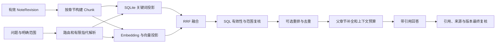

# P4：仅面向原子笔记与 Concept 的检索和问答

日期：2026-10-21。状态：**后端已实现并完成阶段验收**。依赖 P2 的内容与证据、P3 的统一有效性和事件路由。先用有效 ATOMIC 验证检索，再接入 Concept。

配套：[总体方案](../NEXT-SYSTEM-DESIGN.md)、[实际实施记录](../IMPLEMENTATION-STATUS.md)、[P3 设计](./P3-CONCEPT-MAINTENANCE.md)、[查询 Schema](../schemas/planned-rag-query.schema.json)、[回答 Schema](../schemas/planned-rag-response.schema.json)。Schema 和下述接口均为设计合同。

> 本文保留目标设计。当前实现见 [使用说明](../P3-P4-IMPLEMENTATION.md) 和 [验收记录](../P3-P4-ACCEPTANCE.md)；运行时 Schema 已另行导出，查询/回答缓存、全量质量基准等尚未实现。

## 先明确检索边界

只检索当前有效的 `ATOMIC` 和 `CONCEPT` 正文，包括其合法图注、公式解释和表格。原 PDF、解析块、原文 Markdown、MOC、系统规则、聊天历史不作为事实召回语料。

来源页码用于追溯，可以按已知证据 ID 打开原 PDF 核验，但不能通过核验工具追加笔记里没有的事实。PDF 有而笔记遗漏时明确提示覆盖不足，不能悄悄回退原文检索。

全库查询允许两类知识。限定某份 PDF 时，首版仅检索该来源有效 ATOMIC；不让包含该 PDF 一条引用的多来源 Concept 整页混入。需要 Concept 的受限查询明确返回范围限制，不静默扩大范围。

## 实施前的检索基础

旧 `application/retrieval.py` 对候选向量逐个解析 JSON、计算 cosine，再与关键词分数加权；Concept 在旧 synthesis 模块另行检索。P4 不将这套分数直接平移到新库。

`next-v1` 已有 `chunks、index_entries、embedding_profiles` 表和禁止 MOC Chunk 的约束，但没有真正的新 Chunk 构建器、全文索引、向量后端和问答链路。P4 要复用新模型，避免同时维护新旧事实索引。

## 整体数据流

图扩展默认关闭。比较、先修或关系题可以在确认链接上有界扩展候选，再回到目标知识页正文内检索；关系路径本身不作为事实证据。

## Chunk：从正文切，不从原文切

层级为 Note → Revision → Section → Chunk。Chunk 不保存第二份可编辑正文，用 Revision 的 Markdown 引用与范围恢复内容。

建议初始目标 400 token，普通块上限约 800 token，重叠最多 60 token；这些是待评测参数。按段落、列表项、完整公式组、代码围栏和表格边界切分，不机械每 N 个字符断开。公式、变量定义和成立条件尽量成组。超长表格先保持完整；超过模型输入上限则标记需处理，不能静默截断或丢掉表头。

每块保留父 Revision、section_id、标题路径、正文范围与哈希、顺序、邻接、资源和证据引用。检索用文本可加当前知识标题和章节标题；添加内容必须是确定性的知识元数据，不能拼入解析原文。

偏移使用 Unicode 码点索引，内容哈希使用原 Markdown 片段的 UTF-8 字节。公式归一化、别名或符号搜索文本只作派生字段，不能改写引用正文。

## 存储与必要迁移

| 数据 | 存放位置 | 权威性 |
| --- | --- | --- |
| 身份、活动版本、来源与输入、有效性代次 | SQLite | 决定内容能否读取 |
| 正文、冻结输入、构建报告 | 不可变 Markdown / JSON artifact | 可校验的内容快照 |
| Chunk 边界、证据与资源映射 | SQLite 元数据 | 可由正文和规则重建 |
| FTS、向量、缓存 | 派生投影 | 不能决定来源资格 |
| 查询快照与指标 | 本地 artifact / 轻量元数据 | 用于复现，不参与后续事实召回 |

现有 `index_entries` 的主键包含 `(chunk_id, profile_id, generation)`，可以保留多代次；不需要再创建相同意义的索引表。当前还缺代次清单与活动指针。

建议增量：

- `index_generations`：backend、语料清单哈希、分块/词法政策、状态、构建报告、时间及 embedding_profile_id；纯关键词代次允许最后一项为空，不创建假向量 profile。
- `index_heads`：corpus_id、非空 mode_key、backend 对应的活动代次，CAS 切换。mode_key 固定检索方式、词法政策和可选 embedding profile，避免 NULL 唯一约束歧义。查询范围在召回时过滤，不为每份 PDF 重建一份完整索引。
- `chunk_metadata` 或 chunks 增量列：token 数、顺序、资源与证据、结构化依赖。字段由正文确定性生成。
- `knowledge_fts`：generation、Chunk ID、标题/别名、关键词和正文搜索文本；查询必须绑定活动清单。纯关键词模式不依赖 index_entries 的向量记录。
- 查询/回答 artifact：问题哈希、范围、profile、generation、有效性代次、候选排名、上下文引用和检查结果。默认不重复保存完整聊天史。

通过现有 Alembic 添加迁移，不修改历史迁移。没有新索引时显式显示 INDEX_PENDING；不能把空库当成“问题没有答案”。

## Embedding 和向量后端

profile 固定提供方、模型、维度、归一化、输入文本政策及分块版本。检查向量长度、有限值、范数和模型身份。真实模型缺配置时语义模式失败；用户可显式使用 KEYWORD_ONLY，不自动替换为测试 HashEmbedding。

Embedding 缓存键为 `profile_id + embedding_input_sha256`。相同正文而 Revision 不同可以复用向量字节，但新 Chunk/Revision 的索引条目和来源资格仍要重新确认。

首版落实两个后端：

| 后端 | 具体定位 | 采用条件 |
| --- | --- | --- |
| 归一化 float32 精确搜索 | 必备基线；不可变二进制向量与代次矩阵，内存映射/缓存后批量点积 | 不逐请求解析 JSON，ID 映射与范围掩码可复现 |
| Chroma 本地服务 | 第一工程化候选；API/Worker 使用同一服务，显式提交向量 | 增删、过滤、重建、故障和同条件评测通过后才作默认 |
| FAISS | 可选实验；初期优先精确 Flat + 显式 ID 映射 | 自行处理元数据、删除、持久化和并发，不作为本次默认要求 |
| Milvus | 后续数据量和多进程并发扩大时再验证 | 有真实容量、延迟或部署需求支撑额外运维成本 |

这是项目选型，并非性能排名。Chroma 官方提供独立进程的服务与 HttpClient，以及 metadata 过滤；选择服务模式是为了集中索引拥有者。[服务模式](https://docs.trychroma.com/docs/run-chroma/client-server)、[过滤接口](https://docs.trychroma.com/docs/querying-collections/metadata-filtering)。

FAISS 的删除能力随索引类型变化，部分顺序索引删除会移动内部位置，因此不能用数组位置直接充当稳定业务 ID。[FAISS 索引操作](https://github.com/facebookresearch/faiss/wiki/Special-operations-on-indexes)。Milvus 提供多种一致性级别，但它们不覆盖本项目 SQLite 与向量服务之间的跨存储事务。[Milvus 一致性](https://milvus.io/docs/consistency.md)。

二进制向量基线可用 `.npy`/等价格式，禁用 pickle，读取时核对 dtype、shape 与哈希；持久化以原子清单切换，不在请求中重建矩阵。NumPy 与向量服务客户端依赖在实施时锁定和测试，本设计不虚构已采用版本。

统一 VectorStore 语义为 `upsert、delete、search、health、build_generation、activate_generation`。服务端每个 profile/generation 使用隔离 collection；SQL 有效性和范围检查始终保留。显式回退精确后端时必须同 profile、同语料清单，不能换模型后混合排名。

## 索引构建、删除与恢复

P3 的集中路由为每个 NOTE_PUBLISHED 创建 INDEX_NOTE 任务，按 kind 跳过 MOC。任务冻结 Revision、正文哈希、profile 和分块政策，依次构建 Chunk、词法投影、向量与检查报告。

新索引代次先完整构建和回读验证，再 CAS 激活；新内容可暂时 INDEX_PENDING，旧有效内容可以继续检索，但必须返回当前覆盖状态。活动代次落后时不能让旧 Revision 重新成为活动知识。

INDEX_NOTE 先登记索引需求，由单一索引协调者合并短时间事件再构建目标清单，不为每篇笔记各做一次全库重建。构建中到达的变更进入下一代需求；当前性仍由 SQL 安全屏障保证。

首版采用完整代次作为简单可靠基线，Embedding 字节可复用。若基准表明频繁重建代价过高，再增加不可变基础代次加小型增量层，由单写入者压实；不能一开始同时维护多种可变投影。

删除/编辑流程：

1. 来源或笔记变化在 SQLite 提交，推进有效性代次；当前知识资格立即改变。
2. 读取、缓存、检索和工具使用同一批量 EligibilityPolicy。物理向量尚未删除也不能放行失效内容。
3. 后台写新索引并清理旧投影，允许幂等重试；SQL 提交成功而向量服务失败时保持待同步状态。
4. 返回前再次核对来源与活动 Revision。有界补召回仍不足就返回明确状态，不使用原文兜底。

有效性需要区分代次切换与安全屏障：索引可异步变新，来源删除屏障必须立即生效。查询快照同时记录 index_generation 和 validity_epoch，两个值不能互相替代。

## 查询、融合与重排

1. **明确范围**：冻结 source_ids、note_ids、领域、允许类型和当前实体。显式用户范围优先，模型改写不能放宽。
2. **解析指代**：仅在必要时从会话提取实体，保留原问题；歧义影响范围时询问用户。历史回答不充当事实证据。
3. **双路召回**：关键词与向量并行，初始各取 50 个候选。两类正文共享一次原问题向量；查询变体另算调用预算。
4. **RRF 融合**：`score = Σ weight/(60+rank)` 作为初始参数；每一路先按 Chunk 去重。多个改写在本路合并再参与融合，不能靠重复列表放大权重。
5. **有效性复核**：批量检查 kind、当前头、来源、政策和明确范围。ANN 服务 metadata 过滤只是前置优化。
6. **可选精排**：在融合前 30 个左右候选上调用配置的 Reranker，保留前后排名与超时原因；默认是否开启由消融评测决定。故障可按策略退回同批 RRF 排名并标注，不换一批来源。
7. **去重与补全**：同页重叠 Chunk 合并；Concept 与其派生 ATOMIC 不当成两份独立证据。按问题缺口保留必要定义、条件、公式和对照，默认每页最多 3 块，可有理由放宽。
8. **上下文装配**：目标约 6,000 token，硬上限同时受回答模型约束。先保留必要语义组，不能为塞满数量切掉公式条件。父章节与邻接补全只来自允许范围中的当前两类知识，并重新计费和去重。

初始参数用于测试，不是已经调优的结论。相似度阈值需按模型和标注数据校准；不照搬旧 cosine 与关键词分数的加权阈值。

## 中文、术语和公式检索

默认 unicode61 不等于适合中文词语的分词。先将确定性的中文字符 n-gram、拉丁词项、双语别名及符号名称生成词法投影，和可选中文分词方案对照。短词、连续中文、反向传播/backpropagation、下标和公式编号都要有测试。

SQLite FTS5 提供不同 tokenizer 和 BM25；其能力不等于本项目的中文策略已经通过评测。[FTS5 官方说明](https://www.sqlite.org/fts5.html)。用户输入以受限词项构建 MATCH 表达式和绑定参数，不将任意搜索语法直接拼入 SQL。

原公式保持不变；搜索别名可以把 `learning rate` 与“学习率”关联，但不凭语言模型改写公式后作为新事实。

## 回答与引用

检索结果生成短引用 ID，例如 K1、K2，绑定精确 NoteRevision、section、Chunk、正文范围和哈希。Concept 引用同时展示其 ATOMIC 支持链和原 PDF 页码；独立来源计数按原文件哈希去重。

回答模型只得到已装配知识和问题，输出正文、引用及不足说明。应用校验引用 ID 存在、范围与版本有效；对关键结论额外记录支持片段，模型核对其支持关系。程序能验证引用结构与当前性，不能据此证明所有语义都正确。

回答结束前再次检查版本/来源。变化则丢弃该回答并最多重试一次，或返回 CONTENT_CHANGED。生成中途引用失效不能把旧答案当新答案继续发出。最后一次检查在同一 SQL 读取快照内完成，作为响应的有效性检查点；与答案无关的全局代次变化可在复核引用仍有效后继续。检查点之后发生的新变更属于下一次状态，已送达的历史答案应标记过期，不能承诺事后撤回网络上已发送的内容。首版默认缓冲完整回答完成校验后返回；若以后支持 token 流，需在界面标记未核验，并支持撤回失效草稿。

PDF 阅读器由引用精确定位证据，不能借机全文搜索追加答案。无资料、资料尚未整理、知识覆盖不足、索引待更新、来源变化、模型故障分别返回状态；这些状态不都写成“命中 0”。

## 上下文、缓存和工具

会话只保存会话意图、实体与可追溯引用。下一轮用引用重新读取当前知识，不复用上轮完整证据作为永久事实；摘要也受同样规则限制。

检索缓存键至少包含问题/路由、明确范围、允许类型、profile、generation、validity_epoch、关键词/重排政策。回答缓存还包含实际上下文哈希与回答模型/提示。命中缓存仍核对当前有效性。

计划只读接口为 `/internal/next/search` 与 `/internal/next/answer`；请求 Schema 不允许 RAW 或 MOC。返回检索诊断、覆盖状态、引用、用量与 timings，不只给一个混合分数。`/search` 额外返回 hits（原子/Concept 身份、正文片段、范围、各路排名和引用）；`/answer` 使用配套回答 Schema。示例中的固定哈希与 ID 为结构占位，不是真实检索结果。

复用 `src/read-tools.ts、src/http-provider.ts、src/contracts.ts` 的工具桥，明确新旧运行模式，只连接一套活动知识库。P4 工具只读，不赋予任意 SQL、文件遍历或直接改 Concept 的权限。写工具继续通过明确编辑、版本检查和现有审批机制。

## 可观测性和故障

记录 parse-free 的查询阶段时间：route、embedding、lexical、vector、SQL filter、rerank、pack、answer、final check。记录各路候选数、过滤原因、重复率、最终 ATOMIC/CONCEPT 篇数、Chunk 数、独立来源数和索引覆盖。

纯 Concept 命中时应显示“原子笔记 0，Concept N”，不能写成整体没有命中。API 故障、profile 不匹配、索引陈旧和真实零证据必须区分。指标默认不上传私人查询和正文。

服务不可用时仅执行已配置且可说明的回退；语义模式不静默换成关键词或测试向量。索引读取异常不影响 SQLite 正文和历史记录，重建投影后恢复。

## 验收与后端选择

先固定语料 Revision、问题、允许范围、人工标注的相关章节和正确引用。保留原有 7 个问答种子，但它们不是全部已通过的新 RAG 样本；还需补齐负例、跨资料、精确术语、公式、中文别名、删除和指代题。

| 批次 | 验证内容 | 门禁 |
| --- | --- | --- |
| P4-A | Chunk、范围、EligibilityPolicy、FTS 与精确向量基线 | 无 RAW/MOC；无静默截断；相同输入结果可复现 |
| P4-B | 双路召回、RRF、中文策略、去重与可选精排 | 报告 Recall@20、nDCG@10/MRR、范围正确率和派生重复率 |
| P4-C | 回答、引用、快照和工具桥 | 引用结构 100% 合法；删除或变更后不输出旧事实；覆盖不足不兜底原文 |
| P4-D | Chroma 与精确基线同条件对照 | 同模型/分块/语料/过滤；故障恢复、增删与代次切换通过 |

硬门禁：越界及失效语料泄漏为 0；真实模式混用 HashEmbedding 为 0；未配置回退为 0；索引覆盖可解释；故障后可重建。语义支持度使用独立人工样本，不能用同一个模型自评替代。

初始目标可设为正例 Recall@20 ≥ 0.90、ANN 相对精确基线的邻居 Recall@50 ≥ 0.98；这是待验证目标，不是验收结果。p50/p95 分阶段报告，注明硬件、冷暖缓存和规模；若初始小样本未达标，优先修复生成和分块，再调后端。

精排必须做开/关消融，说明质量提升与时延成本。Chroma 若无明确收益或部署负担过高，保留精确后端为默认仍属合格方案。FAISS、Milvus 不作为 P4 必须同时落地的三个实现。

公开评测只用合成或获准公开内容；私人课件结果留本地。P4 交付的是新只读检索/问答及最小集成，完整新版阅读、地图和 Vault 浏览留到 P5。
