# Noodle Agent 实践：从 PDF 笔记到可演化、可溯源的个人知识库

学习同一个主题时，我会交叉阅读教材、课件和论文。教材建立框架，课件补充推导，论文介绍方法与实验。资料越来越多，查找、整理和核对来源也越来越费时间：同一个概念重复出现，新资料有时只是换了一种表述，有时又补上了关键条件或推导。

我为此开发了 Noodle Agent：**基于 DeepSeek Harness 的可溯源本地个人知识管理 Agent，重点解决多文档知识管理、知识持续演化和可靠问答问题。**

项目将 PDF 整理成可独立阅读的 Atomic 笔记，再将跨资料的同一知识对象维护为 Concept。问答从这些笔记的当前有效版本中检索，引用可以继续追踪到来源版本与 PDF 页码。资料新增、修订或撤回后，内容支持、索引和阅读结构也会随之维护。

正文沿实现链路解释设计与取舍，也可以作为面试讲述的提纲：

| 章节 | 要讲清楚的问题 |
| --- | --- |
| 1. 项目定位 | 用户怎样使用，我主要实现了什么 |
| 2. 项目背景 | 多文档整理为什么需要持续维护 |
| 3. 知识演化 | PDF 怎样变成笔记，知识如何归并、更新与组织 |
| 4. Agent 框架 | Harness、领域工具与 Python 服务如何分工 |
| 5. 检索与溯源 | 向量怎样构建，混合检索怎样返回可查证的回答 |
| 6. 任务可靠 | 删除、中断、重复执行与并发更新怎样处理 |
| 7. 成本优化 | 哪些措施减少等待，哪些措施减少重复调用 |
| 8. 问题与扩展 | 当前质量边界是什么，后续怎样接入音视频 |

## 1. 项目定位：让资料积累成为可维护的知识

### 1.1 用户实际使用的流程

用户在 Web 工作台导入 PDF，后台完成解析、规划和笔记生成。Atomic 发布后即可阅读；索引就绪后进入检索；跨资料的 Concept 归并和结构维护继续推进。用户可以沿目录阅读主题，也可以从知识体系进入某个对象，查看它的相关知识与来源支持。

右侧助手承担自然语言入口。例如，用户可以要求“对比 SVM 的硬间隔与软间隔，并给出来源”，也可以查找某篇笔记、读取某节、查询生成进度，或发起需要审批的小节修订和任务暂停恢复。

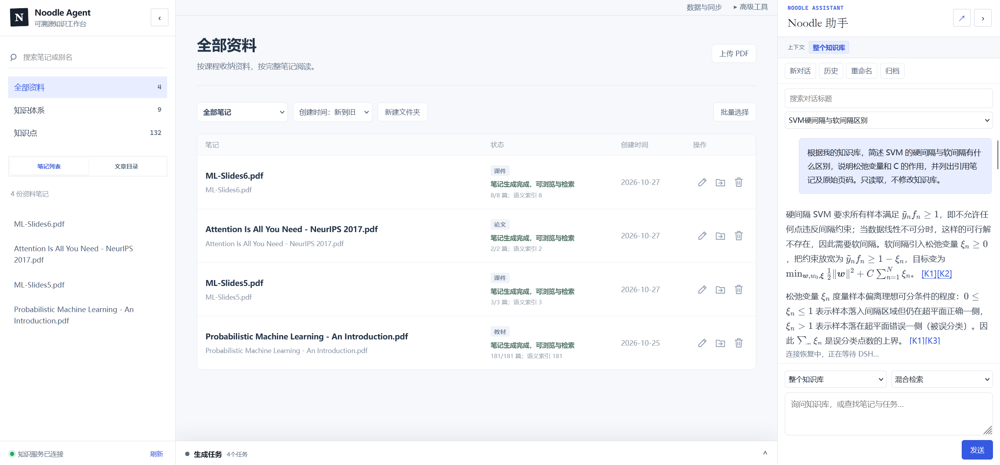

*资料列表展示笔记与索引状态，右侧助手提供会话、问答范围和引用入口。*

工作台中的“笔记已发布”“索引就绪”“知识维护完成”分别对应不同能力。发布意味着可以阅读，索引就绪意味着符合条件的内容可以参与检索，知识维护完成则涉及跨来源归并与组织。前端分别呈现这些状态，方便用户判断当前可以做什么。

### 1.2 我的实现与框架分工

我的主要工作集中在知识业务：资料识别与主题规划、Atomic 生成、Concept 身份和贡献模型、版本证据维护、混合检索、引用定位，以及持久任务与恢复机制。

DeepSeek Harness 提供会话、外层模型与工具交替运行、审批和上下文管理。我通过项目插件注册领域工具，再通过统一 HTTP Provider 接入 Python 服务。知识是否有效、结果能否发布，由领域服务依据持久状态判断。

这里的“本地”指知识、版本、原件、图片和任务状态保存在本地。MinerU、文本模型、视觉模型及 Embedding 使用配置的外部服务。理解部署边界时，需要同时考虑本地存储与外部调用。

## 2. 项目背景：多文档整理需要处理什么

### 2.1 资料增长带来的四个问题

- 文档分散：同一主题位于不同文件，阅读时需要反复切换和定位。
- 内容冗杂：封面、导航、重复背景与实质内容混在一起，直接按页整理的成本较高。
- 浏览困难：原始目录、跨页公式和图表不一定适合复习，需要重新组织成完整主题。
- 知识重复：相同对象有不同表述，需要区分重复支持、真正增量和适用条件的差异。

以 SVM 为例，课件可能分开讲硬间隔、软间隔与核方法，教材提供更完整的定义和推导，另一份资料又补充概率输出或使用限制。把所有内容堆在一起会重复，简单去重则可能丢掉关键条件。

### 2.2 从单次问答延伸到长期维护

如果目标是临时询问一份 PDF，解析、切片和检索可以形成较短的实现路径。Noodle Agent 面向持续积累的资料，因此增加了可读笔记、稳定知识身份和贡献依赖：

1. 新资料到来时，判断哪些内容已经覆盖，哪些需要补充。
2. 原资料修订时，保留稳定身份，记录新的正文版本与证据。
3. 来源被撤回时，重算受影响对象的有效支持。
4. 用户提问时，只使用符合当前范围和有效性条件的内容。

这也带来了额外成本：生成链路更长，需要维护身份、版本、任务和索引的一致性。我接受这部分复杂度，是为了让整理结果可以反复阅读和继续更新。

## 3. 知识演化：PDF → Atomic → Concept

### 3.1 先看完整流程

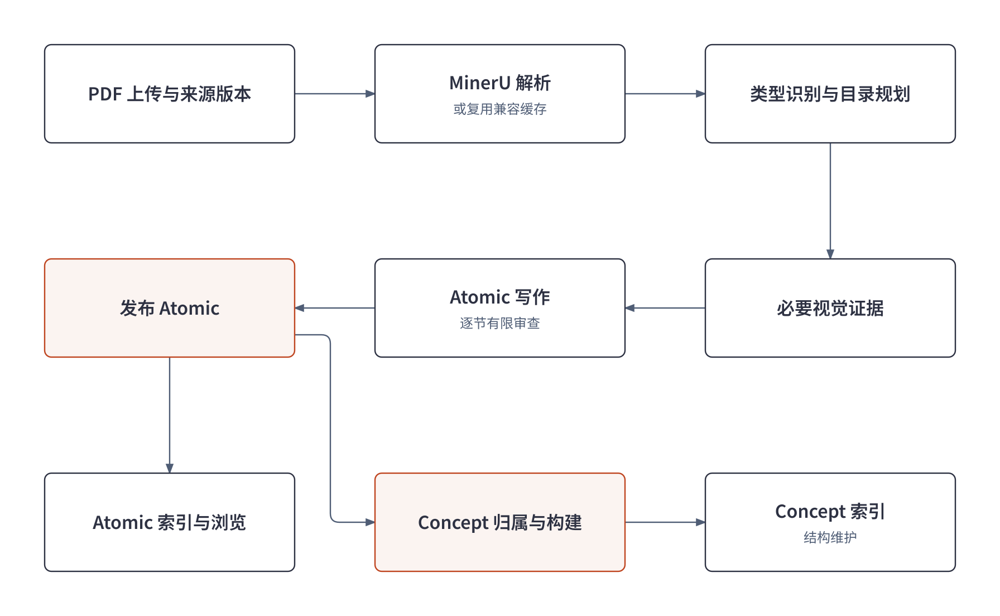

主流程从登记 PDF 来源版本开始，经 MinerU 解析、资料类型识别和主题规划，补充必要视觉证据，再进行 Atomic 写作、有限审查与发布。发布后的 Atomic 一方面进入索引和阅读工作台，另一方面参与 Concept 归属、内容构建与结构维护。

这几个步骤有明确依赖：未发布草稿不能直接成为正式问答语料；资料内目录组织与 Atomic 索引都依赖已发布正文，但目录组织不是向量构建的前置条件。它们可以分别调度，用户无需等全部维护结束才看到第一批笔记。

用 SVM 串起一次导入：课件被解析成带页码的正文和图片；规划得到硬间隔、软间隔、核方法等完整主题；这些主题形成 Atomic；归属阶段判断它们支持“支持向量机”这个 Concept；贡献判断再决定补正文、加支持还是保留差异。最终用户既能按课件阅读，也能进入跨来源的 SVM 知识对象。

代码中，内容生成分为三层规划、两次正文构建：

| 规划层 | 主要产物 | 对后续正文的影响 |
| --- | --- | --- |
| 来源范围规划 | 每篇 Atomic 的主题、来源单元、页码、资产与排除项 | 固定写作范围，控制输入规模和证据归属 |
| 章级命名与候选对象规划 | 中文标题、候选 Concept 键与内部主题 | 协调同章笔记的命名，为后续归属提供参考 |
| 发布后的归属与贡献规划 | 正式 Concept 绑定、小节或片段去向、贡献类型 | 决定复用正文、补充知识、增加支持或保留争议 |

执行顺序是“来源范围与章级提纲 → Atomic 写作、审查、发布 → 正式归属与贡献判断 → Concept 正文维护”。前两层不会提前生成 Concept 正文，正式归属依赖已发布 Atomic 的实际内容。

### 3.2 Atomic、Concept 与 Chunk 的数据边界

| 单元 | 定义与主要内容 | 主要用途 |
| --- | --- | --- |
| Atomic | 一份资料内围绕完整主题组织的笔记，包含摘要、多个 Section、公式图片和来源证据 | 独立阅读、来源内修订、为 Concept 提供输入 |
| Concept | 跨资料维护的稳定知识对象，包含身份、别名、边界、内部主题、贡献与关系 | 同对象归并、增量演化、跨资料浏览 |
| Chunk | 已发布 Atomic 或 Concept 正文中的一个检索范围，包含修订、小节、偏移和 hash | 精确召回、控制上下文、定位引用 |

Atomic 可以跨多页保留完整推导；Concept 可以聚合多份资料，但仍保留各项支持的来源；Chunk 则按检索需要划定范围。同一篇 Atomic 或 Concept 都可以产生多个 Chunk。

身份和正文版本分开保存，避免每次编辑都让引用失去对象：

| 定位信息 | 含义 |
| --- | --- |
| `source_id` / `source_revision_id` | 区分一份资料与它的某次来源版本 |
| `note_id` | 标识同一篇笔记，修订后保持稳定 |
| `revision_id` | 标识一次不可变正文及其证据快照 |
| `section_id` 与正文偏移 | 定位小节和具体正文范围 |
| 来源证据 | 将小节关联到来源版本、PDF 页码和原件 hash |
| 资产引用 | 记录图片路径、来源和校验信息 |

这张表描述逻辑模型，不是完整数据库定义。SQLite 保存身份、状态、版本和关系；本地文件保存正文、原 PDF、图片及阶段产物。文件存在还不足以说明它是当前有效内容，读取与发布仍要核对数据库状态。

### 3.3 PDF 解析、资料识别与主题规划

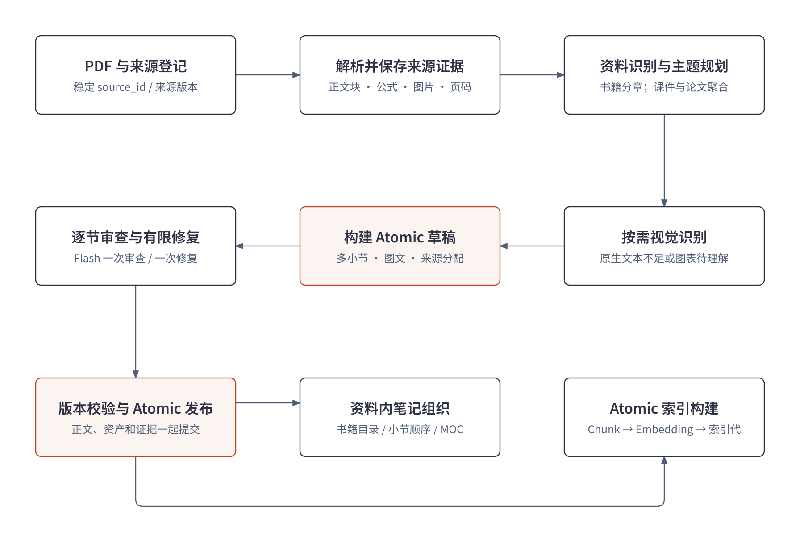

上传时先保存原件和来源版本，再建立持久事件与生成任务。MinerU 输出正文块、标题、公式、图片和页码。解析缓存可以复用，但需要匹配原件和解析配置，不能只按文件名判断。

规划阶段识别书籍、课件、论文或一般文章。识别信号包括页数、横竖版比例、目录锚点、摘要与参考文献等，也支持明确指定类型。类型决定组织视角：

- 书籍沿可信目录分章节批次，章内组织综合主题，控制一次处理范围。
- 课件合并同一知识对象的连续内容，保留推导与例子的连贯性。
- 论文围绕问题、方法、结构、实验和限制组织，避免机械复制每个原文标题。

每个写作单元分配相关来源块、必要页图与相邻上下文，并记录排除项。版权、导航可以排除，实质引言、关键实验和附录则需要按内容判断，不能仅凭所在页的位置丢弃。

范围规划由 `source_sections.py` 编译为可执行计划。可信书籍目录优先按章和来源预算组织；需要模型判断的资料，由 `learning_objects.py` 先提出主题，再做一次语义归并与排除确认。模型给出按原文顺序排列的起点，程序根据相邻起点推导范围，并检查顺序、覆盖和过度碎片化。同一方法的定义、公式、训练和算例应尽量形成完整 Atomic；超过输入预算时再拆分。

计划保存 `key`、`unit_ids`、`pages`、`asset_ids` 和 `input_sha256`。每个来源单元必须恰好归入一篇计划或明确排除；这些字段随后控制写作输入、可用资产和检查点复用。执行批次用于调度，与前端阅读目录分别维护。

随后，`learning_labels.py` 按自然章或整份短资料统一生成中文标题，并保存 `concept_outline`，包含 `concept_key`、`concept_title`、`internal_topic`。例如，硬间隔、软间隔和简短核方法可以共享“支持向量机”候选键，各自保留内部主题。这个键只在当前来源内表达候选身份，不等于全局 Concept ID，也不直接规定 Atomic 的正文小节。

新任务使用冻结的生成 profile，记录采用的策略。恢复历史任务时继续使用原 profile，防止程序配置变化后混用新旧规划、生成或归并方式。

### 3.4 写作、视觉证据与有限审查

写作模型接收主题范围和局部来源，输出标题、摘要、小节正文及来源分配。程序检查输出结构、内容归属和资产引用，再进入审查与发布。

这里有两类控制：主题与标题引导模型组织内容，小节标题和叙述顺序由写作模型生成；来源范围与资产白名单则由程序验收。`section_contracts.py` 将模型返回的来源区间展开为单元 ID，要求端点真实、有序、不越过其他 Atomic 的实质内容、不重叠、不遗漏。每个选中单元都要分配到正文小节，或给出省略原因，每个正文小节也要有来源支持。

来源分配继续决定 Section 审查看到哪些原文、局部修复可以修改哪里，以及发布后的证据链接。覆盖检查只能证明来源已被交代，事实是否正确、条件是否完整仍依赖内容审查；标题措辞也不采用逐字相等的硬校验。

| 操作 | 默认分工 | 原因 |
| --- | --- | --- |
| 主规划、排除项规划审查、标题组织 | Pro | 前期边界错误会放大后续工作量 |
| Atomic 常规写作 | Flash | 主题、来源与输出结构已受到约束 |
| Section 审查与定向修复 | 一次 Flash 审查，有意见再修复一次 | 限制重复生成与误报修复成本 |
| 局部格式恢复 | 最多一次 Pro 恢复 | 在限定范围内处理结构或格式失败 |
| 图表和页图理解 | 配置的视觉模型，按需调用 | 补足解析文本缺失的信息 |
| 向量构建 | 配置的 Embedding 模型 | 生成匹配检索 profile 的向量 |

Pro 和 Flash 是项目路由角色，实际模型以配置和调用回执为准。Python 工作流模型与 DSH 外层对话模型分别配置。

Section 审查只检查当前小节与实际来源。相邻段落和其他小节标题提供理解背景，不应被误判成当前小节遗漏的正文。有意见时定向修复一次，之后完成结构、引用和资产检查，不继续循环语义复审。局部格式问题可以进入有界 Pro 恢复；审查服务异常则保留不可用记录与警告。

这是质量、成本和可用性的取舍。有限审查减少了反复修改，但可能留下事实错误，因此后续仍需要抽查和独立评测。空白正文、损坏结构或无效资源引用应作为实际问题处理。

视觉证据也有两个层次：整页截图用于理解页面，正文配图则需要单独落实资产和引用。文本证据充分、没有缺失图像信息时，可以跳过重复视觉识别；复用视觉缓存时还要匹配页图 hash、模型和提示策略。

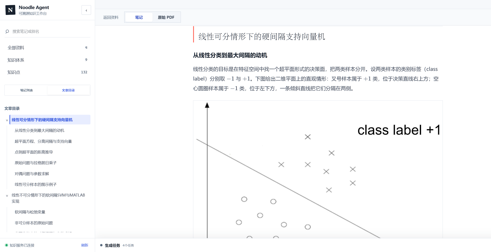

*SVM 来源内笔记：目录组织主题，正文保留相关解释与配图。目录服务阅读导航，与 Atomic 不要求一一对应。*

### 3.5 Concept 归并：先判断身份，再判断贡献

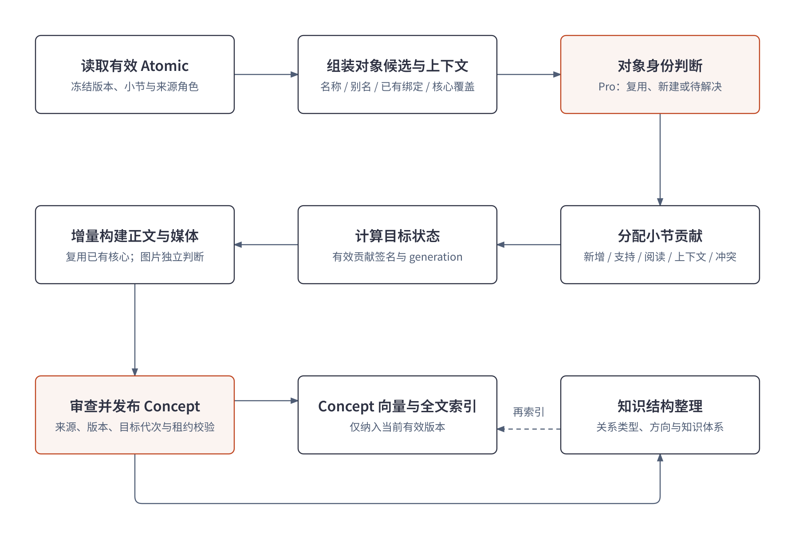

Concept 构建把四件事分开：对象身份回答“这是谁”，内部主题回答“它包含什么”，内容贡献回答“新资料改变什么”，证据回答“判断依据在哪里”。

归属时先固定当前有效 Atomic 的版本，带入来源角色、同章主题和已有绑定，再从 Concept 目录构造有界候选。候选包含名称、别名、身份边界、内部主题和核心覆盖，目录较大时按绑定、名称和词项相关性压缩，随后由模型判断复用、新建或待解决，并分配小节与片段。

当前主批量归属使用目录候选与模型判断。即使代码中存在身份向量检索，也不能据此认为每次归并都复用问答的向量召回。

正式归属由 `concepts/entity_routing.py` 执行。它读取已发布 Atomic 的摘要、小节、片段和图片，并结合前期 `concept_outline` 与同来源已确认绑定。候选提纲可以保留，也可以说明理由后修订；实际绑定另行保存。归属支持复用、新建、分配到多个对象、仅保留来源笔记或待审查。一个 Atomic 可以按小节或片段支持多个 Concept，因此不会机械地“一篇 Atomic 新建一个 Concept”。

判断对象时要保留边界：SVM 的软硬间隔通常可以组织为内部主题；逻辑回归使用伯努利分布，则属于方法使用关系。名称相似不足以证明同一对象，出现同一个术语也不足以建立父子归属。存在疑义时，需要保留待解决状态。

对象确定以后，再判断新来源的贡献：

| 类型 | 对正文和来源的影响 | 示例 |
| --- | --- | --- |
| `CORE_DELTA` | 更新受影响的核心主题 | 补上原来缺失的推导或适用条件 |
| `SUPPORT_ONLY` | 记为 `ADD_EVIDENCE`，满足复用条件时不调用正文模型 | 另一份课件解释相同定义 |
| `FURTHER_READING` | 增加深入阅读关联 | 保留更详细的方法说明 |
| `CONTEXT_ONLY` | 记为 `NO_CHANGE`，不作为核心构建输入 | 相邻背景或辅助术语解释 |
| `CONFLICT` | 进入待审查状态，暂不作为已接受的核心输入 | 不同前提下出现不同结论 |

例如，教材已经充分解释 SVM 的基本定义，新课件再次说明定义时可以增加支持；若它补充了原来缺失的软间隔推导，就更新相应主题。基础来源与补充来源是一种组织策略，科学结论仍要结合条件与证据判断。

### 3.6 内容更新、来源撤回与图片贡献

系统根据有效贡献计算输入签名，并维护目标 generation。输入签名反映构建所依赖的实际支持，目标代次标识当前期望完成的维护。签名不变时避免重复调度；需要构建时，`concepts/builder.py` 再判断正文能否复用。

当前默认的 `concise-foundation-v1` 策略将 Concept 正文集中在一个 `concept_core` 小节，显示为“知识框架”。内部主题通常成为其中的 Markdown 小标题，不会自动各建一个数据库 Section。正文凝练定义、要素关系、核心公式与条件、变体及适用边界；提示通常控制在约 600 至 1500 中文字，复杂对象允许更长，这属于写作目标。完整推导、长算例和代码保留在 Atomic，读者可以沿来源深入阅读。

| 输入变化 | 正文处理方式 |
| --- | --- |
| 贡献未变，或仅增加证据且旧支持仍有效 | 复用已有 Markdown，记录 `writer_called=False`，更新支持信息 |
| 出现核心增量，且旧支持仍有效 | 将已检查的旧核心作为 `accepted_core`，结合新增片段更新正文 |
| 支持撤回且无法安全复用 | 不将失去支持的旧正文交给模型，仅据剩余有效证据重建 |
| 新基础来源触发 `foundation_rebase` | 按当前基础证据重建框架，保留仍有支持的补充增量 |

这套策略控制是否调用模型、保留哪些旧知识以及输入哪些新证据。默认维护单位仍是整份核心正文，不能据此承诺只修改某个段落；作者保护的小节也不能自动覆盖。

文字与图片分别判断贡献。新资料可能没有文字增量，却提供了更清晰的架构图，因此选图不能完全依附于文字是否重写。

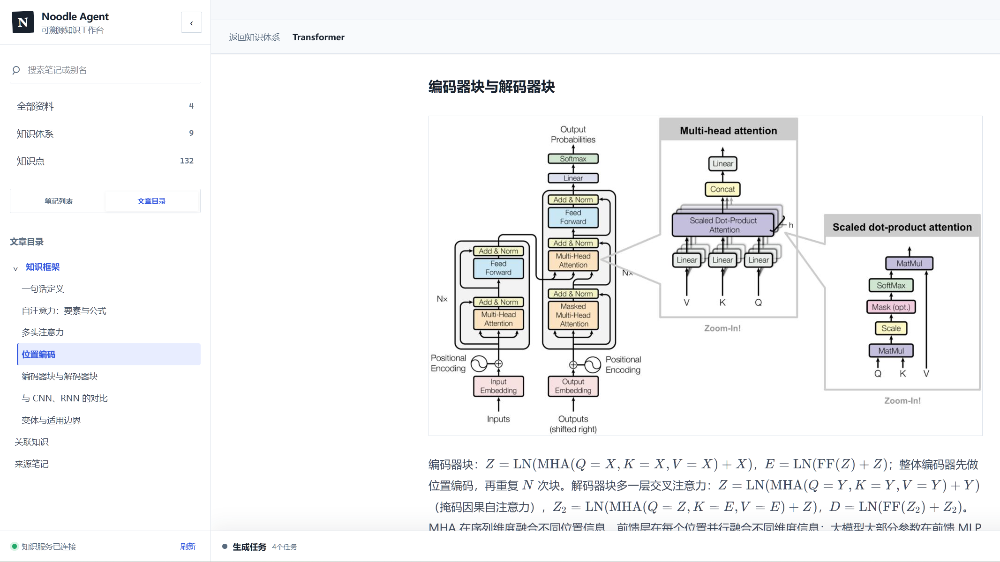

*Transformer Concept 中的资料配图与公式，与小节正文一起呈现。*

每项贡献保留具体 Atomic 输入及来源版本，用户可以继续找到支撑笔记。来源修订、撤回或删除后，系统沿依赖重算有效支持：撤回一份课件时，仍有教材支持的 SVM 内容可以保留；只有失去支持或受输入变化影响的部分需要重新维护。

构建期间也可能发生来源变化，所以发布前再次检查输入版本、签名、目标代次与租约。旧任务即使成功生成正文，也不能覆盖更新之后的状态。来源冲突与作者修订还需要保留相应属性和保护规则。

### 3.7 知识组织：一份正文，多个阅读入口

对象身份、阅读目录和语义关系分别维护。同一个 Concept 可以出现在多个知识体系中，共用一份正文；体系和目录负责组织阅读。

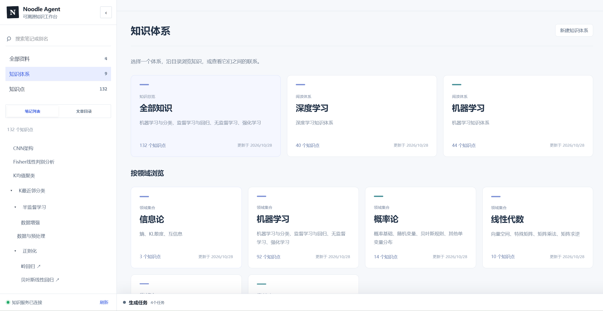

*工作台按阅读体系和领域提供入口，用户可以从深度学习、机器学习等体系进入知识内容。*

结构维护读取当前对象、已有关系和 Atomic 支持，提出有界组织建议。已有边可以保留、移除或替换，提交时检查端点、方向、证据归属与覆盖。它负责维护关系，不借此凭空创建知识或重写正文，也需要区分系统建议与用户维护的结构。

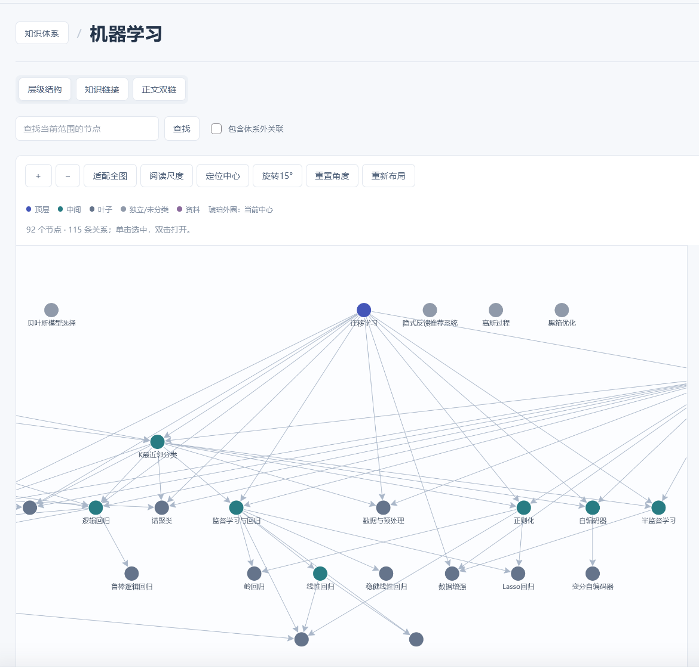

*机器学习体系的层级视图，同时提供知识链接与正文双链等浏览入口。*

当前关系层主要服务浏览和维护，问答使用后文的混合检索链路。阅读地图可以帮助找到知识，但它本身不直接作为这条问答链路的事实语料。

## 4. Agent 框架：Harness 管理会话，领域服务维护事实

### 4.1 完整架构与两类请求

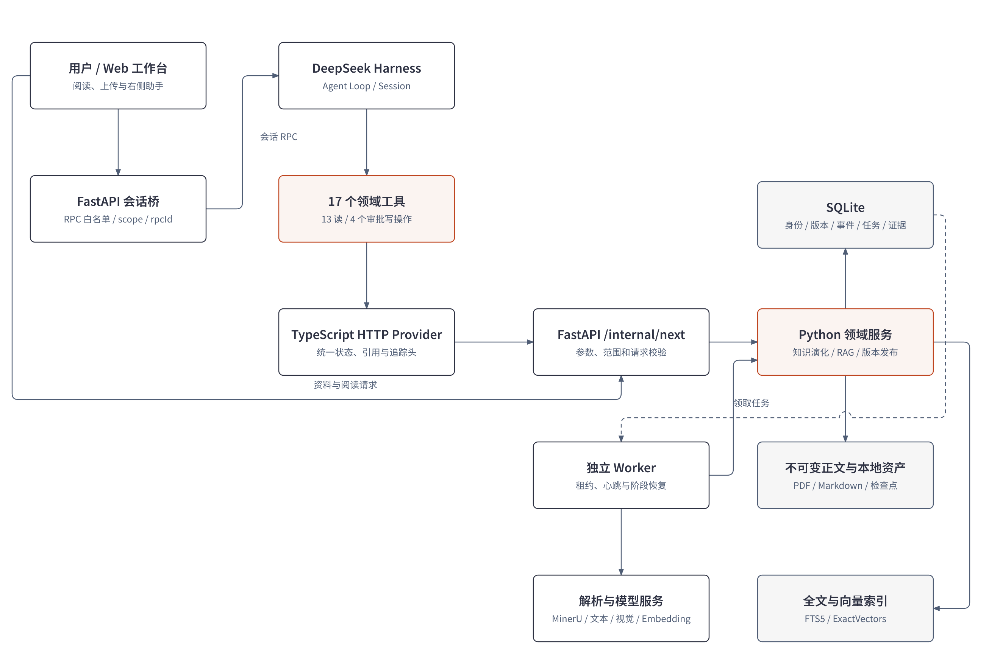

系统中有两类主要请求。资料管理与阅读直接访问知识 API；右侧助手的对话通过 FastAPI 会话桥进入 DSH 原生 Agent Loop，再由领域工具调用知识服务。独立 DSH 工作台使用相同的领域工具。

| 层 | 主要职责 |
| --- | --- |
| Web 工作台 | 资料管理、阅读、范围选择、会话、审批与引用展示 |
| FastAPI 会话桥 | 适配 DSH 会话协议，检查 RPC 白名单、范围与请求身份 |
| DeepSeek Harness | 组装上下文，调用外层模型，运行工具，管理会话、审批与压缩 |
| 领域工具与 HTTP Provider | 参数契约、统一请求、超时、取消、状态与追踪信息 |
| FastAPI 领域服务 | 知识读写、版本检查、RAG、任务接口与发布规则 |
| 独立 Worker | 领取持久任务，执行生成、归并、索引与阶段恢复 |
| SQLite 与本地文件 | 身份、版本、证据、事件、任务，以及正文、原件与资产 |
| 全文与向量索引 | 从正式正文重建的检索投影 |

会话桥负责适配和约束，对话循环由 Harness 运行。Python 服务和 Worker 执行知识业务。这样，来源和发布规则集中在领域层，工作台与对话工具可以复用同一套能力。

### 4.2 为什么选 Harness，以及怎样接入

我需要会话历史、模型与工具交替执行、写操作审批、取消和上下文压缩。Harness 提供这些运行时能力，可以减少通用会话基础设施的重复实现，将主要精力放在知识 Workflow 上。

项目通过 `@noodle/agent` 插件接入，使用 Cordis 装配 HTTP Provider、只读工具、状态与写工具、领域提示和工作区。工具依赖 `ctx.tools` 与 `ctx.noodle`，通过注入的领域接口访问 Python 服务，避免各工具分别创建业务客户端或直接读数据库。

在一个回合里，DSH 加入领域策略、当前范围和工具 Schema，调用外层模型；模型选择工具后，运行时处理参数与审批，执行工具并记录结果，再继续或结束回合。底层通用 Agent Loop 由框架实现。

这项选型的依据是复用能力和清晰分工。项目没有对所有 Agent 框架进行性能基准比较，因此也不以框架选型推导性能优势。

### 4.3 当前工具清单与粒度设计

当前注册 17 个业务工具：13 个读取类工具和 4 个需要审批的状态修改工具。读取类是业务分类，其中 `answer` 仍会调用模型并保存回答与调用记录。

下表省略统一的 `noodle_` 前缀：

| 工具 | 用途与关键约束 |
| --- | --- |
| `answer_knowledge` | 完整 RAG 问答，输入问题、范围和检索模式，返回领域答案与引用 |
| `search_knowledge` | 定位相关当前笔记，适合查找和检查材料 |
| `get_atomic_note` | 按笔记 ID 读目录，或按小节 ID 读指定正文 |
| `list_concepts` | 按名称或别名发现 Concept 身份和摘要 |
| `get_concept` | 读取 Concept 目录、小节和支持笔记 |
| `get_readiness` | 检查检索配置、模式与索引就绪状态 |
| `list_knowledge` | 分页发现笔记与导航对象 |
| `list_sources` | 发现资料 ID、名称与当前来源版本 |
| `list_tasks` | 按来源或状态查找已有任务 |
| `get_source_status` | 分别查看笔记、索引与知识维护状态 |
| `get_task` | 查看任务时间线、用量与暂停状态 |
| `get_relations` | 有界读取笔记周围关系 |
| `list_knowledge_roots` | 发现知识体系入口 |
| `edit_section` | 审批后按基准版本修订明确小节 |
| `refresh_knowledge_map` | 审批后刷新派生导航地图 |
| `pause_task` | 审批后暂停明确选择的已有任务 |
| `resume_task` | 审批后从已有任务检查点恢复 |

参数由 Schema 约束，结果保留业务 JSON 中的关键状态、正文与引用字段。工具设计还要处理身份发现：来源 ID、来源版本 ID、笔记 ID 和任务 ID 分别使用，模型需要先发现目标，再把真实返回值传给下一步。

例如，“暂停这份课件的任务”可以形成：

```text
发现来源 → 查找任务 → 读取任务状态 → 请求暂停 → 用户审批 → 报告实际状态
```

这些步骤由 Agent 根据工具描述和返回结果选择。当前对话工具开放的是已有知识与任务的受限操作，任意文件、SQL、全库重建等能力没有通过这组工具开放。

### 4.4 写操作审批与版本冲突

编辑小节是一条典型受控写路径：

```text
发现笔记 → 读取目录 → 读取目标小节及当前修订
    → 形成修改内容与 expected_revision
    → 用户审批
    → 服务端检查版本和状态
    → 发布新修订，或返回冲突
```

审批确认用户意图，版本检查保护并发更新。假设 Agent 读取了修订 A，用户审批期间另一个任务已发布 B，基于 A 的修改就不能直接覆盖 B。工具需要重新读取，再根据新正文决定下一步。

发布后的索引和依赖维护继续走领域流程。刷新地图同样是请求派生导航维护；请求已受理与后台维护完成应分别报告。

### 4.5 会话记忆与长期知识怎样分开

| 状态 | 保存位置与使用方式 |
| --- | --- |
| 对话历史 | DSH 持久 Session 事件，支持恢复会话和查看工具轨迹 |
| 当前模型上下文 | 近期消息、摘要、领域策略与工具定义，受上下文预算约束 |
| 范围和实体提示 | 当前 scope 与稳定身份，帮助解释“它”等指代 |
| 长期知识 | Atomic、Concept、版本、贡献和证据，通过工具读取当前有效内容 |
| 工作流状态 | 事件、Job、租约、检查点和回执，用于任务推进与恢复 |

旧答案可以帮助理解对话，但新问题仍需要读取当前知识。会话压缩不会删除知识，工具结果被裁剪也不会改变领域存储中的原始正文。

Preset 的工具结果剪枝阈值为 8192 字符，保留头部 4096、尾部 1024。这是上下文压力处理配置，既不是 Token 上限，也不是每次输出后立即截断。读取工具先给目录、再按小节取正文，可以从调用方式上减少重复上下文。

HTTP Provider 还传递会话、工具调用与用户 RPC 的关联信息，统一处理超时和取消。这样排查一次回答时，可以沿调用身份回到对应请求和领域结果。

## 5. 检索与溯源：从当前修订召回，沿证据返回原文

### 5.1 先确定哪些内容有检索资格

检索从有效发布的 Atomic 和 Concept 出发。系统检查笔记当前版本、来源状态与贡献支持，再生成候选范围。未发布草稿、失效来源及不符合范围条件的内容不能直接成为当前答案的证据。

问答范围分三种：

| 范围 | 使用的内容 | 目的 |
| --- | --- | --- |
| `GLOBAL` | 当前有效 Atomic 与 Concept | 跨资料查找和综合 |
| `SOURCE` | 指定来源下的 Atomic | 严格限制某份资料，避免跨来源 Concept 带入其他内容 |
| `NOTES` | 指定笔记集合中的有效内容 | 限定若干已知笔记 |

范围由服务端再次约束。用于指代消解的 `entity_note_ids` 可以说明“它”指向哪个对象，但不能扩大 SOURCE 或 NOTES 的证据范围。

### 5.2 Chunk 与向量怎样构建

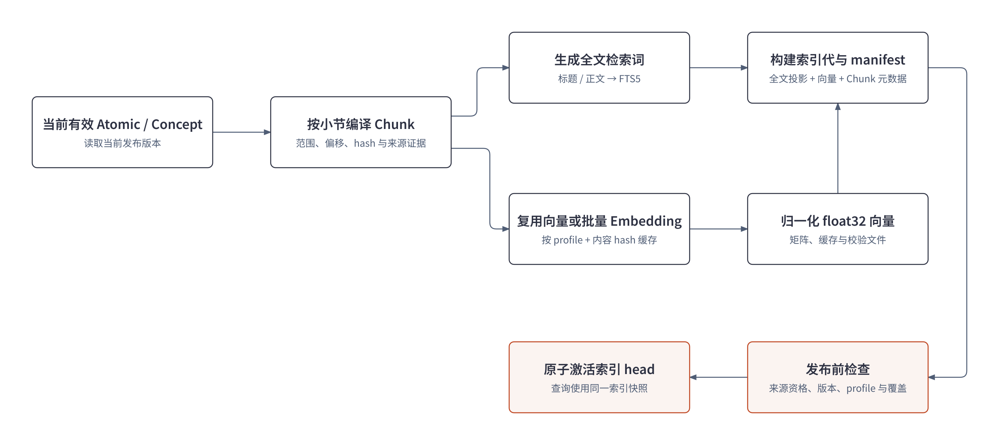

Chunk 是不可变正文中的范围，保存 `note_id`、`revision_id`、`section_id`、起止偏移、文本 hash 和证据定位。它保留回到正文的路径，也允许同一份正文同时建立全文与向量投影。

当前切分以约 400 Token 为目标，短小节在约 600 Token 内可整体保留，过短尾块在条件允许时合并。策略中的尾块阈值不等于固定重复 100 Token 的 overlap。

向量构建分为以下步骤：

1. 读取当前有效笔记与修订，编译小节内的 Chunk。
2. 用笔记标题、小节标题和正文组成 Embedding 输入。
3. 按内容 hash 与 Embedding profile 查兼容缓存，仅请求缺失向量，当前实现每批最多处理 20 条缺失输入。
4. 校验返回数量与维度，归一化向量，保存 float32 矩阵、内容缓存、manifest 与校验信息。
5. 提交时核对输入、索引头和租约，激活新的索引代。

Embedding profile 确定向量空间，模型或维度不同的向量不能混用。最近部署记录使用 `text-embedding-v4`、1024 维和本地 `ExactVectors`，归一化后以 NumPy 点积排序。代码中的其他适配不等于正式部署已经切换到独立向量数据库。

当前精确检索路径便于在本地管理索引文件和版本。资料规模扩大后，可以评估近似检索与独立向量服务，但仍要保留范围过滤、版本资格和索引激活规则。

### 5.3 混合召回、RRF 与重排

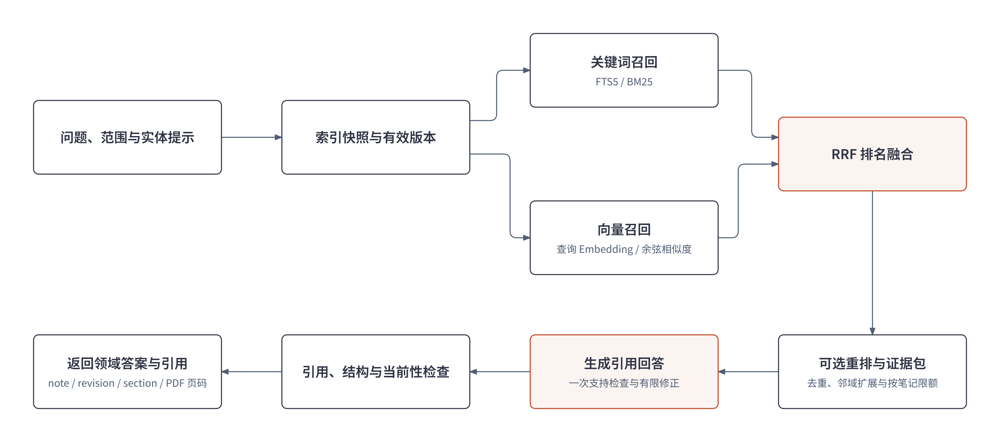

以“对比 SVM 的硬间隔与软间隔，解释松弛变量和 C，并给出来源”为例，系统先确定范围，读取匹配配置的索引快照，过滤无效内容，然后同时执行两条召回路线。

关键词路线通过 FTS5/BM25 匹配标题和正文，适合明确术语、名称和符号；文本处理包含中文双字词组、英文、数字与部分公式符号。向量路线计算问题向量，在相同范围的候选白名单中检索语义相关内容。

两条路线的原始分数尺度不同，因此采用 RRF 融合排名：

```text
score(chunk) = Σ 1 / (60 + rank_in_lane)
```

每条路线都按名次贡献分数，同时在两路靠前的片段会得到共同支持。融合后的候选再按配置重排，之后进行相邻范围扩展、重叠合并和单笔记片段限额，形成回答证据包。

这些限制各自解决不同问题：邻域扩展补齐必要上下文，重叠合并减少重复文本，单笔记限额防止一篇长笔记占满证据包，整体预算控制发送给回答模型的长度。默认代码每路召回上限为 50，重排候选为 10，回答正文上下文约 4000 Token，实际使用以配置为准。

重排支持 OFF、AUTO 和 REQUIRED。AUTO 故障时可以保留原来那批 RRF 候选并记录降级；REQUIRED 故障则返回失败。配置不可用与没有相关知识是不同问题，需要给 Agent 不同反馈。

### 5.4 回答检查与引用定位

回答模型基于证据包生成带 `citation_ids` 的结构化陈述，执行一次支持检查；存在可修复问题时定向修正，再核对引用身份、结构与内容当前性。覆盖不足可以返回 `COVERAGE_GAP`，查询期间内容变化则返回 `CONTENT_CHANGED`。

引用保存一条可追踪的链：

```text
request_id / citation_id
    → note_id / revision_id / section_id
    → start_offset / end_offset / 文本 hash
    → evidence_ids
    → source_revision_id / 原文件 hash / PDF 页码
```

用户先打开笔记对应位置，再沿来源证据找到原 PDF。页码来自保存的证据记录，原件 hash 区分同一资料的不同版本；Concept 的支持还可能关联多个来源。

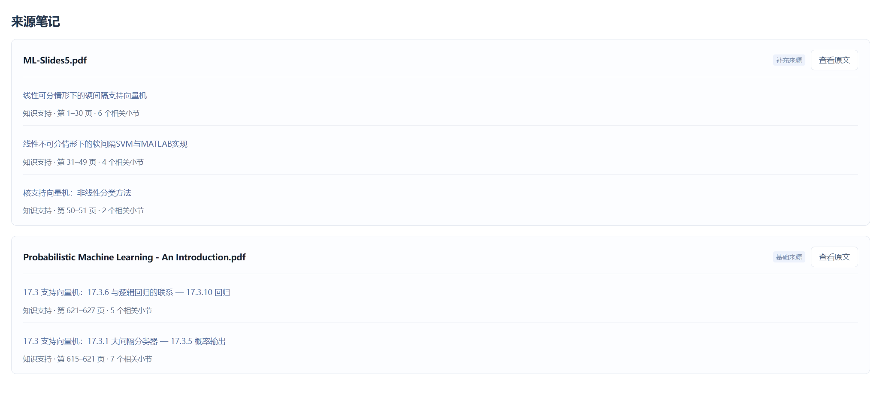

*来源卡片汇集教材与课件中的支持笔记，列出相关小节、PDF 页码，并提供“查看原文”入口。*

当前不少证据仍绑定在小节级，因此定位能力与逐句事实支持需要分别评估。返回前还要检查内容是否仍有效，避免一次检索期间发生更新后继续输出过期引用。

### 5.5 DSH 怎样完成一次普通问答

```text
用户问题与范围
    → 会话桥校验并进入 DSH
    → Agent 选择 noodle_answer_knowledge
    → 统一 HTTP Provider 调用领域 RAG
    → 召回、融合、重排、回答、支持与当前性检查
    → 返回 status、request_id、答案正文与引用
    → 展示领域结果，结束普通回合
```

`answer` 内部已包含检索，普通问答不要求先 search 再逐篇 get。工具默认调用 `exec.concludeTurn()`，减少外层模型重复检索和二次改写事实。一次工具调用内部仍可能包含查询 Embedding、重排、回答和支持检查等多个请求。

只有用户明确要求回答后继续执行其他动作时，才允许在 READY 后继续；非 READY 仍应结束本轮问答。遇到配置或供应商故障，工具保留实际状态，并限制继续枚举笔记作为无约束回退。

已有记录覆盖 HYBRID READY、SVM 问答与追问、来源限定和无证据拒答。READY 说明这次链路可以返回结果，准确性、引用支持和完整 UI 交互仍需要独立评测。

## 6. 任务可靠：失效约束、租约与阶段恢复

### 6.1 删除内容怎样影响索引与 Concept

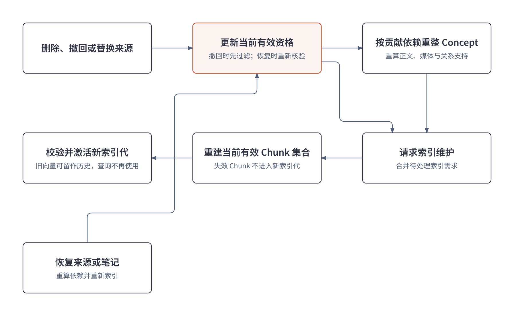

假设用户撤回一份课件，系统首先改变该来源及相关笔记的有效资格。即使旧向量文件仍存在，候选过滤和返回前检查也不能允许失效 Chunk 继续作为当前证据。

后续沿贡献依赖重算 Concept：仍有教材支持的内容可以保留，失去支持或输入变化的部分进入维护。索引任务合并需求，构建并激活不含失效片段的新索引代。

这里分别处理三件事：当前资格决定是否可查询，索引维护决定当前集合包含什么，物理清理决定历史文件保留多久。正文、旧索引和向量缓存可以按策略保留，支持审计与恢复。恢复来源时重新检查支持和索引，兼容缓存可以复用，过期关系则需要重算。

### 6.2 为什么使用独立 Worker

PDF 解析、模型生成、跨资料归并和索引构建都可能耗时较长。业务行为写入事件，再按类型派发为持久 Job：生成 Worker 处理 PDF 到 Atomic，维护 Worker 处理归属、Concept、索引和结构。

任务不依赖浏览器连接或某一轮聊天持续存活。HTTP 请求可以先返回任务身份，用户通过状态接口观察进度。Atomic 发布、来源变化等事件又会触发相应维护，避免把所有步骤塞进一次请求。

同一事件与任务种类控制重复派发；索引维护还会合并待处理需求。暂停与恢复针对已有任务执行，保留它的检查点和执行记录。

### 6.3 租约、幂等与过期结果

Worker 领取带 token 的限时租约，通过心跳续租。租约过期后可以由新 Worker 接手，旧 Worker 迟到返回时，发布阶段仍检查租约和当前状态。

可以把不同发布路径的关键约束概括为：

```text
可以发布 = 当前租约有效
        ∧ 对应的基准版本与输入仍匹配
        ∧ 输入签名未变化
        ∧ 目标代次仍有效
```

租约保护执行所有权；版本检查保护正文并发修改；签名判断输入支持是否变化；目标代次防止旧一轮构建覆盖新的维护需求。不同对象的提交条件由各领域服务落实。

幂等也分层处理：任务层避免重复创建同类 Job，执行层复用相同输入下的有效阶段产物，发布层拒绝过期结果。这样可以控制重复事件和重试带来的业务副作用。

远端请求已完成、回执却未落盘时，重试仍可能重复调用与计费。这里能够保证的是受约束的恢复和合法发布；远端调用次数还需要依靠有限重试、缓存和可追踪回执控制。

### 6.4 从可信检查点继续

检查点记录阶段产物，并与输入、策略和 hash 绑定。恢复时先确认来源、冻结 profile 与产物兼容性，已经可信完成的阶段可以复用，再继续缺失步骤。

```text
Worker A：领取租约 → 解析检查点 → 草稿检查点 → 进程崩溃
Worker B：取得新租约 → 校验输入与产物 → 继续缺失阶段 → 检查当前状态 → 发布
Worker A：迟到提交 → 旧租约被拒绝
```

如果恢复期间发现原 PDF 或策略不兼容，就不能只因检查点文件存在而继续使用。冻结 profile 还可以避免程序升级后，旧任务前半段采用旧规则、后半段采用新规则。

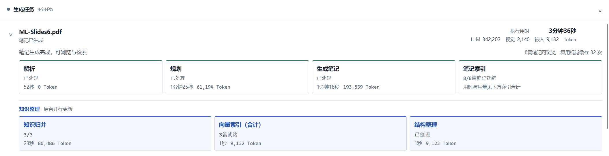

*任务面板按阶段展示状态、耗时与调用用量，笔记索引和后台知识维护分别报告。*

暂停在安全边界生效，在途远端请求可能继续。取消聊天只影响当前对话执行，也不等于暂停后台生成。前端因此分别展示聊天、生成、索引和知识维护状态。

## 7. 成本优化：减少重复工作，约束模型调用

### 7.1 分别观察等待、Token、费用与质量

并行通常减少等待时间，但并发的各个调用仍然消耗 Token。模型切换会改变单价和输出行为，缓存命中会减少真实请求，重试又可能增加费用。因此我把端到端延迟、文本调用、视觉与 Embedding 用量，以及内容质量分别观察。

任务面板中的阶段耗时也不能直接相加当作总耗时，因为有些阶段存在并行与后台维护。DSH 外层模型的用量同样只覆盖对话部分，Python 生成和 RAG 内部请求还需要单独统计。

### 7.2 有界并发与模型分工

独立任务、小节级审查以及检索双路召回采用有界并发。Atomic 发布后的索引准备和后台 Concept 维护可以独立推进，但共享索引、同对象发布和供应商限额仍然约束调度。

模型能力按错误的影响范围分配。规划和对象身份错误会影响较多后续步骤，因此优先保留 Pro；常规写作、审查和修复在明确来源与结构下主要使用 Flash，格式失败局部恢复。视觉与 Embedding 使用专门服务，按需调用。

实际路由由统一 cost policy 和回执决定。某个函数传入了 Pro 意图，还要结合当前策略核对实际调用，不能只读一个局部开关就估算成本。

### 7.3 从输入、输出和维护范围减少重复

| 优化动作 | 具体减少什么 | 需要观察的代价 |
| --- | --- | --- |
| 综合主题规划 | 过度拆分导致的重复背景、上下文和审查 | 主题是否过大、覆盖是否遗漏 |
| 局部证据包 | 每次重复发送整份 PDF 或整章 | 是否保留了必要条件和相邻解释 |
| 有界候选与批量归属 | 反复读取全库候选 | 名称差异较大时是否漏候选 |
| 区分支持与正文增量 | 内容已覆盖时仍重写 Concept | 是否遗漏真实新增知识 |
| 兼容缓存与检查点 | 重复解析、视觉、向量与从头重跑 | 输入和策略是否仍兼容 |
| 合并维护需求 | 同一对象或索引频繁重复构建 | 合并后是否覆盖最新目标代次 |
| 结构化输出与有限修复 | 冗长审查解释和无边界模型循环 | 有限审查保留了多少事实错误 |
| 按节读取、answer 后结束普通回合 | 正文反复入上下文与外层重复生成 | 工具结果是否足以完成用户任务 |

这些措施改变的是实际重复工作量。优化时仍要保留必要来源和失败信息，避免仅凭输出更短就判断效果更好。

### 7.4 已有成本结果及其统计口径

历史固定四份 PDF 的文本调用对照如下：

| 指标 | 对照记录 | 优化后 | 降幅 |
| --- | ---: | ---: | ---: |
| 文本 LLM 调用 | 185 | 125 | 32.4% |
| 文本 Token | 996,515 | 592,536 | 40.5% |

这组结果说明相应流程减少了重复文本模型工作。它覆盖特定历史样本，尚未完成独立盲式质量 A/B，缓存、重试和等待条件也没有完全控制，所以不能直接推导任意资料的收益或全链路费用降幅。

下一轮比较需要固定资料、模型、缓存和并发条件，同时记录质量、Token、延迟、失败及恢复结果。成本下降是否值得，需要结合内容覆盖与正确性判断。

## 8. 问题与扩展：先验证质量，再接入更多模态

### 8.1 知识质量需要单独评测

结构合法、审查通过、引用存在和回答 READY 分别说明不同环节满足条件。近期样例仍有适用条件遗漏、过度归纳、公式表述和图文覆盖需要核查，小节级证据也不一定足以支持每个生成句子。

后续我计划建立覆盖教材、课件和论文的独立标注集，分别测量：

- 主题、公式和关键图片是否被保留，重要条件是否遗漏。
- 回答中的陈述是否得到引用支持，证据不足时是否拒答。
- SOURCE 与 NOTES 是否泄漏范围，来源撤回后旧内容是否退出回答。
- 关键词、向量、RRF 与重排分别带来了哪些召回和排序变化。

这类内容评测与程序回归测试各有作用。接口和状态测试能够验证执行规则，回答准确率需要标注问题、参考证据和独立审阅。

### 8.2 合并规则仍有优化空间

当前已经区分身份、内部主题和贡献，仍可能出现同一对象重复创建、不同方法错误合并、净新增遗漏，以及使用关系误判成父子关系。候选筛选依赖名称与词项时，也可能漏掉名称差异较大的同一对象。

我准备整理“同对象、不同对象、使用关系、内部变体”的标注案例，分别观察重复率、错合并率与新增覆盖；再加入来源冲突和导入顺序变化，检查结果是否稳定。必要时引入身份向量召回，并通过对照验证它实际补回了哪些候选。

减少 Concept 数量只能说明归并更积极，不能单独证明合并更正确。最终仍要检查对象边界、证据和内容是否完整。

### 8.3 音视频输入怎样复用现有流程

音视频笔记识别属于后续方向，目前尚未接入。扩展时，入口处理与证据定位需要变化，后续主题笔记和知识维护可以继续复用。

音频侧需要语音识别、分段、时间戳和专业术语核查，必要时区分说话人。视频侧还需要将音轨、字幕、关键帧和画面文字对齐，让讲解能够对应到实际图表或幻灯片。

来源证据可以从 PDF 页码扩展为时间区间与关键帧，Atomic 保留完整主题，Concept 继续判断跨来源贡献。原视频替换或片段撤回时，仍沿来源版本与贡献依赖维护正文和索引。

我会先用小样本检查识别质量、定位准确性、成本和长任务恢复，再扩大输入范围。现有内容质量与合并规则也会继续优化。
